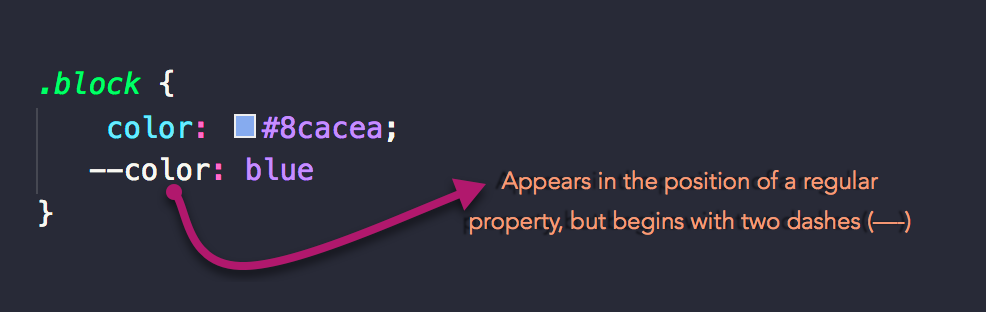
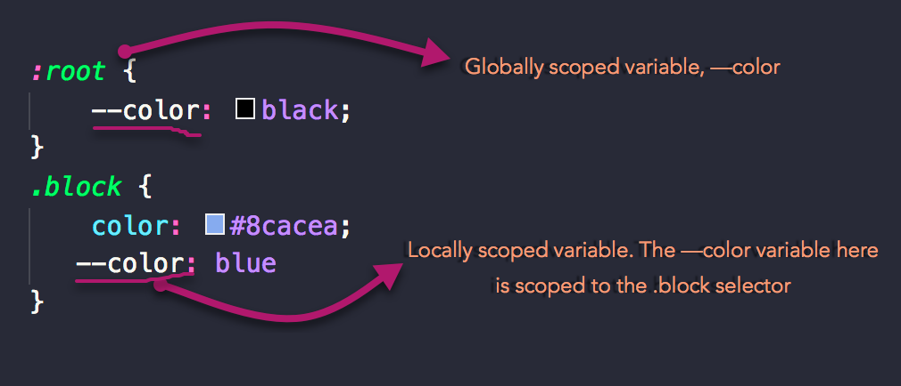
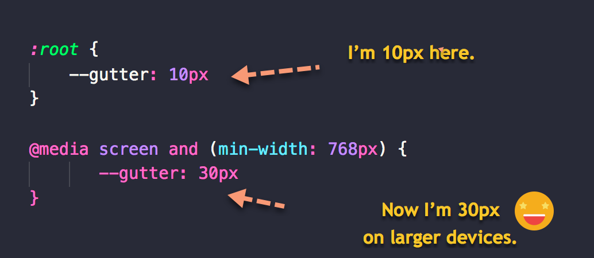

# CSS Variables

 **Mar 25, 2017** 微软发布 《[CSS Custom Properties are coming to Microsoft Edge in the Windows 10 Creators Update](https://www.neowin.net/news/css-custom-properties-are-coming-to-microsoft-edge-in-the-windows-10-creators-update/)》，即：在windows 10中微软的Edge浏览器支持 CSS自定义属性（也叫CSS变量）。


## Defining CSS variables

In CSS, a CSS variable is any “property” whose name begins with **two dashes（--）**.




## Scoping CSS Variables

In CSS, variables either have a `global` or `local` scope.




### :root

The `:root` selector allows you to target the highest-level element in the DOM, or document tree.

```css
:root {
  --main-color: red
}
```


## Using CSS Variables

With native CSS variables, you reference a variable by using the `var()` function.

-function.png)


## @media

As with other properties, you can change the value of a CSS variable within a `@media` block or other conditional rules.




## change css variable with js

* HTML

  ```html
  <p style="--color:red; color: var(--color)"></p>
  ```

* JS

  ```js
  // Get our <p> element
  const element = document.querySelector('p');
  
  // On click, change text from "red" to "blue"
  element.addEventListener('click', function() {
    element.style.setProperty('--color', 'blue');
  });
  ```

  


## hsla

```css
div {
  width: 100px;
  height: 100px;
  background: conic-gradient(
    hsl(360 100% 50%),
    hsl(315 100% 50%),
    hsl(270 100% 50%),
    hsl(225 100% 50%),
    hsl(180 100% 50%),
    hsl(135 100% 50%),
    hsl(90 100% 50%),
    hsl(45 100% 50%),
    hsl(0 100% 50%)
  );
  clip-path: circle(closest-side);
}
```


* [Everything you need to know about CSS Variables](https://medium.com/free-code-camp/everything-you-need-to-know-about-css-variables-c74d922ea855)