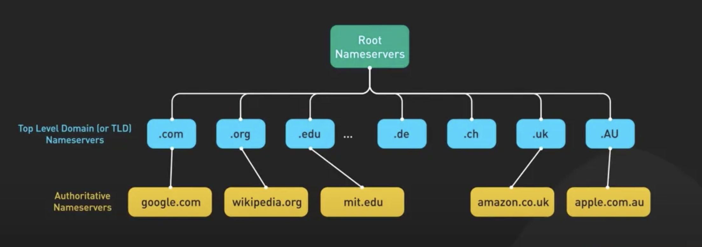
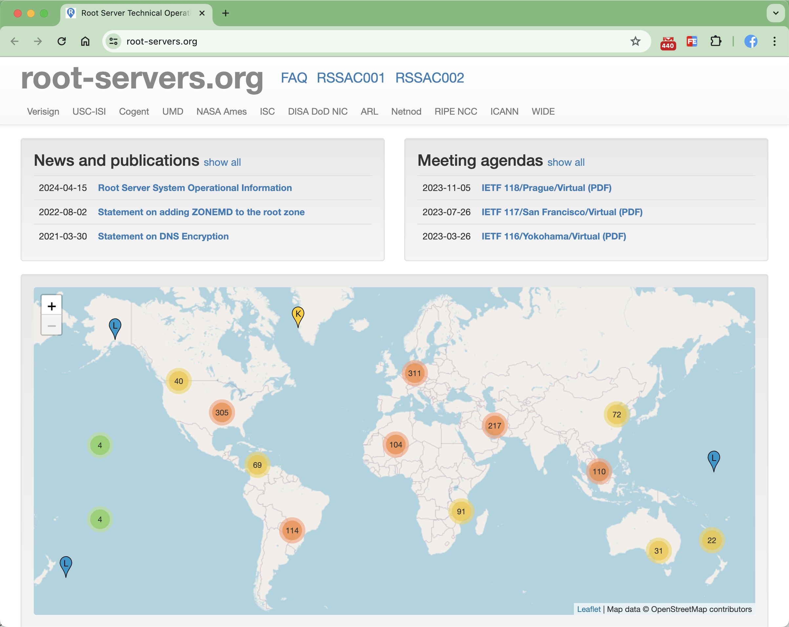
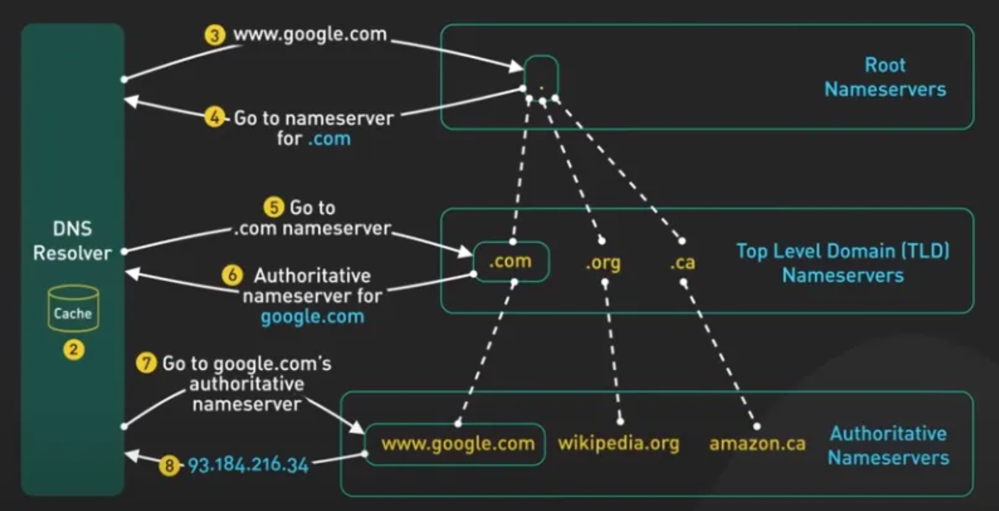
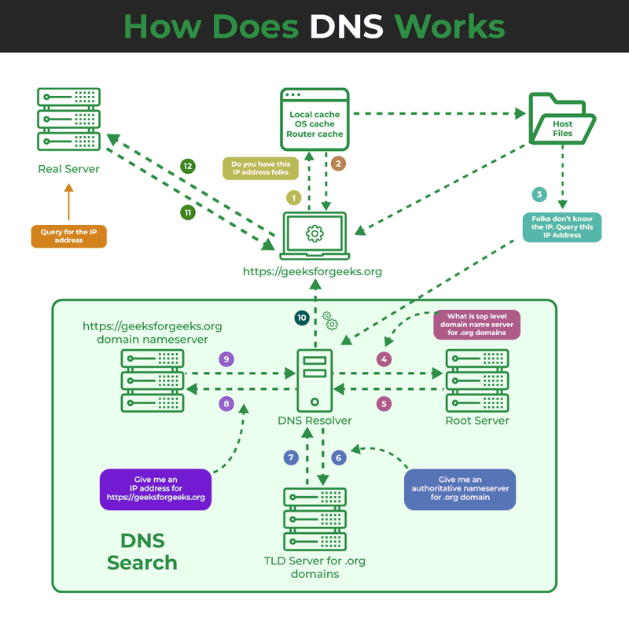

# DNS

> Resolve Domain Name

DNS（Domain Name System，域名系统），将人类可读的域名，进行**域名解析为机器可读的IP 地址**。它是因特网上作为域名和IP地址相互**映射**的一个**分布式数据库**，能够使用户更方便的访问互联网，而不用去记住能够直接被机器读取的IP数字串。


* `A（Address，地址记录）`：用来指定域名的IPv4地址（如：8.8.8.8），如果需要将域名指向一个IP地址，就需要添加A记录。

* `CNAME（canonical name）`：如果需要将域名指向另一个域名，再由另一个域名提供ip地址，就需要添加CNAME记录。
* `IPV6`：地址记录，用来指定域名的IPv6地址（如： 0000:0000:0000:0000:0000:0000:767A:5ED1）。

- `MX`：如果需要设置邮箱，让邮箱能收到邮件，就需要添加MX记录。
- `TXT`：在这里可以填写任何东西，长度限制255。绝大多数的TXT记录是用来做SPF记录（反垃圾邮件）。
- `SRV`：一般用于 邮箱快捷设置。
- `DYNAMIC`：动态域名解析服务（需单独购买），将域名始终解析到非固定IP的服务器，实现在家/办公室搭建网络服务器。

 

## DNS Cache

​		当本地缓存不能直接使用时，就需要向服务器（CDN节点）发起请求，但是要发起请求首先就需要建立连接，客户端需要把URL解析成IP。这个解析过程，需要会先对 **DNS Cache** 缓存进行查询：

* **`Browser DNS Cache`**：搜索浏览器自身的DNS缓存，如果存在，则返回IP地址。如：在 **google chrome **中可能通过查看：`hrome://net-internals/#dns`
* **`OS(Operating System) DNS Cache`**：如果 浏览器缓存查找不到IP地址，则会尝试读取操作系统中的 `host` 文件。如：在命令行中查看：`ipconfig/displaydns`
* **`Router Cache`**：如果 `host` 文件中查找不到，就会在路由器的DNS缓存中查找。
* **`ISP(Internet Service Provider) Cache`**：如果路由器的DNS缓存找不到，则会尝试去网络供应商的DNS缓存中查找。


如果DNS缓存中找不到，就会尝试去根域服务器下查找


## DNS Resolution

`DNS Resolution（DNS解析）`，主要有四种类型的服务器：

* **`DNS Resolver`**，域名解析器（一般是 **DNS recursive search** 递归查询，也叫：递归解析器），主要是**接收客户端发出的域名解析请求**，并发送 DNS query 查询请求。

  它的地址由ISP提供（你也可以通过修改网络设置来改变ISP，例如设置你的**VPN**）

* **`The Root Server`**（根服务器），转换IP执行的第一步查询。

* **`Top Level Domain Server (TLD)`**，转换IP执行的第二步查询。

* **`Authoritative Name Server`**，转换IP执行的最后一步查询。




### Root Server

根服务器，不会保存具体域名的IP映射信息。它就像一个索引服务器，会告诉你下一步该去那台**TLD Server**查询。

> 这些根服务器（A-M）共有**13**套，战略性地分布在全球各地。下面的地图显示了这些根服务器的分布：




### Top-Level Domain (TLD) Servers

顶级域名服务器，负责管理在该顶级域名服务器下注册的**二级域名**，例如 `www.example.com`，`.com `则是**顶级域名**服务器，在向它查询时，可以返回一级域名 `example.com`所在的**权威域名服务器地址**。

#### Types of Domain

域的类型有以下几种：

* **Generic domains（通用域）:** `.com(commercial，商业)`、`.edu(educational，教育)`, `.mil(military，军事)`, `.org(nonprofit organization，非营利组织)`、 `.net(similar to commercial，类似于商业) `

* **Country domain（国家域）**：`.cn(China)`、`.in(India)` 等。

* **Inverse domain（反向域名）**：如果我们想知道网站的域名是什么。

  ```bash
  $ nslookup google.com
  Server:		114.114.114.114
  Address:	114.114.114.114#53
  
  Non-authoritative answer:
  Name:	google.com
  Address: 59.24.3.174
  ```

  

### Authoritative Nameservers

Authoritative Name Servers（权威域名服务器），在特定区域内具有唯一性，负责维护该区域内的**域名与IP地址之间的对应关系**，例如云解析DNS。





### IP Address Returned

客户端最终从**DNS Resolver（解析器）**获取IP地址，**DNS Resolver** 将**IP地址缓存在本地缓存**中以备将来使用。


## DNS Work



