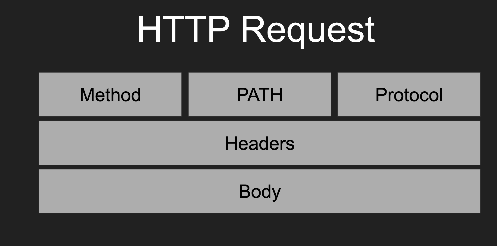
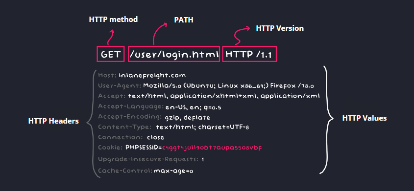
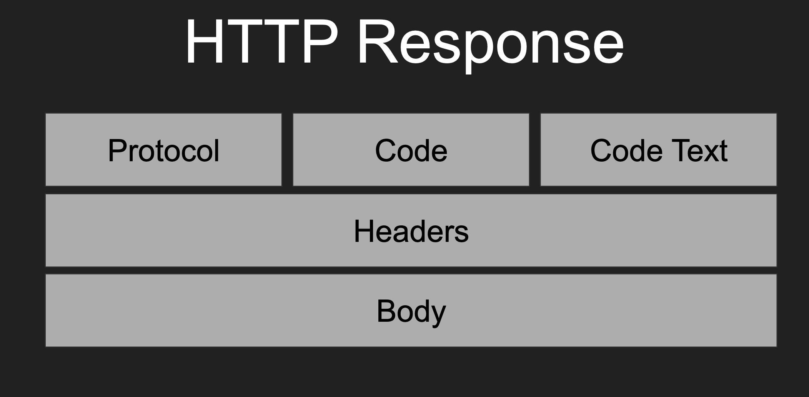
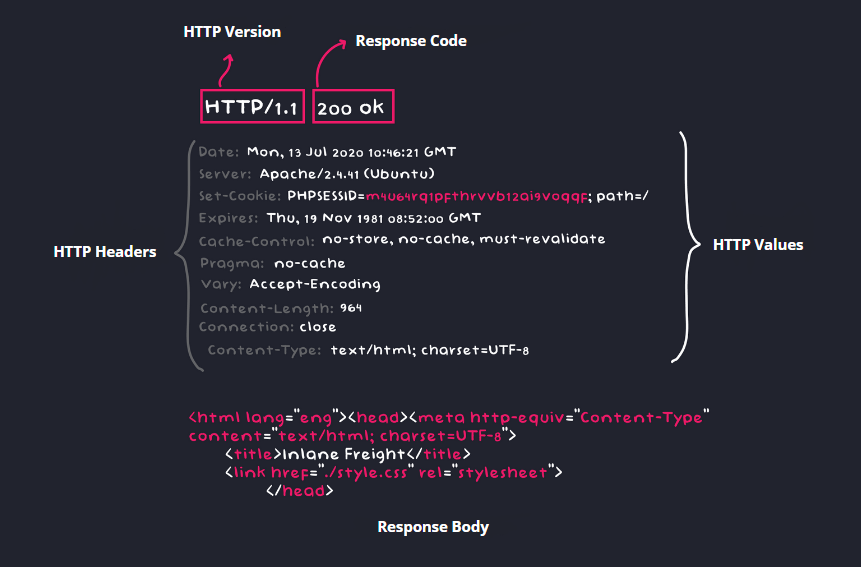

# HTTP

**HTTP（Hypertext Transfer Protocol，超文本传输协议**）是应用层协议，采用的是「**请求（Request）-应答（Response）**」的模式，也就是客户端发起了请求，服务端才会返回响应，一来一回这样子。


## HTTP Request

当建立 `TCP` 连接之后，就可以在这基础上进行通信，浏览器发送 `http` 请求到目标服务器。HTTP请求报文包括三部分：**Request Line（请求行）**、**Request Headers（请求头）**、**Message Body（请求体）**。






### Request Line

**Request Line（请求行）**，如：`GET /XXX HTTP/1.1`，指定**HTTP method（请求类型）**、**URL**（统一资源定位器，即：目标资源）和**HTTP协议版本**。

#### HTTP Request Methods

* GET
* POST
* HEAD
* PUT
* DELETE
* PATCH
* TRACE
* CONNECT
* OPTIONS


### Request Headers

```http
Host: website.com
User-Agent: Chrome/5.0 (Windows 10)
Accept-Language: en-US
Accept-Encoding: gzip, deflate
Connection: keep-alive
```

* **Connection**：告诉服务器是保持连接处于活动状态（长连接）还是为其设置超时


## HTTP Response

HTTP响应报文包括三部分：**Status Line（状态行）**、**Header（响应头）**、**Body（响应体）**。






### **Status Line（状态行）**

与请求行（`Request Line`）类似。指定正在使用的HTTP版本和指示请求结果的状态代码（例如，`200 OK`、`404 Not Found`）。

#### Status code

| S.N. | Code and Description                                         |
| :--- | :----------------------------------------------------------- |
| 1    | **1xx: Informational**<br>这意味着请求已收到，并且过程仍在继续。 |
| 2    | **2xx: Success**<br/>这意味着该操作已被成功接收(successfully received)、理解(understood)和接受(accepted)。 |
| 3    | **3xx: Redirection（重定向）**<br/>这意味着必须采取进一步行动才能完成请求。 |
| 4    | **4xx: Client Error**<br/>这意味着请求包含不正确的语法或无法满足(fulfilled)。 |
| 5    | **5xx: Server Error**<br/>这意味着服务器无法完成一个明显有效的请求。 |


### Response Headers


**Body（响应体）**


包含从服务器发送到客户端的实际内容


