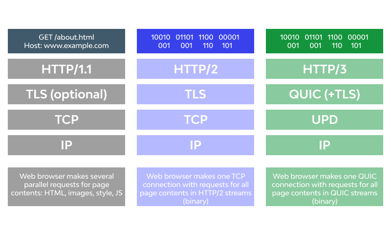

## HTTP version



### HTTP 1.1

> 以纯文本（plain text）形式发送消息

* **持久连接**：即在单个TCP连接上可以发送和接收多个HTTP请求和响应，而不需要为每个请求和响应都建立新的TCP连接，从而减少了连接的建立和关闭次数，提高了性能。
* **管道化（Pipeline）**：允许客户端在发送请求之前不必等待先前的响应，提高了请求-响应的并发处理能力。
* **缓存控制**：细粒度的缓存控制机制，包括`Cache-Control`、`Expires`、`Last-Modified`、`If-Modified-Since`等头部字段，允许客户端和服务器对缓存的内容进行更精细的控制和管理。
* **范围请求（Range Requests）**：允许客户端请求资源的部分内容，而不是整个资源。这对于大文件下载和断点续传等场景非常有用。
* **错误处理**：HTTP/1.1定义了一套标准的状态码（Status Code），用于表示服务器对请求的处理结果。例如，200表示成功，404表示资源未找到，500表示服务器内部错误等。
* 安全性：通过基本认证（Basic Authentication）、摘要认证（Digest Authentication）等方式提供了一定的安全性支持。此外，它还支持通过TLS/SSL加密协议来保护通信内容的安全性。

**HTTP 1.1**，为Web应用程序的开发和传输提供了基础，但它也存在一些性能和效率上的限制，如头部字段重复、队头阻塞等问题。


### HTTP 2.0

* **多路复用（Multiplexing）**

  支持在单个 TCP 连接上同时发送多个请求和响应，而 HTTP/1.1 每个请求需要建立和维护一个独立的连接。

  

* **二进制分帧（Binary Framing）**

  HTTP/2 将 HTTP 报文划分为更小的**二进制帧（`binary data frame`）**——这意味着它可以通过各种分发模式。，而不是像 HTTP/1.1 那样使用**纯文本（`plain text`）**格式的报文。

  这样做的好处是更高效地利用了 TCP 连接，降低了**头部开销**，并且允许优先级和依赖性的管理。

* **头部压缩（Header Compression）**

  HTTP/2 使用了 HPACK 算法对请求和响应的头部进行压缩，减少了重复头部的传输，进一步降低了网络流量。相比之下，HTTP/1.1 的头部信息每次请求都需要重复发送，导致了较大的开销。

* **服务器推送（Server Push）**

  HTTP/2 支持服务器主动向客户端推送资源，这样客户端在请求 HTML 页面时，服务器可以将相关的 CSS、JavaScript 等资源主动推送给客户端，减少了额外的往返时间和延迟。而 HTTP/1.1 中，客户端需要发起额外的请求来获取这些资源。

* **流量控制（Flow Control）**

  HTTP/2 引入了流量控制机制，允许客户端和服务器控制数据的传输速率，以避免拥塞和过载。这对于在高速网络和低速网络之间自适应传输非常有用。

* **优先级（Prioritization）**

  HTTP/2 允许客户端发送请求时对请求进行优先级标记，服务器可以根据这些优先级信息对请求进行处理和响应，优化资源的传输顺序，提高页面加载的速度和响应的质量。

### HTTP 3.0

HTTP/3 在传输层使用 **QUIC（Quick UDP Internet Connections）**协议来替代 TCP，以提供更快的连接建立和更可靠的数据传输。


## HTTP Keep-Alive

* **HTTP 短连接**：**每次请求**都要经历这样的**过程**：建立 TCP -> 请求资源 -> 响应资源 -> 释放连接。

* **HTTP 长连接**

  HTTP 的 `Keep-Alive` 可以使用同一个 TCP 连接，来发送和接收多个 HTTP 请求/应答，避免了连接建立和释放的开销。

```bash
// 开启Keep-Alive（HTTP 1.1默认开启）
Connection: Keep-Alive

// 关闭Keep-Alive
Connection:close
```


## TCP Keepalive

 **TCP 的保活机制**

如果两端的 TCP 连接一直没有数据交互，达到了触发 TCP 保活机制的条件，那么内核里的 TCP 协议栈就会发送探测报文。

- 如果对端程序是正常工作的。当 TCP 保活的探测报文发送给对端, 对端会正常响应，这样 **TCP 保活时间会被重置**，等待下一个 TCP 保活时间的到来。
- 如果对端主机崩溃，或对端由于其他原因导致报文不可达。当 TCP 保活的探测报文发送给对端后，石沉大海，没有响应，连续几次，达到保活探测次数后，**TCP 会报告该 TCP 连接已经失活**。