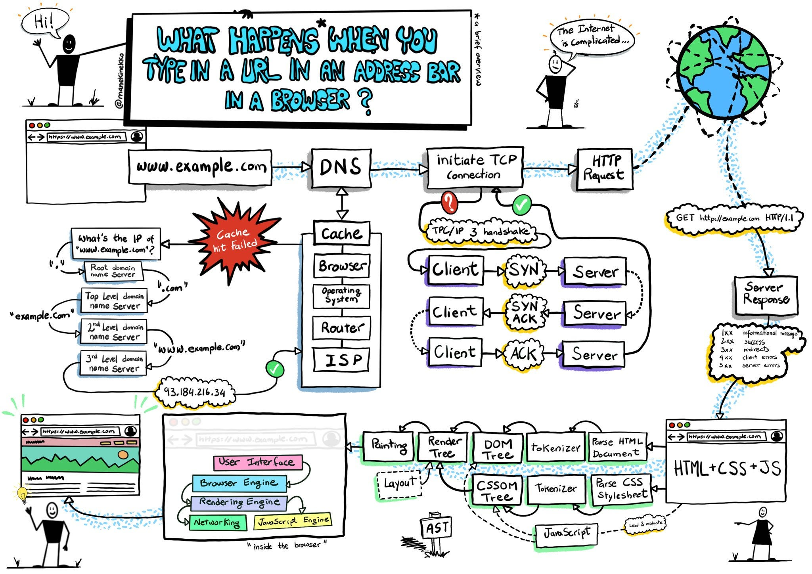
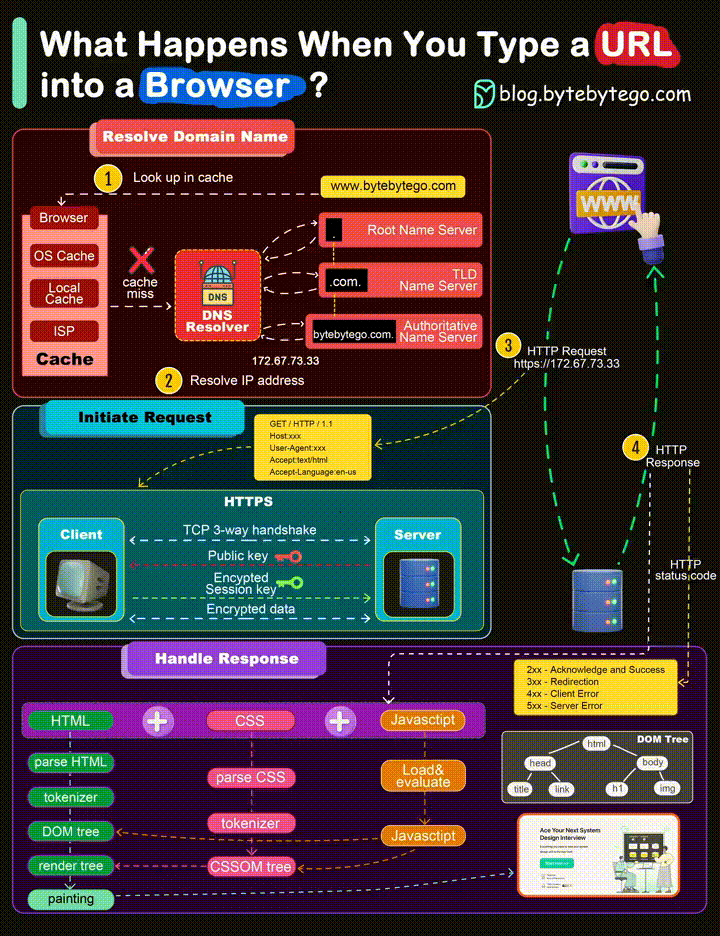
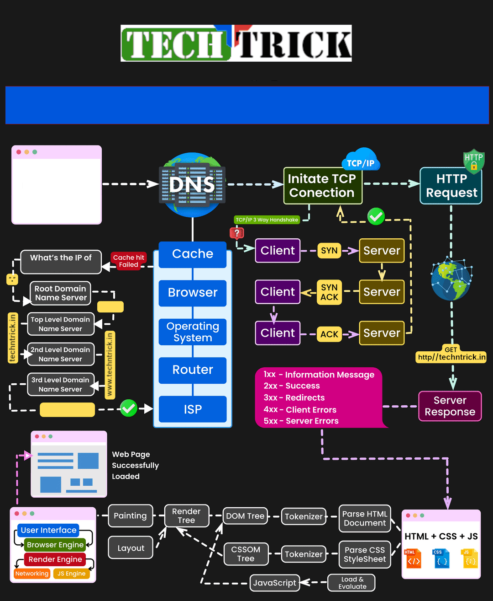

# Overview

1. **Navigation**
   * DNS lookup - 通过DNS（域名系统）查找，把域名解析成IP地址
   * TCP 3-way handshake - 通过TCP协议三次握手，建立与服务器的连接
   * TLS negotiation - HTTPS (HTTP + SSL/TLS)建立安全连接【这是一个”公钥加密、私钥解密“的**非对称加密**过程，最终可以在客户端与服务器端得到相同的SessionKey（会话密钥），从而在后面数据传输过程中使用**对称加密进行数据传输**】

2. **Fetching**

   HTTP request

   HTTP response

   Browser caching

3. **Parsing**

   - Building the DOM tree
   - Building the CSSOM tree
   - Combining the trees into the render tree
   - Preload Scanner
   - JavaScript Compilation
   - Building the Accessibility Tree

4. **Rendering**

   - Critical Rendering Path
   - Layout
   - Paint
   - Compositing

5. **Finalising**

   - JavaScript Occupied.
   - User can now browse the page!

## TCP Connection close

> 在服务器响应之后，由于现在`http`默认开始长连接`keep-alive`，当页面关闭之后，`tcp`链接则会经过四次挥手完成断开。
>
> **4次挥手**（断开连接），`FIN（finish，完成）`

* 客户端向服务器端发送断开连接请求（我们分手吧）
* 服务器商接收到请求后，先对请求做出回复（我知道了）
* 接着服务器端把相关信息全部删除（如：修改银行卡密码）后，再给客户端发送信息：那就分手吧
* 然后，客户端再做个回应（好吧，我们结束了）

## 浏览器渲染

## 网络代理

### 正向代理

### 反向代理

VPN（Vritual Personal Network，虚拟专用网络）

CDN（Content Delivery Network，内容分发网络），通过技术手段将内容更快、更好地分发给用户的东西。可以想象成京东物流的工作机制【在全国各地设立物流中心，就近发货】。

**二者的不同**

CDN通常用于**批量传输静态内容**（如图片、视频、CSS和JavaScript等），优化网站访问速度和提高网站的稳定性，适合**网站官方提高C端用户访问速度**；

而VPN通常可以提供**安全**的网络连接和**隐藏**用户的身份、位置，常用于**远程工作、保护隐私、绕过地理限制或访问受限内容等，适合满足个人需要**。

概而论之，需要**提高速度**，选择CDN；需要**更加安全**，选择VPN

[What happens when you type a URL into your browser?](https://newsletter.techworld-with-milan.com/p/what-happens-when-you-type-a-url)

 TCP (*Transmission Control Protocol*)

> 	* （HTTP，*Hypertext Transfer Protocol*）three-way handshake
> 	* （HTTPS）SSL/TLS handshake

Sending an HTTP Request

Receiving the HTTP Request

* HTTP status code
* headers（e.g. Conten-Type，Cache-Control）
* requested content：HTML、CSS、images、javascript

Rendering the web page

HTML（包含HTML中的引用资源，如：图片、样式文件、js等），执行js代码

* DOMContentLoaded、Load（图片加载）
* HTML与JS是两个互斥的进程

### VPN

A VPN works by routing a device's internet connection through a private service rather than the user's regular internet service provider (ISP). 

The VPN acts as an intermediary between the user getting online and connecting to the internet by hiding their IP address.

VPN的工作原理是通过私人服务而不是用户的常规互联网服务提供商（ISP）来路由设备的互联网连接。

VPN通过隐藏用户的IP地址，充当用户上网和连接互联网之间的中介。

Using a VPN creates a private, encrypted tunnel through which a user’s device can access the internet while hiding their personal information, location, and other data.

使用VPN可以创建一个私人的加密隧道，用户的设备可以通过该隧道访问互联网，同时隐藏他们的个人信息、位置和其他数据。

 All network traffic is sent through a secure connection via the VPN. This means that any data transmitted to the internet is redirected to the VPN rather than from the user’s computer. 

所有网络流量都通过VPN通过安全连接发送。这意味着传输到互联网的任何数据都会重定向到VPN，而不是从用户的计算机。

A VPN masks a user’s true location to the one they set their VPN to. 

VPN将用户的真实位置屏蔽为他们设置VPN的位置。

* [What happens when you type a URL into your browser?](https://dev.to/systemdesign/what-happens-when-you-type-a-url-into-your-browser-3ba4)
* [What exactly happens when you enter a URL into your Browser](https://medium.com/@atishayjn999/what-exactly-happens-when-you-enter-a-url-into-your-browser-2a47297833ca)
* [What happens in a TLS handshake? ](https://www.cloudflare.com/zh-cn/learning/ssl/what-happens-in-a-tls-handshake/)
* [阿里云 - DNS概念](https://help.aliyun.com/zh/dns/basic-concepts)
* [Wireshark抓包工具](https://wireshark.org)