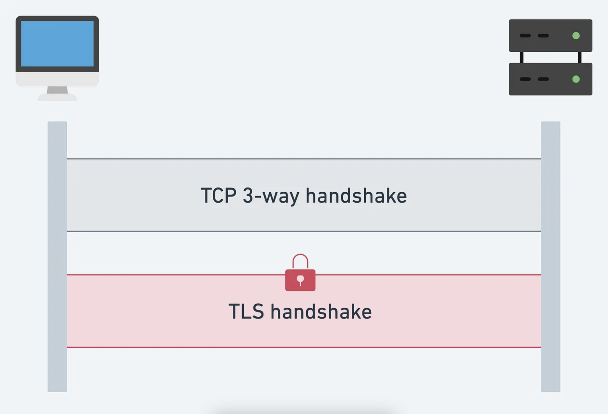
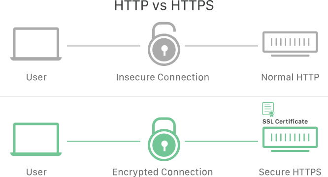
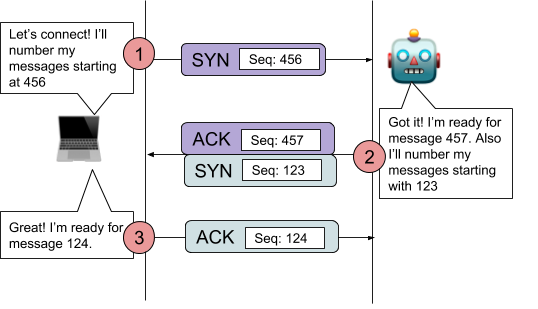
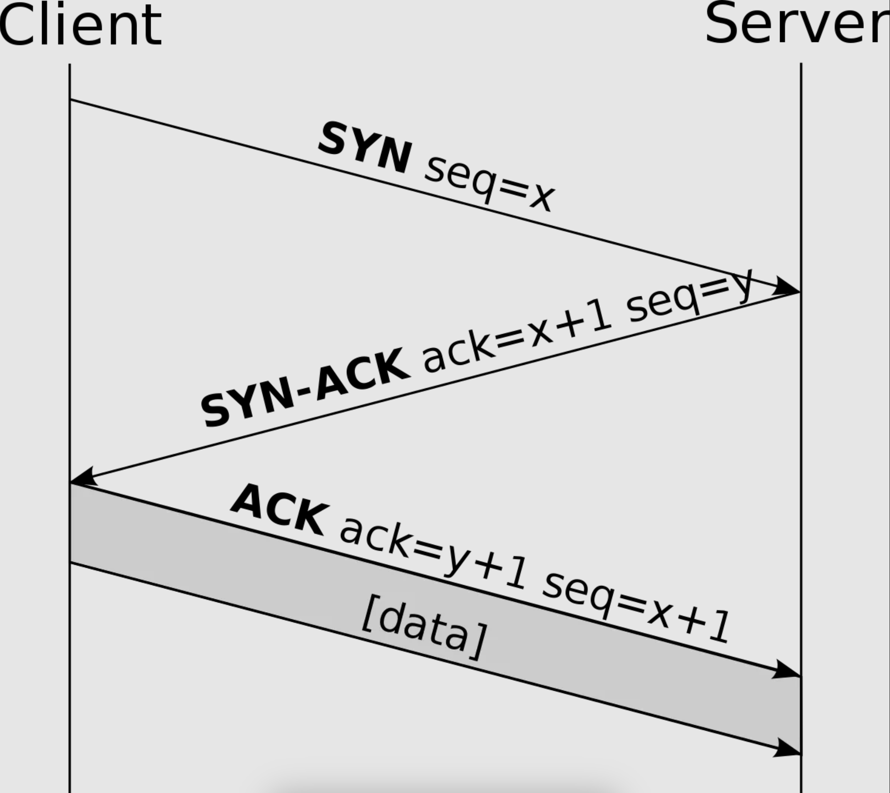
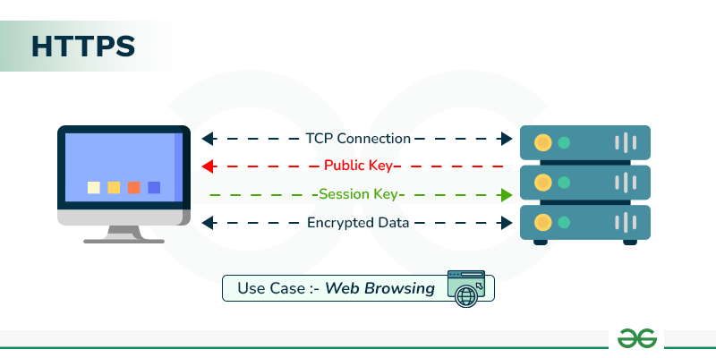
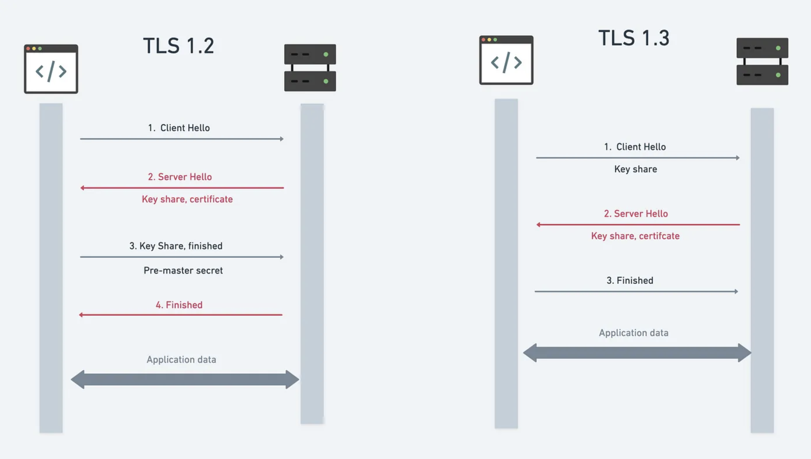
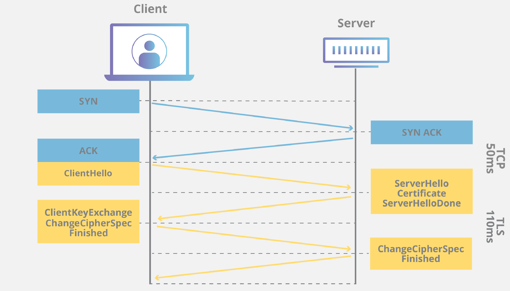

# Initiate Request

The browser can start connecting with the server, with the following steps:

1. TCP three-way handshake (SYN, ACK & SYN, SYN)
2. TLS handshake (website that has HTTPS)

* HTTP vs HTTPS

  

## TCP 3-way handshake

TCP（**T**ransmission **C**ontrol **P**rotocol ，传输控制协议），是一种面向连接的、可靠的、基于字节流的传输层通信协议。

​		当浏览器获取到IP地址后（在两个设备开始交换数据之前），使用 **`three-way handshake(三次握手)`** 建立连接，以**确保两个通信设备准备好**且**能够进行安全通信**。

- **SYN (Synchronize，同步):** 客户端给服务端发一个 SYN 报文，并指明客户端的初始化序列号 ISN(c)，此时客户端处于 SYN_SENT 状态

  > 🎉 **客户端**的**发送**能力、**服务端**的**接收**能力是正常的。

- **SYN-ACK (Synchronize-Acknowledge，同步确认):** 服务器收到客户端的 SYN 报文之后，会以自己的 SYN 报文作为应答，为了确认客户端的 SYN，将客户端的 ISN+1作为ACK的值，此时服务器处于 SYN_RCVD 的状态。

  > 🎉 **服务端**的**接收、发送**能力，**客户端**的**接收、发送**能力是正常的。不过此时**服务器并不能确认客户端**的**接收**能力是否正常

- **ACK (Acknowledge，确认):** 客户端收到 SYN 报文之后，会发送一个 ACK 报文，值为服务器的ISN+1。此时客户端处于 ESTABLISHED 状态。服务器收到 ACK 报文之后，也处于 ESTABLISHED 状态，此时，双方已建立起了连接

  > 客户端的接收、发送能力正常，服务器自己的发送、接收能力也正常

## TLS handshake

> * HTTP是超文本传输协议，信息是明文传输（握手阶段： `3-way handshake` ）
> * HTTPS则是具有安全性的SSL加密传输协议（握手阶段：`3-way handshake` + `TLS handshake`）。
>   * SSL (Secure Sockets Layer，安全套接字层)：上一代加密协议，TLS 由此演变而来。
>   * TLS（Transport Layer Security，传输层安全性）：一种广泛采用的安全性协议，促进通信的私密性和数据安全性。

* **非对称加密（asymmetric encryption）**：也叫公钥加密（public-key cryptography）。它用于**HTTPS握手阶段**。
  * 客户端公钥加密，服务器端私钥解密
  * 会话密钥（Session Key）：就像每次登录时都会重置的密码一样。仅用于单次通信会话进行加密的任何**对称加密**密钥。
  * CA（Certificate Authority，证书授权），证书包含：颁发对象、颁发者、在效期、SHA-256指纹（证书、公钥）等信息。
* **对称加密（symmetric encryption）**：又叫私钥加密（private-key cryptography)。它用于**HTTPS数据传输**阶段（加密和解密规则是约定好的，如果别人知道加解密规则，则容易破解。）

> 注：服务器端已部署CA颁发的证书：公钥 和 私钥。

### TLS 1.2

**Key Share**：`Session Key` = `client random` + `server random` + `pre-master secret`

* 公钥加密：客户端将`pre-master secret` 预主密钥，通过公钥进行加密，分享给服务器端
* 私钥解密：服务器端通过私钥将客户端通过公钥加密传输的`pre-master secret`进行解密

此时，客户端和服务器端都有会生成相同的 `session-key`会话密钥。

* 客户端（Client）向服务器端发送`Client Hello`（包含：TLS版本、加密套件、`client random`第1个随机数）消息。
* 服务器（Server）向客户端发送响应
  *  `Server Hello`（包含：TLS版本、加密套件、`server random`第2个随机数）
  *  证书（Certificate）：包含颁发对象、颁发者、在效期、SHA-256指纹（证书、公钥）等信息。
  *  `Server Hello Done`
* 客户端接收到服务器的响应后
  * 身份验证
  * **premaster secret，预主密钥**：客户端生成一串随机数（即：预主密钥），并通过服务器发送的公钥加密生成（**公钥加密**）发送给服务器。【只有服务器的**私钥可能解密**】
* 服务器收到客户端发送的预主密钥及其它信息后
  * 通过私钥，对客户端公钥加密发送的预主密钥进行解密。
* 生成会话密钥：客户端和服务器端生成一样的`session key = client random + server random + premaster secret `

到此，客户端和服务器端之前，通过非对称加密得到了相同的 `session key` **会话密钥**，标志着`SSL/TLS handshake`握手完成。在后面的**数据传输过程**中，会使用这个相同的`session key`对数据进行**对称加密**通信。

* [TCP and TLS handshake: What happens from typing in a URL to displaying a website?](https://medium.com/@alysachan830/tcp-and-tls-handshake-what-happens-from-typing-in-a-url-to-displaying-a-website-part-2-243862438cd9)