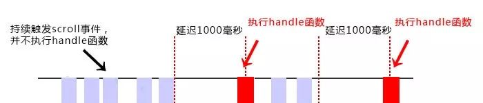
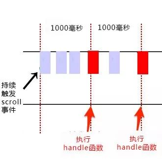
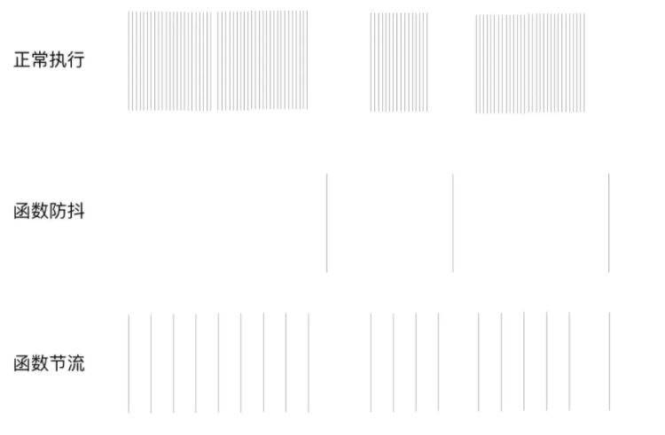

## 防抖debounce

想象成电梯，当第一个人进电梯后，电梯等待10秒关门；如果10秒内有人进来，则重新计时再等待10秒。

>  无论用户触发多少次事件，对应的回调函数只会在事件停止触发指定事件后执行。（即：回调函数在事件停止触发指定时间后被调用）



### 应用场景

* 搜索框建议项：在每次击键时，都会等待几秒钟，然后再给出建议。
* 消除resize事件：不断的调整浏览器窗口大小会不断触发这个事件，用防抖让其只触发一次。
* 自动保存：在线文本编辑器，为防止数据丢失会与后端进行数据交互保存，当用户停止输入后一段时间内再自动保存。
* 手机号、邮箱等验证：用户停止输入后一段时间再进行格式检测，而不是输入框中内容发生改变就检测。
* 在用户停止输入之前不要发出任何 Ajax 请求。


### 手写代码

```js
/**
 * 防抖
 * 类比：类似于进电梯，比如进一个人10秒后关门，如果10秒内有人进，则重新计时
 * 定义：无论用户触发多少次事件，对应的回调函数只会在事件停止触发指定事件后执行
 * 场景：搜索框建议项、消除resize事件、在线文本编辑器自动保存、手机号验证
 **/
function debounce(fn, seconds){
    let timer = null;
    return function(...args){
        clearTimeout(timer)
        timer = setTimeout(() => {
            fn.apply(this, args)
        }, seconds)
    }
}
```


## 节流 throttle

想象成坐地铁，每隔5分钟一躺。

> 在事件不断触发的过程中，固定时间内执行一次事件。



###  应用场景

* 限制mousemove/touchmove事件处理程序
* 滚动事件处理


### 手写代码

```js
//时间戳方式
function throttle(fn, delay){
  let pre = Date.now();
  return function(){
    let context= this;
		let args = arguments;
		let now= Date.now();
		if(now - pre > delay) {
			fn.apply(context,args);
			pre = Date.now();
    }
  }
}
// 或
function throttle(fn, delay) {
    let pre = 0;
    return function (...args){
        if (new Date() - pre > delay) {
            // 当 n 秒内不重复执行
            pre = new Date();
            fn.apply(this, args)
        }
    } 
}
  
//定时器方式
function throttle(fn, delay){
  let timer = null;
  return function(){
		let context= this;
		let args = arguments;
		if(!timer){
			timer = setTimeout(function(){
        fn.apply(context, args);
        timer = null;
			},delay)
    }
  }
}
// 或

/**
 * 节流
 * 定义：在事件不断触发的过程中，固定时间内执行一次事件。
 * 类比：想象成坐地铁，每隔5分钟一躺。
 * 场景：限制mousemove/touchmove事件处理程序
 **/
function throttle(fn, delay) {
    let timer = null;
    return function (...args) {
        if (!timer) {
            timer = setTimeout(() => {
                timer = null;
                fn.apply(this, args)
            }, delay)   
        }
    }
}
```


## 总结

> 如果只关心**最终状态**，建议使用**防抖**。
>
> 如果是想要函数**以可控的速率执行**，那么建议使用**节流**。




* [JS的防抖与节流](https://mp.weixin.qq.com/s/Vkshf-nEDwo2ODUJhxgzVA)