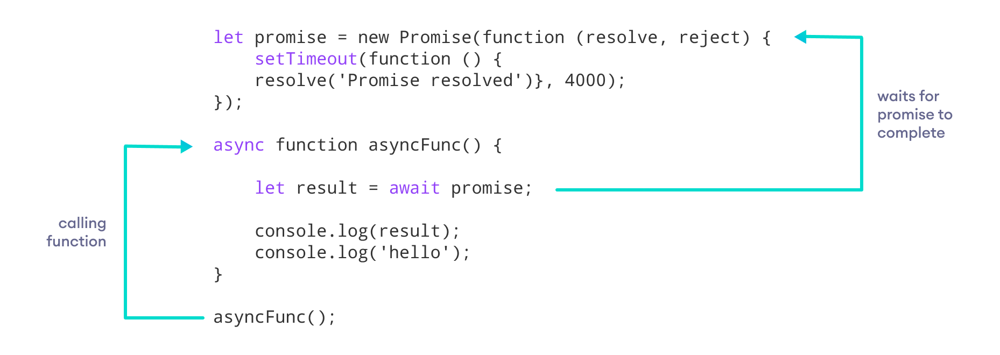

# async/await

​		通过 `async function` 创建一个异步函数，并在函数体内使用 `await` 关键字。可以使用我们更简单的编写 `Promise` 异步代码。

* 语法

  ```js
  // async
  async function name([param[, param[, ... param]]]) {
    statements
  }
  
  // await
  await expression;
  ```

* 示例

  ```js
  function foo() {
    return Promise.resolve(1);
  }
  // 等价于
  async function foo() {
    return 1;  // 异步函数同步运行
  }
  ```

* 示例：`await` —— **`async wait`(异步等待)**

  ```js
  function foo() {
    return Promise.resolve(1).then(() => undefined);
  }
  // 等价于
  async function foo() {
    await 1;   // 每个 await 表达式之后的代码可以被认为存在于 .then 回调中。
  }
  ```


### 原理

`async/await`是语法糖，内部是 `generator+promise`实现 `async` 函数就是将`Generator`函数的星号**`（*）`**替换成**`async`**，将 **`yield  `** 替换成 **`await`**。


## async/await在事件循环中

```js
function getJson() {
   return new Promise((resolve, reject) => {
     setTimeout(function() {
       console.log(2);
       resolve(2)
     }, 2000)
   })
 }
 
async function testAsync() {
    await getJson()  //事件循环机制  await 下面的代码会去到下一次事件循环机制
    console.log(3);
}
testAsync()


// output: 2   3
```



```js
// calling the async function, will output:
Promise resolved
hello
```