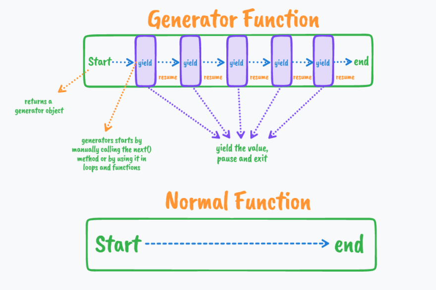
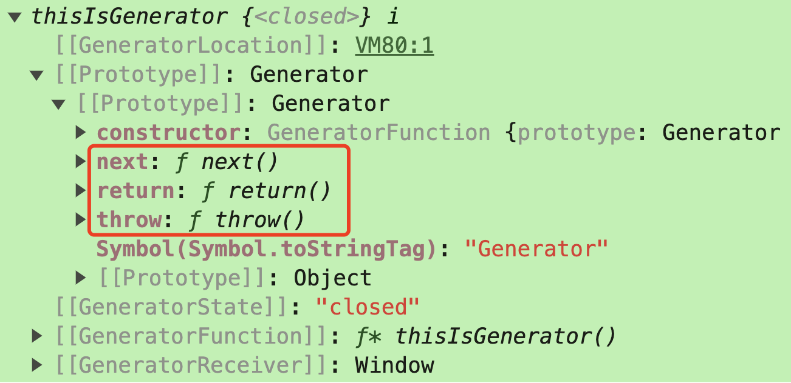
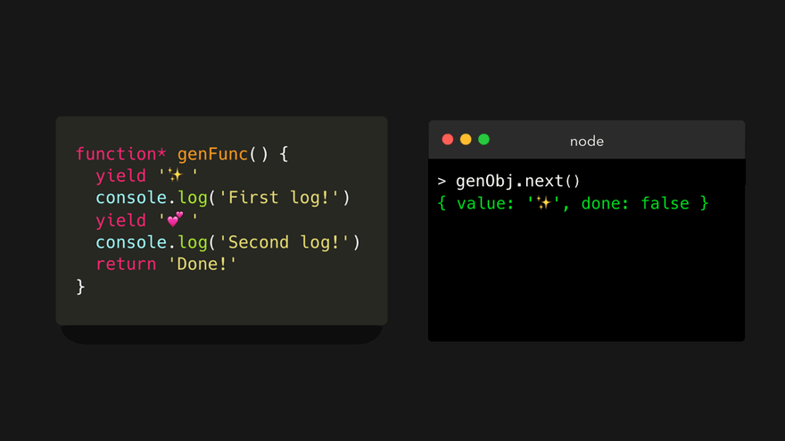
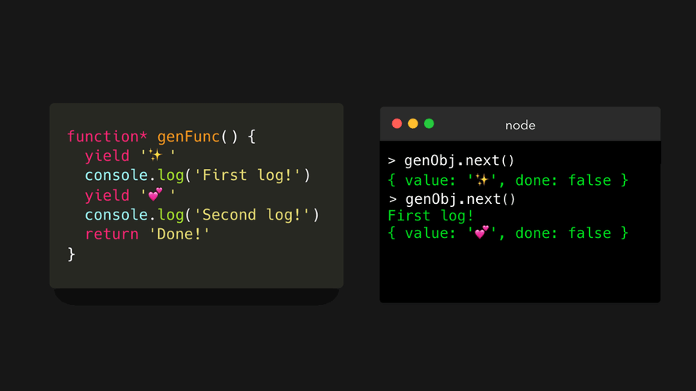
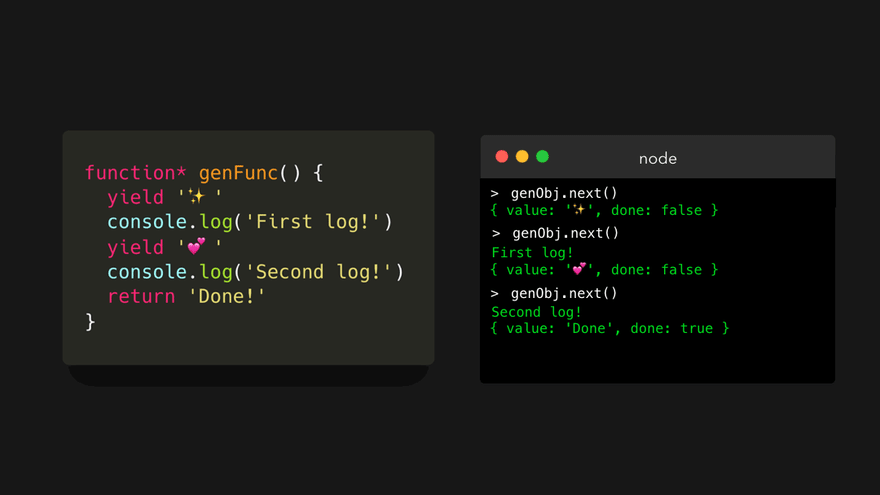
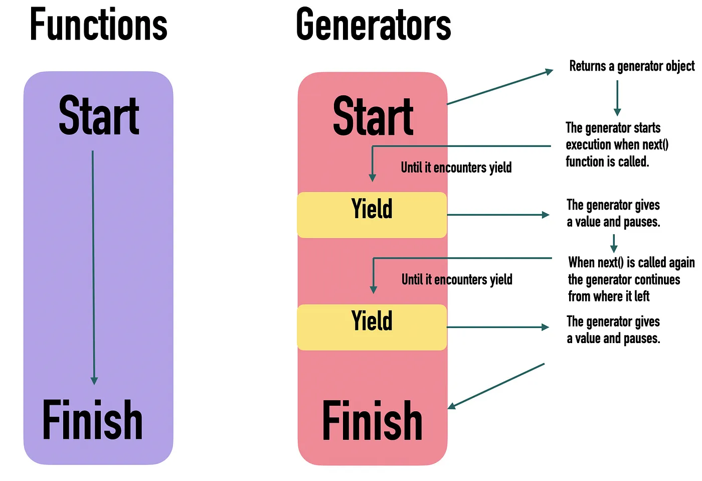

## generator

​		生成器（generator）是一个特殊的函数，它可以在函数内多次暂停（**paused**）/恢复（**resumed**）来运行代码。

* 下面是 `Generator`生成器函数和正常函数的区别。




### 语法

在`function`关键字后添加一个 `*(asterisks，星号)` 用来表示这是一个生成器函数。

```js
function* thisIsGenerator() {}
function *thisIsGenerator() {}
function * thisIsGeneratour() {}
```

在生成器函数内部，使用 **`yield`** 关键字来暂停，它会**生成一个值**（注意不是返回[**return**]）。

```js
function* thisIsGenerator() {
  yield 1;
  yield 2;
}
```

要使用生成器（generator），必须先**运行生成器**函数，它将为我们提供一个称为**生成器对象**的对象，我们可以使用该对象来操作刚刚创建的生成器。

```js
// execute the generator function
const genObj = thisIsGenerator()
// To obtain the generator object
console.log(genObj)
```



> 上面的生成器对象中的 `[[Prototype]]` 属性，有三个方法：`next()`、`return()`、`throw()`。


### 实例方法

#### next()

* `Generator.prototype.next()`：它成让我们**运行生成器内部的代码**，返回 `yield` 表达式生成的值。

```js
function* thisIsGenerator() {
  	// some code
    yield 1;
  	// pauses
  	// some code
    yield 2;
  	// pauses
}

const genObj = thisIsGenerator();

genObj.next(); // {value: 1, done: false}
genObj.next(); // {value: 2, done: false}
genObj.next(); // { value: undefined, done: true }
```

* 返回值
  * `value`：生成器产生或返回的任何 JavaScript 值
  * `done`：[boolean]，生成器是否还可以产生更多的值
    * **false**：生成器还可以产生更多的值
    * **true**：生成器的控制流程已经结束，此时`value`返回 `undefined`

#### return()

* `Generator.prototype.return()`：在生成器暂停位置插入`return` 语句，结束生成器。 可与`try...finally` 结合使用。

```js
function* gen() {
  yield 1;
  yield 2;
}

const g = gen();

g.next();          // {value: 1, done: false}
g.return();        // { value: undefined, done: true }
g.return('foo');   // {value: 'foo', done: true}
g.next();          // { value: undefined, done: true }
```


#### throw()

* `Generator.prototype.throw()`：在生成器暂停位置插入`throw` 语句，通知生成器有错误情况。

```js
function* gen() {
  while (true) {
    try {
      yield 42;
    } catch (e) {
      console.log("Error caught!");
    }
  }
}

const g = gen();
g.next();   // { value: 42, done: false }
g.throw(new Error("Something went wrong"));
// "Error caught!"
// { value: 42, done: false }

```


## Iterators


### GIF










<!--  -->


### 参考资料

* [JavaScript generators explained to a 5 year old](https://dev.to/pramit_marattha/javascript-generators-eli5-2o61)
* [💡🎁 JavaScript Visualized: Generators and Iterators](https://dev.to/lydiahallie/javascript-visualized-generators-and-iterators-e36)
* https://vue3js.cn/interview/es6/generator.html

