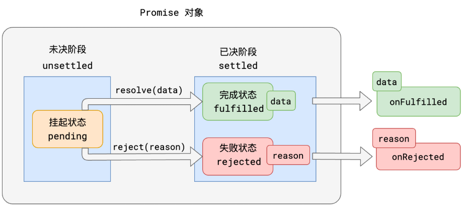
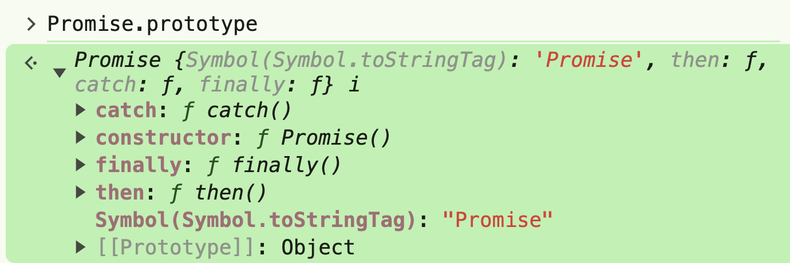

# 异步编程


* setTimeout、setIntenver
* Promise
* generate
* async/await
* Event loop
* nextTick
* Ajax
* Fetch
* Axios


## Promise

`Promise`，是异步编程的一种解决方案，比传统的解决方案（回调函数）更加合理和更加强大。优点：

- **链式操作**减低了编码难度
- 代码可读性明显增强

### 状态

 `Promise` 处于以下3种状态之一：

- *待定（pending）*：初始状态，既没有被兑现，也没有被拒绝。
- *已兑现（fulfilled）*：意味着操作成功完成。
- *已拒绝（rejected）*：意味着操作失败。

### 阶段

`Promise` 有两个阶段：

* `unsettled（未确定，未敲定）`：`pending`状态。
* `settled（已确定，已敲定）`：`fulfilled` 或 `rejected` 状态。
  * 我们可能通过 `Promise.allSettled` 来获取所有Promise被敲定(`settled`)。
  * 一旦被敲定，不会再改变。(Once a Promise is settled, its state doesn’t change anymore.)




### 用法

`Promise` 是一个构造函数，通过 `new` 来实例化。

```javascript
new Promise(function(resolve, reject) {});
```

接受一个**函数**作为参数，该函数的两个参数分别是`resolve`和`reject`

- `resolve`函数的作用是，将`Promise`对象的状态从“未完成”变为“成功”
- `reject`函数的作用是，将`Promise`对象的状态从“未完成”变为“失败”

```js
Promise.resolve('foo')
// 等价于
new Promise(resolve => resolve('foo'))

const p = Promise.reject('出错了');
// 等同于
const p = new Promise((resolve, reject) => reject('出错了'))
```


### 实例方法

`Promise`构建出来的实例存在以下方法：

- `then()`：状态发生改变时的回调函数。
- `catch()：`：用于指定发生错误时的回调函数。
- `finally()`：不管 Promise 对象最后状态如何，都会执行的操作。



* **顺序可以颠倒**，但一般建议按 `then-catch-finally` 的顺序编写程序。
* `catch`只会执行第一个（除非`try...catch`异常），`then` 和 `finally` 可以多次执行。因此，最好只安排一个`catch` 和 `finally`。
* `then` 默认会向下顺序执行，可能通过throw来跳转到catch实现中断。

```js
new Promise((resolve, reject) => {
  setTimeout(() => {
    if (Math.random() < 0.5) { resolve('success'); 
    } else { reject('error'); }
  }, 300);
}).then((value) => {
    console.log('resolve:' + value);
}).catch((err) => {
    console.error('reject: ' + err);
}).finally(function () {
    console.log("finally");
});
```


## 并发

| 方法                   | 成功                                                         | 失败                                                         |
| ---------------------- | ------------------------------------------------------------ | ------------------------------------------------------------ |
| `Promise.all()`        | 所有传入的Promise都**成功（`fulfilled`）**，则以数组方式返回。 | 有一个被拒绝（rejected）,则返回被拒绝的结果                  |
| `Promise.allSettled()` | 所有Promise都被**敲定（settled）**时：无论是 `fulfilled` 还是 `(rejected）`。都返回一个数组对象。 |                                                              |
| `Promise.any()`        | 任意一个Promise**成功（`fulfilled`）**，则返回该成功结果。   | 全部被拒绝（rejected）时，它会以一个包含拒绝原因数组的 `AggregateError ` 拒绝。 |
| `Promise.race()`       | 任意一个Promise**成功（`fulfilled`）**，返回最先执行结束成功结果。 | 任意一个被拒绝（rejected）时，返回最先执行结束拒绝结果       |


### Promise.all()

* 所有都成功，则返回以数组方式返回结果。（有一个失败，则返回被拒绝的值）

```js
const promise1 = Promise.resolve(3);
const promise2 = 42;
const promise3 = new Promise((res, rej) => { setTimeout(res, 100, 'foo'); });
const promise4 = Promise.reject('reject');

// A. 都成功，则以数组方式返回
Promise.all([promise1, promise2, promise3]).then((values) => {
  console.log(values);  // output: [3, 42, "foo"]
});

// B. 有一个失败，则返回被拒绝的值
Promise.all([promise1, promise2, promise4]).then((values) => {
  console.log(values);
}).catch((error) => {
  console.log(error);   // output: 'reject'
});
```


### Promise.allSettled()

* `settle`，音：`/ˈsetl/`，译：**解决，确定，安排好**
* 稳定输出所有数组对象。

```js
const promise1 = Promise.resolve(3);
const promise2 = 42;
const promise3 = new Promise((res, rej) => { setTimeout(res, 100, 'foo'); });
const promise4 = Promise.reject('reject');

// 无论是 `fulfilled` 还是 `(rejected）`。都返回一个数组对象。
Promise.allSettled([promise1, promise2, promise4]).then((values) => {
  console.log(values);
})
 // [{status: 'fulfilled', value: 3}, {status: 'fulfilled', value: 42},{status: 'rejected', reason: 'reject'}]
```


### Promise.any()

* 任意一个成功，则返回该成功结果。（全部失败，则返回拒绝原因AggregateError）

```js
const promise1 = Promise.resolve(3);
const promise2 = 42;
const promise3 = new Promise((res, rej) => { setTimeout(res, 100, 'foo'); });
const promise4 = Promise.reject('reject');
const promise5 = Promise.reject(0);

// A. 任意一个成功，则返回该成功结果
Promise.any([promise1, promise2, promise4]).then((values) => {
  console.log(values); // 3
});

// B. 全部失败，则返回拒绝原因AggregateError
Promise.any([promise4, promise5]).then((values) => {
  console.log(values);
}).catch((error) => {
  console.log(error)   // AggregateError: No Promise in Promise.any was resolved
})
```


### Promise.race()

* `rece`，音：`/reɪs/`，译：**比赛，竞争**。
* 特征：**谁先执行完，返回谁**（不论成功还是拒绝）。

```js
const promise1 = Promise.resolve(3);
const promise2 = 42;
const promise3 = new Promise((res, rej) => { setTimeout(res, 100, 'foo'); });
const promise4 = Promise.reject('reject');
const promise5 = Promise.reject(0);

// A. 任意一个成功，任意一个Promise**成功（`fulfilled`）**，返回最先执行结束成功结果
Promise.race([promise1, promise4, promise2]).then((values) => {
  console.log(values); // 3
}).catch((error) => {
  console.log(error);
});

// B. 任意一个被拒绝（rejected）时，返回最先执行结束拒绝结果
Promise.race([promise4, promise5]).then((values) => {
  console.log(values);
}).catch((error) => {
  console.log(error)   // reject
});
```


### 手写Promise


## 参考资料

* [JavaScript Visualized:  Promise Execution](https://lydiahallie.framer.website/blog/promise-execution)

* [Promise - 实现红黄绿灯交替闪烁](https://juejin.cn/post/7174602840906661925)
* [理解和手写Promise.all和Promise.race](https://juejin.cn/post/6962019510526148615)


