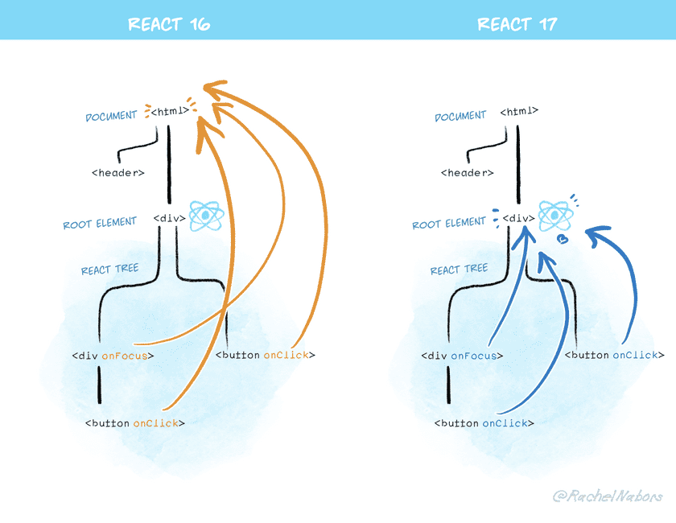
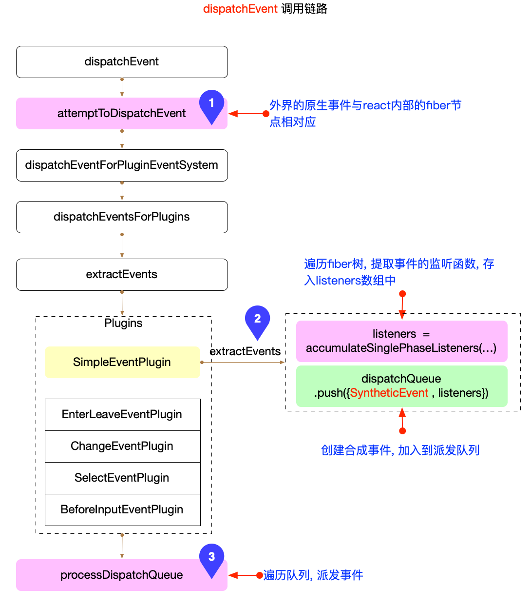

## 事件

事件的本质是，程序各个组成部分之间的一种通信方式。

* 浏览器内置对象：XMLHttpRequest、AudioNode、AudioContext等

* DOM 的事件操作：EventTarget

## 事件流

> 由于 **DOM** 的一个树结构，如果在父子节点绑定事件的时候，当触发子节点的时候，就存在一个顺序问题。这就涉及到 **事件流** 的概念。

* 事件捕获阶段：capture phase
* 目标阶段：target phase
* 事件冒泡阶段：bubbling phase

### 事件冒泡

**从下往上**传播：由最具体的元素（触发节点），逐渐向上传播到最不具体的节点（DOM中最高层的父节点）。


### 事件捕获

由不太具体的节点最早接受事件, 而最具体的节点（触发节点）最后接受事件。


## 事件模型

事件模型可以分为三种：

- 原始事件模型（DOM0级）
- 标准事件模型（DOM2级）：先捕获再冒泡。
- IE事件模型（基本不用）


### addEventListener

#### 语法

```js
addEventListener(type, listener[, useCapture]);
addEventListener(type, listener[, options]);
```

第三个参数，除了设置boolean值外，还可以定制事件监听行为：

* `capture`：boolean。同 `useCapture`
* `once`：boolean。默认为 `false`；当设为`true`时，表示监听函数执行一次就会自动移除。
* `passive`：boolean。默认为 `false`；当设为`ture`时，表示禁止监听函数调用`preventDefault()` 方法。
* `signal`

例如：`{once: true }`

#### 示例

```html
<div id='div'>
    <p id='p'>
        <span id='span'>Click Me!</span>
    </p >
</div>
```

* `useCapture`：用于指定是否在捕获阶段进行处理。它是一个boolean值，默认为：`false` 。

```js
var div = document.getElementById('div');
var p = document.getElementById('p');

function onClickFn (event) {
    const { tagName } = event.currentTarget;
    const { eventPhase } = event;
    console.log(tagName, phase);
}

// useCapture为false，表示在冒泡阶段进行触发。
div.addEventListener('click', onClickFn, false);
p.addEventListener('click', onClickFn, false);
```

> `eventPhase`，代表当前执行阶段的整数值：1，捕获阶段、2，对象触发阶段、3，冒泡阶段

当点击 **Click Me** 时，会输出：

```bash
P 3
DIV 3
```

* 如果把第三个参数，都改为`true`

```js
div.addEventListener('click', onClickFn, true);
p.addEventListener('click', onClickFn, true);
```

输出如下：

```js
DIV 1
P 1
```


###  removeEventListener

用来移除`addEventListener()`方法添加的事件监听函数，该方法没有返回值。

```js
removeEventListener(type, listener[, useCapture])
removeEventListener(type, listener[, options]);
```

* 第三个参数，必须与`addEventListener`一致，否则无效

```js
div.addEventListener('click', function (e) {}, false);
div.removeEventListener('click', function (e) {}, false); // 无效：因为监听的不同一个函数

element.addEventListener('mousedown', handleMouseDown, true);
element.removeEventListener("mousedown", handleMouseDown, false); // 无效，第三个参数不一样
```


### dispatchEvent

​		当前节点上**触发指定事件**，从而触发监听函数的执行。该方法返回一个布尔值，只要有一个监听函数调用了`Event.preventDefault()`，则返回值为`false`，否则为`true`。


## 事件委托

事件委托，也是事件代理（event delegation），即：把一个元素响应事件委托到另外一个元素。

一般来讲，会把**一个或一组**子元素的事件委托到它的**父层或更外层元素**上。它的原理是，通过利用事件冒泡影响设置的每个子元素；如果子元素阻止了事件冒泡，那么委托就无法实现。


事件委托存在两大优点：

- 减少整个页面所需的内存，提升整体性能
- 动态绑定，减少重复工作

但是使用事件委托也是存在局限性：

- `focus`、`blur`这些事件没有事件冒泡机制，所以无法进行委托绑定事件
- `mousemove`、`mouseout`这样的事件，虽然有事件冒泡，但是只能不断通过位置去计算定位，对性能消耗高，因此也是不适合于事件委托的

如果把所有事件都用事件代理，可能会出现事件误判，即本不该被触发的事件被绑定上了事件


## React合成事件

从 `v17.0.0 `开始, React 不会再将事件处理添加到 `document` 上, 而是将事件处理添加到渲染 React 树的根 DOM 容器中。——这就是 **事件委托(代理)**。



有一些[特殊情况](https://github.com/facebook/react/blob/v17.0.2/packages/react-dom/src/client/ReactDOMComponent.js#L530-L616), 是直接绑定到对应 DOM 元素上的(如:`scroll`, `load`), 它们都通过[listenToNonDelegatedEvent](https://github.com/facebook/react/blob/v17.0.2/packages/react-dom/src/events/DOMPluginEventSystem.js#L295-L314)函数进行绑定.


### 事件触发

