# JavaScript Memory Management

> 以面试题的形式作为切入点，根据面试题去反推学习更具体的知识点。
>
> 绝不仅限于应对面试，要真真切切在学习过程中得到蜕变。


这篇文章，我将介绍JS的内存管理，你将会了解到 **Stack（栈内存）**、**Heap（堆内存）**、**allocate memory（内存分配）**、**release memory（内存回收）**、**garbage collection（垃圾回收）**、**memory leaks（内存泄露）**等相关概念。以及由此引发的对象深浅拷贝。


## Memory Life cycle

> 在JS中，当我们创建字符串、对象或其它数据类型时，JS引擎会为此分配内存（allocate memory），并在不再需要内存时将其释放。
>
>  It automatically allocates memory when we create objects, strings, and other data types, and frees it up when it’s no longer in use.
>
> * **分配内存**是在内存中保留空间的过程
> * **释放内存**：则释放空间，准备用于其他目的。


每次我们分配一个变量或创建一个函数时，其内存总是经过以下相同的阶段：

> * **分配内存**：JS会为我们创建的对象（还包括函数以及函数作用域），自动分配所需的内存。
> * **使用内存**：是我们在代码中明确做的事情：对内存的读取和写入，无非是对*变量的读取或写入*。
> * **释放内存**：当变量不再使用时，JS引擎会自动释放内存，它就可以用于新的目的。

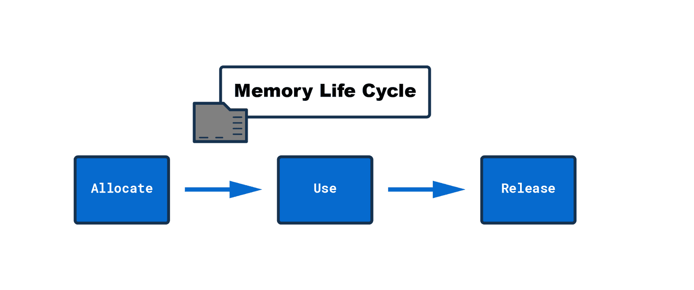

> 思考一下：*JS中的变量或函数，被存储在哪里？*


## the memory heap and stack

JS由两种类型的内存空间组成用来存储变量：**stack（栈）**和**堆（heap）**。

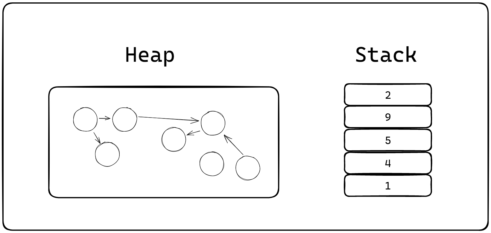

### stack(栈)

​		栈内存是一个有序的插入位置（an ordered insertion place），它使用**LIFO （Last-In-First-Out，后进先出）**原理。

​		栈内存存储的是 **static data（静态数据）**，引擎在编译的时候就能确定静态数据的大小。它包括：原始值（`string`、`number`、`boolean`、`null`、`undefined`）和 **指向对象或函数的引用**。


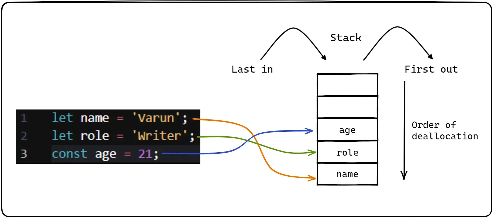


- 原始数据类型是直接存储在栈内存的。为了跟踪当前的内存位置，有一个特殊的处理器寄存器，称为 **Stack Pointer（栈指针）**，用于<u>指向位于堆内存中的对象/函数的指针</u>。

  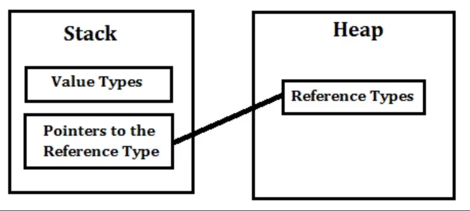

- 所有局部变量（包括参数[arguments]和有返回值的函数），都存储在stack栈内存上的 *函数片段块（function frame block）*。当退出函数时，与该函数相关的所有内容都会从栈中清除。

> 当函数被添加到堆栈中时，最后一个传递到堆栈的函数将首先执行。

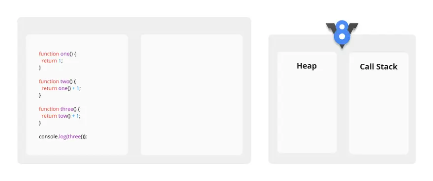

#### Stack overflow（栈溢出）

当栈超过其最大大小（maximum size）时，会发生栈溢出。

如下：当有无限循环或递归函数不返回时，就会发生这种情况。

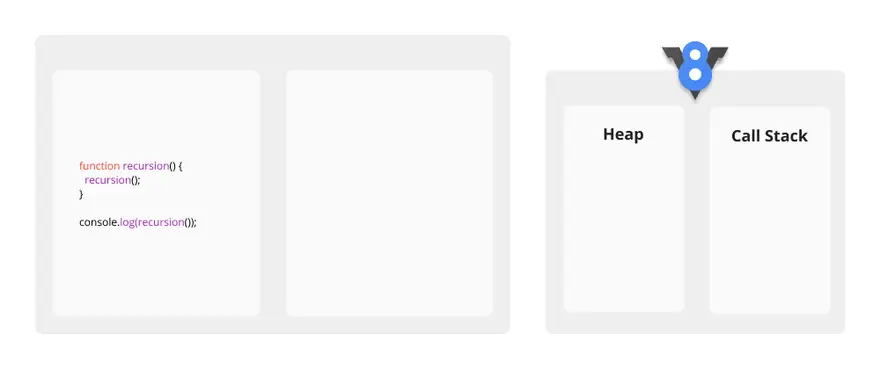

### heap（堆）

> 与栈内存不同的是，堆内存是**无序的**（not ordered），您可以在任何可能的地方分配内存。它主要用于存储对象，并且内存是**动态分配**的（dynamically allocated）。
>
> > **Dynamic memory allocation** refers to memory that’s allocated as needed, i.e, the JS engine doesn’t allocate a fixed amount of memory. This is performed at run time as the size of memory to be allocated is unknown during compile time.（动态内存分配是指根据需要分配的内存，即JS引擎不分配固定数量的内存。这是在运行时执行的，因为在编译时要分配的内存大小未知。）


| Stack（栈）                                                  | Heap（堆）                                      |
| ------------------------------------------------------------ | ----------------------------------------------- |
| ordered（有序）                                              | not ordered（无序）                             |
| Primitive values and references（原始值和指向对象与函数的引用） | Objects and functions（对象和函数）             |
| Size is known at compile time（编译时确定分配大小）          | Size is known at run time（运行时确定分配大小） |
| Allocates a fixed amount of memory（分配固定的内存）         | No limit per object（没有大小限制）             |

原始值是不可变的，这意味着当你尝试改变原始值话，javaScript 实际上会创建一个新值覆盖掉旧值。

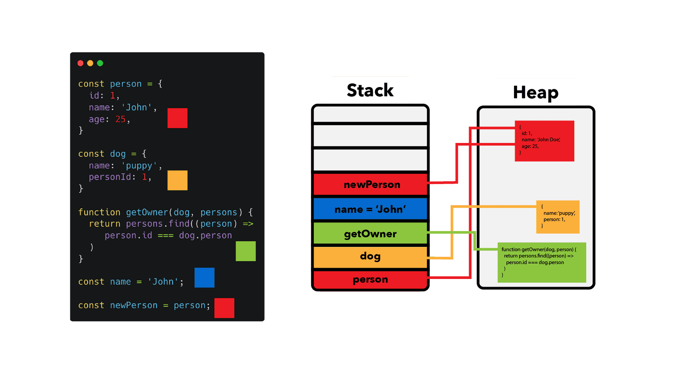

## values and references

> Remember that JavaScript stores **objects and functions** in the heap. 
>
> **Primitive values and references** are stored in the stack.

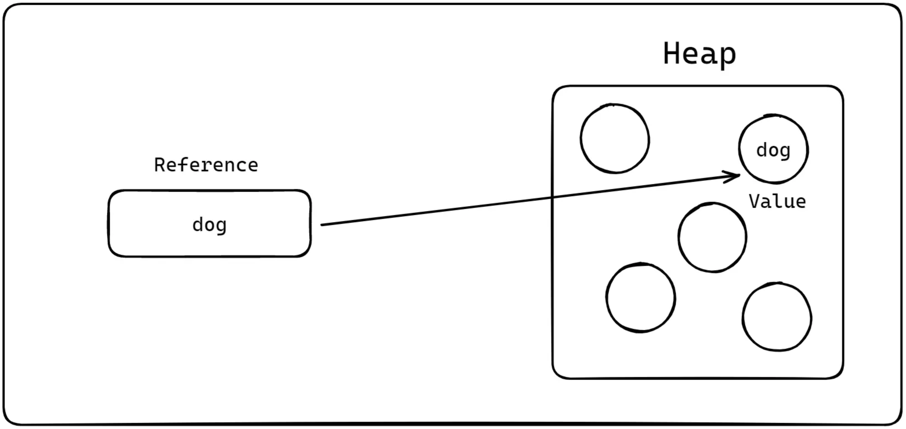

对于对象（object、array、function）的访问，我们需要使用位于 stack（栈内存）中 "对heap（堆内存）位置的引用"

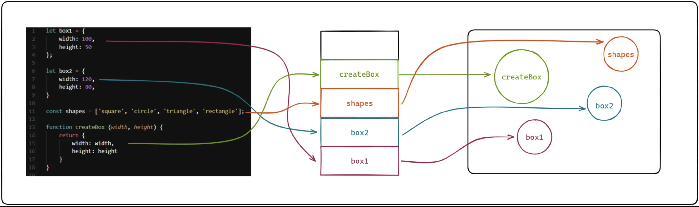

对象总是通过引用访问的（*accessed by reference*）。因此，即使一个对象具有完全相同的属性，它们也不被认为是相等的，因为它们指向堆内存中的不同对象（*pointing to different objects in heap memory*）。

```js
const num = 1;
const num2 =2;
console.log(num === num2); // output: true

let Person = { name: 'leon', age: 18 }
let Person2= { name: 'jack', age: 20 }

console.log(Person === Person2); // output: false

NewPerson = Person; // they point to the same objects in heap memory.
console.log(NewPerson === Person); // output: true.
```


 

## Garbage collection

自动垃圾回收，使我们可以专注于构建应用程序，而不是浪费时间进行内存管理。

> 一旦 JS 引擎识别到了给定的变量或者函数不再被需要了，那么就会释放其占用的内存。


* 引用计数（Reference-counting），是最简单的一种垃圾回收算法，它的核心在于收集那些**没有指向它们引用的对象**。

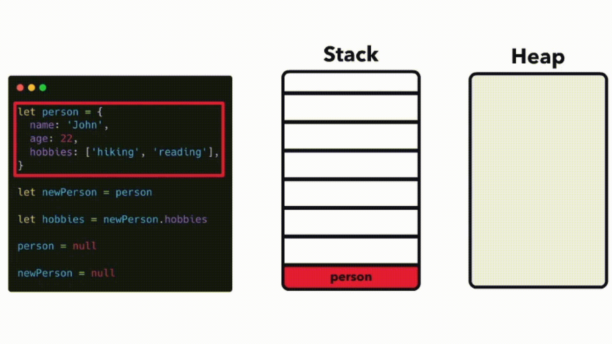


* 当一个对象或者多个对象相互引用对方，但不能再通过代码访问它们时，就会发生问题。

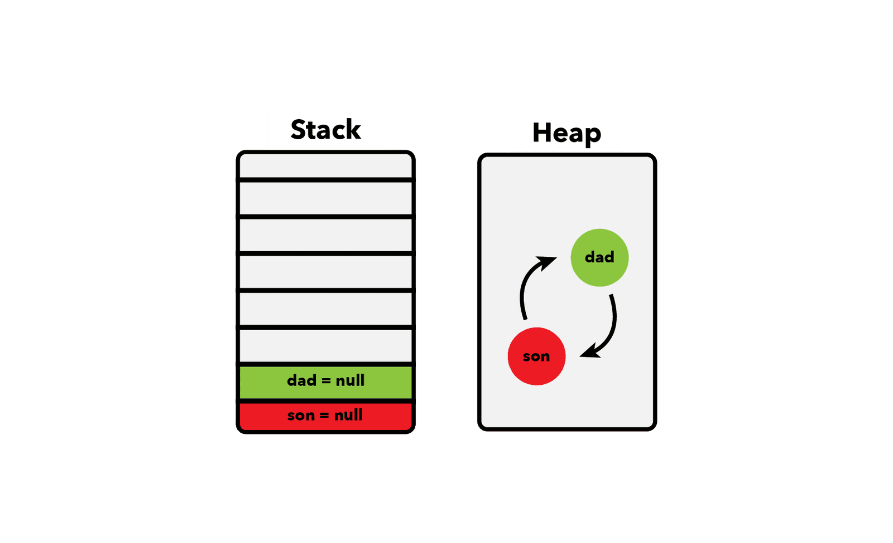


* 标记清除垃圾回收算法（Mark-and-sweep algorithm），它解决循环依赖的问题，它不再是简单的计算给定对象的引用次数，而是检测它们是否可以从根对象（在浏览器中是 `window` 对象，在NodeJS中是 `global`）上访问。

  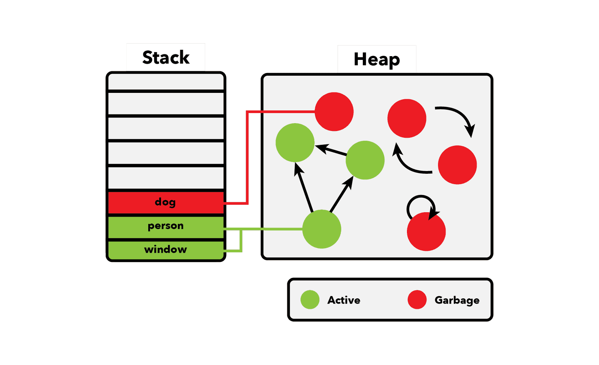

## Memory leaks

来看看最常见的内存泄漏（memory leaks）问题，通过了解幕后发生的事情，就可以轻松避免这些问题。

### global variables

> 将数据存储在全局变量中可能是最常见的内存泄漏类型。

在浏览器中，如果你使用 `var` 替代 `const` 、`let` - 或者完全省略关键字，那么JS引擎会将变量挂载到`window`对象。

```js
user = getUser();            // leave out the keyword
var secondUser = getUser();  // use `var` instead of `const` or `let`

function getUser() {         // defined with the `function` keyword
  return 'user';
}
```

你完全可以使用全局变量，但请确保在不再需要数据时释放空间。

```js
window.user = null;
```


### Forgotten timers and callbacks

忘记清理定时器（timers）和回调函数（callbacks），会导致你的应用程序内存使用量不断增加。尤其在单页应用（**Single Page Applications，SPA**）中，动态添加事件侦听器和回调时必须小心。

```js
// forgotten timers

const object = {};
// the code runs the function every 2s.
const intervalId = setInterval(function() {
  // everything used in here can't be collected
  // until the interval is cleared
  doSomething(object);
}, 2000);


// The objects referenced in the interval won't be garbage collected as long as the interval isn't canceled. 只要不取消interval，就不会对interval中引用的对象进行垃圾收集。

clearInterval(intervalId); // Make sure to clear the interval once it's not needed anymore.
```

在单页面应用程序中，这点非常重要。即便导航到其他页面，这个定时器仍然会在后台不断调用。


```js
// Forgotten callbacks
const element = document.getElementById('button');
const onClick = () => alert('hi');

element.addEventListener('click', onClick);

/* Old browsers weren't able to collect the listener
 * Still, it's a good idea to remove event listeners 
 * once you don't need them anymore
**/
element.removeEventListener('click', onClick);
element.parentNode.removeChild(element);
```

### Out of DOM reference

DOM引用丢失和上一个相似，发生在JS中存储DOM元素时。

```diff
 const elements = [];
 const element = document.getElementById('button');
 elements.push(element);

 function removeAllElements() {
   elements.forEach((item) => {
     document.body.removeChild(document.getElementById(item.id))
+    elements.splice(index, 1);
   });
 }
```

在上面的代码中，调用 `removeAllElements()` 方法从 `body` 节点移除指定的 button 元素。虽然这些 DOM 元素的确从文档中移除了。但是这些 DOM 节点仍然被 `elements` 这个数组所引用。所以 GC 无法对其执行收集操作。


## Shallow copy vs Deep copy

* **shallow copy**：只有第一级的对象被复制。更深层次被引用（referenced），而不是被复制。）
* **Deep copy:** 对象的所有级别都被复制。


A shallow copy can be achieved using the **spread operator (**`…`**)** or using **`Object.assign()`**:

```js
/** Updating a prototype in the first level of the cloned objects
  * the original prototype is not updated
 **/
const obj = { name: 'Version 0', additionalInfo: { version: 0 } };

const shallowCopy1 = { ...obj };
const shallowCopy2 = Object.assign({}, obj);

/** updating a property in a deeper level, 
  * the original property is also updated. 
  * because of deeper levels are referenced, not copied.
 **/

shallowCopy1.name = 'Version 1';
shallowCopy1.additionalInfo.version = 1;

shallowCopy2.name = 'Version 2';
shallowCopy2.additionalInfo.version = 2;

// { name: 'Version 0', additionalInfo: { version: 2 } }
console.log(obj);

// { name: 'Version 1', additionalInfo: { version: 2 } }
console.log(shallowCopy1); 

// { name: 'Version 2', additionalInfo: { version: 2 } }
console.log(shallowCopy2); 
```


A deep copy can be achieved using `JSON.parse()` **+** ` JSON.stringify()`:

```js
const obj = { name: 'Version 0', additionalInfo: { version: 0 } };

const deepCopy = JSON.parse(JSON.stringify(obj));

deepCopy.name = 'Version 1';
deepCopy.additionalInfo.version = 1;

/**
 * the original property is not updated.
 * because of deeper levels are also copied.
**/
console.log(obj); // { name: 'Version 1', additionalInfo: { version: 1 } }
console.log(deepCopy); // { name: 'Version 2', additionalInfo: { version: 2 } }
```


shallow copies are a lot faster than deep copies. 

当对象深度 = 1时，使用浅拷贝；当对象深度>1时，使用深拷贝。


## 疑问

there are two ways to copy: **Shallow** , **Deep** 

为什么const声明变量为原始数据类型，不能改变其值？而声明为对象，可以改变对象的值?

Why vue 建议使用fn返回data?


* [JavaScript's Memory Management Explained](https://felixgerschau.com/javascript-memory-management/)
* [Understanding JavaScript Memory Management: Best Practices and Solutions](https://levelup.gitconnected.com/memory-management-in-javascript-c62c4e48d5ad)
* [Memory Management in JavaScript – Complete guide](https://codedamn.com/news/javascript/memory-management-complete-guide)
* [Memory Life Cycle in JS(Heap, Stack, Call Stack, String Pool)](https://pashazade-nazar.medium.com/memory-life-cycle-heap-stack-call-stack-string-pool-bba2569524cb)


