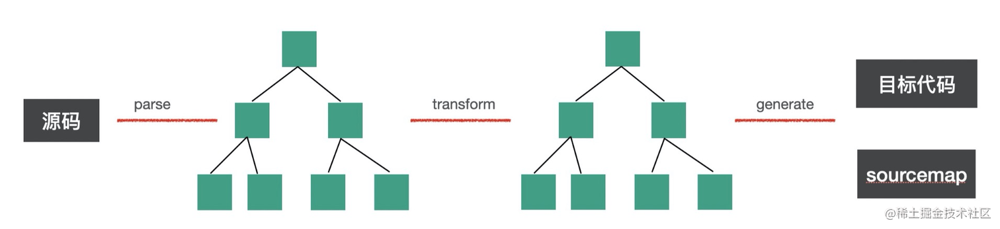

## babel

Babel转译代码：**对源码字符串进行 parse，生成 AST，把对代码的修改转为对 AST 的增删改，转换完 AST 之后再打印成目标代码字符串。**




* **parse阶段**：使用`@babel/parser`，作用是把源码转成 AST

  ```js
  require('@babel/parser').parse(source, {
  	sourceType: 'module',
  	plugins: ['jsx', 'flow', 'classProperties', 'decorator', 'decorators-legacy'],
  });
  ```

* **transform 阶段**：使用 `@babel/traverse`，可以遍历 AST，并调用 visitor 函数修改 AST，修改 AST 涉及到 AST 的判断、创建、修改等，这时候就需要 `@babel/types` 了，当需要批量创建 AST 的时候可以使用 `@babel/template` 来简化 AST 创建逻辑。

* **generate 阶段**：会把 AST 打印为目标代码字符串，同时生成 `sourcemap`，需要 `@babel/generate`包,中途遇到错误想打印代码位置的时候，使用`@babel/code-frame`包。

  ```js
  //设置sourceMaps为true才有sourceMaps
  const { code,map } = generator(ast, { sourceMaps: true });
  ```

  


