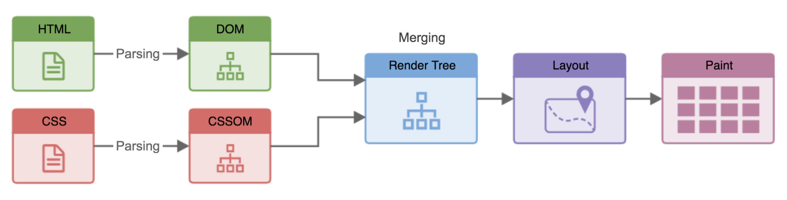

# DOM Performance

## How the browser renders the document

1. Receives the data (bytes) from the server.
2. Parses and converts into tokens (`<`、`TagName`、`Attribute`、`AttributeValue`，`>`)
3. Turns tokens into nodes
4. Turns nodes into the `DOM` tree
5. Build `CSSOM` tree from the `css rules`
6. `CSSOM` and `DOM` trees are combined into a **RenderTree**
   1. Computes which elements are `visible` and their `computed styles`
   2. Starting from the root of the dom tree.
   3. `Not visible` elements like (`meta`, `script`, `link`) and `display: none` are ommited from the render tree.
   4. For each `visible` node, find the appropriate matching `CSSOM` rules and apply them.
7. **Reflow**: `compute` the layout of each `visible` element (position and size).
8. **Repaint**: `renders` the `pixels` to screen.

分析并转换成tokens标记，再将tokens转换为nodes节点，最后再将nodes节点转换成DOM树

css也是如此流程，最终生成一个CSSOM

RenderTree = DOM + CSSOM

renderTree：计算哪些元素可见，及可见元素的样式

不可见元素，如：meta，script，link标签和`display: none;`

Reflow：计算每个可见元素的布局（即：位置和大小）    过程就像canvas画画一样，先确定画布大小，再确定图形位置和尺寸，最后再上色。

Repaint:将像素渲染到屏幕 （浏览器有默认样式，user agent stylesheet用户代理样式表，这里的用户代理就是浏览器啦，最常见的就是h1~h6，字体大小会从大到小）

* animation是单独的GUP，不会导致reflow和repaint
* Z-index

## Reflow

Layout, LayoutFlush, LayoutThrashing

- Occurs when the changes affect the layout.
- Triggers examples: `width`, `position`, `float`.
- Recalculate of positions and dimensions.
- Has a bigger impact, changing a single element can affect all children, ancestors, and siblings or the whole document.
- Triggers (chagne dom or css, scrolling, user actions like `focus`).
- `Reflow` only has a `cost` if the document has changed and `invalidated` the `layout`.
- `Something Invalidates` + `Something Triggers` = `Costly Reflow`.

影响**`layout，布局`**时会触发回流（reflow直译为回流，意译为重排）

某物失效+某物触发

当样式属性发生改变时，如：`width`、`position`、`float` ，会重新计算元素的位置和尺寸；还有如滚动scrolling和用户的行为如表单聚焦和失焦`focus`

## repaint

- Occurs when changes affect the visibility.
- Triggers examples: `opacity`, `color`, `background-color`, `visibility`.

当更改影响**可见性**时发生，如：不透明度、颜色、背景色、可见性。

## 应用

Opcity

display

visible

Anlimaction

* [Understanding Reflow and Repaint in the browser](https://dev.to/gopal1996/understanding-reflow-and-repaint-in-the-browser-1jbg)