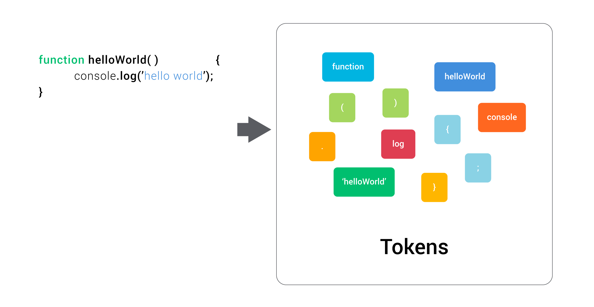
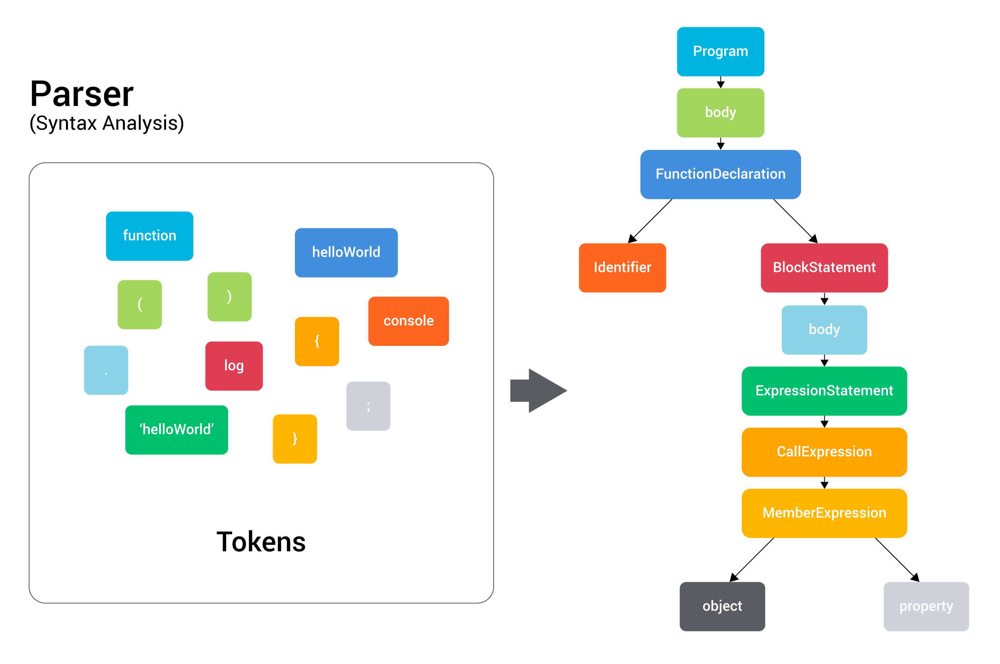
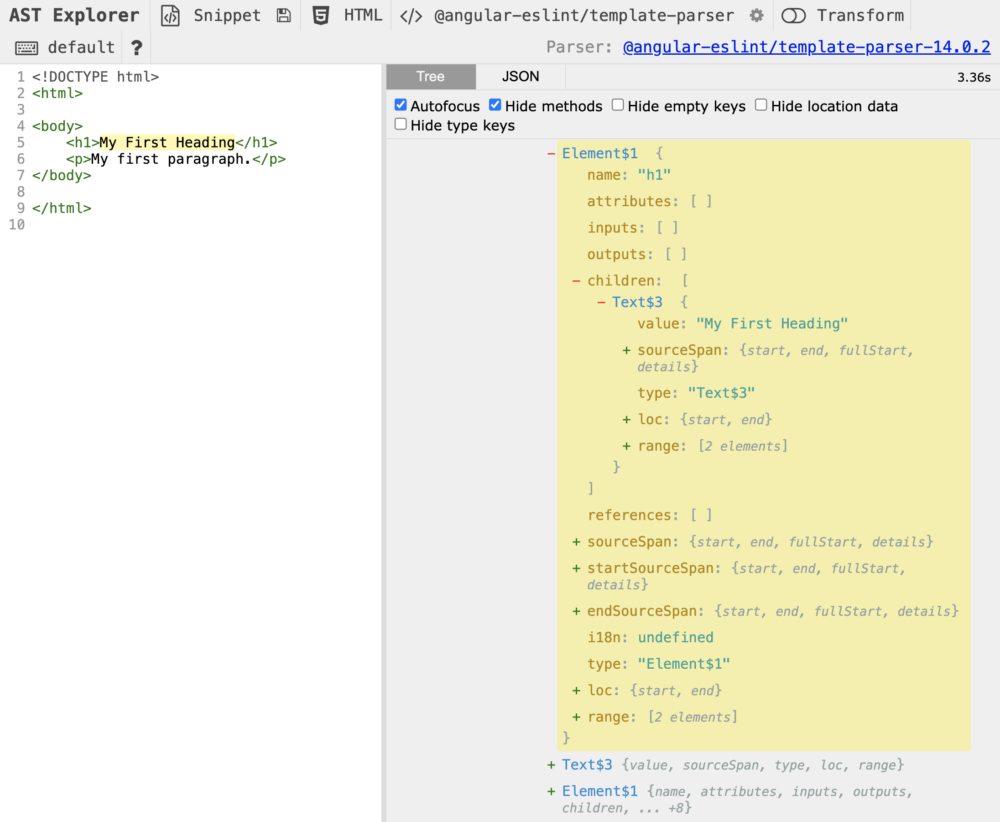
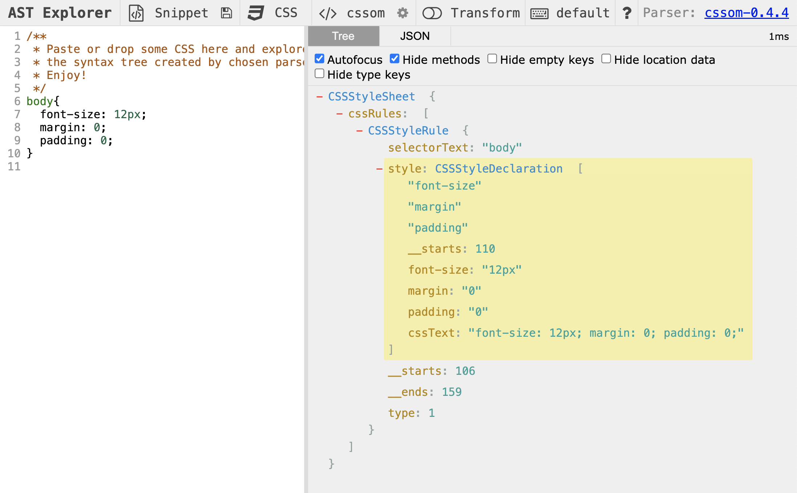
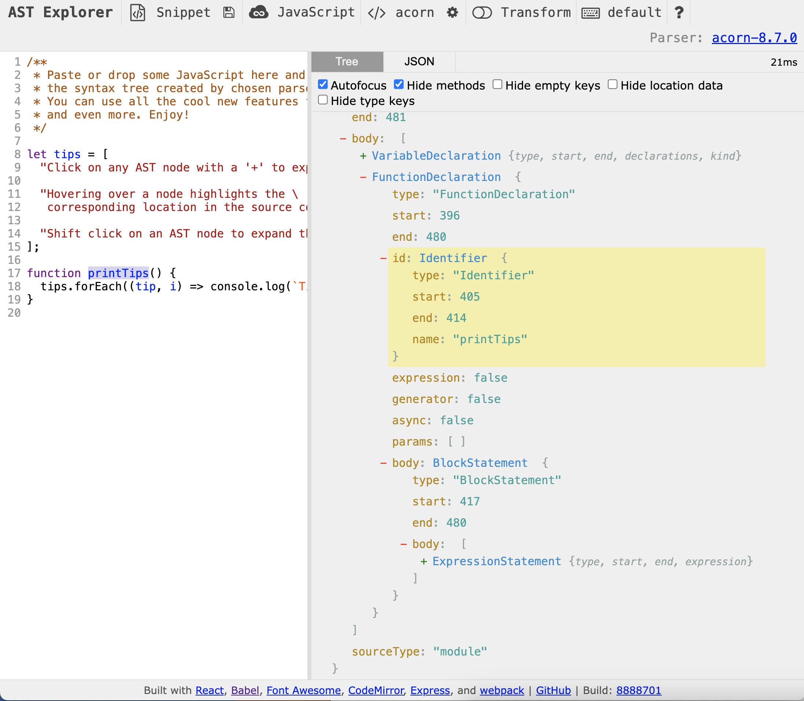

# Abstract Syntax Tree

一个完整的编译器，执行过程分为3个步骤：

* **Parsing（编译）**，它要经过以下一系列操作：

  - **Lexical analysis（词法分析 ）**，也叫 **tokenization（标记化）**。识别源代码中的tokens

  - **Syntactic Analysis（语法分析）**：分析tokens之间的关系。

  - 构建**AST(Abstract Syntax Tree，结构化语法树)**：是源代码**语法结构**的一种抽象表示。

* **Transformation（转化过程**）：将上面的AST按照指定规则处理输出新的AST。
* **Code Generation（代码生成**）

本篇文章，我们只关注解析过程。它分为2个步骤：词法分析、语法分析。

## Lexical Analysis

**Lexical analysis（词法分析 ）**，也叫 **tokenization（标记化）**。

将**source code（源码）**使用`tokenizer(分词器)`或者`lexer(词法分析器)`，拆分成 **tokens**（更小的**块（chunks）**）。

 

## Syntactic Analysis

为了进行 **syntax analysis（语法分析）**，即：整理tokens之间的语法关联关系，parser(解析器)将它们解析为 **AST( Abstract Syntax Tree ,结构化语法树)**。

## AST

### AST应用场景

- JS编译执行原理
- 编辑器的错误提示、代码格式化、代码高亮、代码自动补全；
- `elint`、`pretiier` 对代码错误或风格的检查；
- `webpack` 通过 `babel` 转译 `javascript` 语法；

### AST Exporer

Want to explore more on ASTs? 

The [AST Explorer](https://astexplorer.net/) helps in visualizing ASTs in several popular languages such as Go, Python, Java, and JavaScript.

* HTML AST

* CSS AST

* AST-JS

