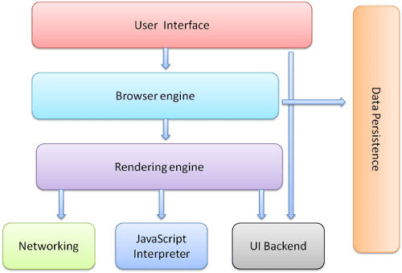

# Browser

浏览器的主要组件包括：

* **User Interface（用户界面）**：它是用户与浏览器交互的空间。包括：`address bar`, `home button`, `back/forward button`，`bookmarking menu`等。

* **Browser Engine（浏览器引擎）**：它充当**用户界面（user interface）**和**渲染引擎(rendering engine)**之间的桥梁，并与数据存储组件通信。

* **Rendering Engine（渲染引擎）**：顾名思义，它负责显示请求的内容。

  * **Networking（网络）**：负责处理网络任务，如HTTP请求。
  * **JavaScript Interpreter（JS解释器）**：用于**parse(解析)**和**execute(执行)** JavaScript代码。
  * **UI Backend**：用于绘制基本的小部件，如组合框和窗口。

* **Data Storage/Persistence（数据存储/持久化）**

  这是一个持久性层。浏览器可能需要在本地保存各种数据，例如 `Cookie`、 、`localStorage`、`IndexedDB`、`WebSQL` 和 `FileSystem `等存储机制。

* [浏览器的工作原理](https://github.com/muwoo/blogs/issues/34)

* [Constructing the Object Model](https://web.dev/articles/critical-rendering-path/constructing-the-object-model)

* [浏览器渲染机制](https://febook.hzfe.org/awesome-interview/book2/browser-render-mechanism)
* [图解浏览器渲染原理及流程](https://zhuanlan.zhihu.com/p/561696825)
* [从零开始实现一个玩具版浏览器渲染引擎](https://www.freecodecamp.org/chinese/news/browser-rendering-engine/)
* [How browsers work](https://dev.to/gitpaulo/journey-of-a-web-page-how-browsers-work-10co)

