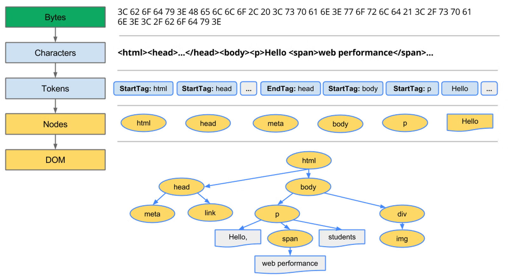

# HTML Parse

* **Raw Bytes**：通过网络请求或磁盘读取HTML文件原始字节（raw byte），根据指定的文件编码（如 UTF-8）将字节转换成字符(**Characters**)。
* Tokenizing（分词）:进行词法分析，将字符串转换为不同的标记（如 `<html>`, `<body>`）。
* Lexing（语法分析）：将词法分析得到的 tokens令牌流，根据规则和语法关系转换为对象，这些对象包含了 HTML 语法的各种信息，如属性、属性值、文本等。
* DOM construction（DOM 构造），最终生成文档对象模型。

