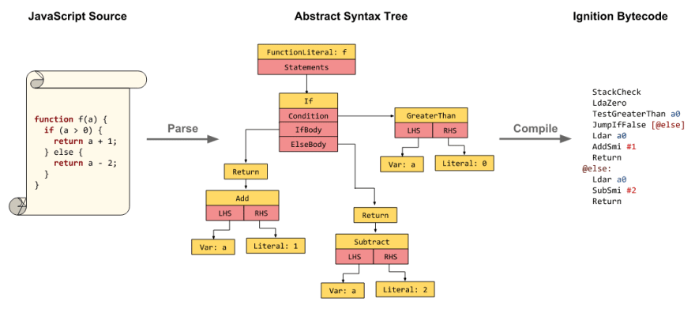
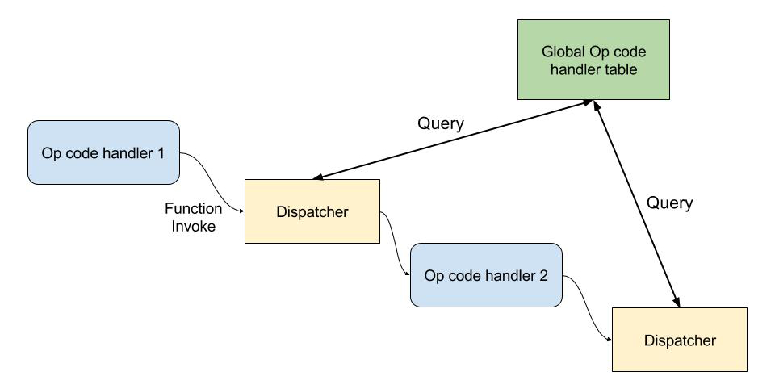
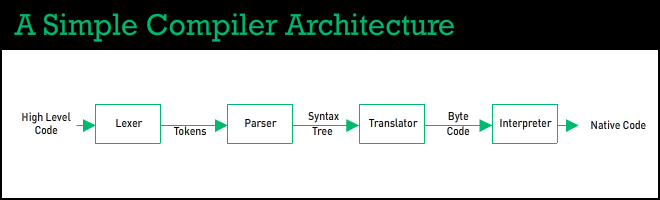
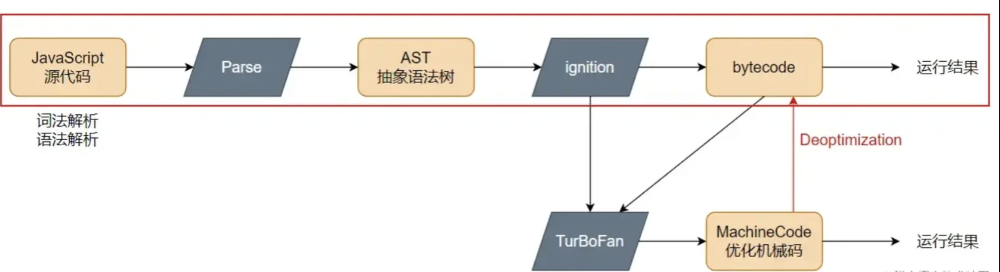

## JavaScript Interpreter

浏览器内核分为两部分：渲染引擎和 JS 引擎。

JavaScript 引擎是一个专门处理 JavaScript 脚本的虚拟机。

著名引擎:

- Rhino，由 Mozilla 基金会管理，开放源代码，完全以 Java 编写。
- SpiderMonkey，第一款 JavaScript 引擎，早期用于 Netscape Navigator，现时用于 Mozilla Firefox。
- V8，开放源代码，由 Google 丹麦开发，是 Google Chrome 的一部分。
- JavaScriptCore，开放源代码，用于 Safari。
- Chakra (JScript 引擎)，用于 Internet Explorer。
- Chakra (JavaScript 引擎)，用于 Microsoft Edge。

**浏览器如果渲染过程中遇到JS文件怎么处理？**

渲染过程中，如果遇到`<script>`就停止渲染，执行 JS 代码。

因为浏览器有**GUI渲染线程**与**JS引擎线程**，为了防止渲染出现不可预期的结果，这**两个线程是互斥的关系**。JavaScript的加载、解析与执行会`阻塞DOM的构建`，也就是说，在构建DOM时，HTML解析器若遇到了JavaScript，那么它会暂停构建DOM，将控制权移交给JavaScript引擎，等JavaScript引擎运行完毕，浏览器再从中断的地方恢复DOM构建。

也就是说，如果你想首屏渲染的越快，就越不应该在首屏就加载 JS 文件，这也是都建议将 script 标签放在 body 标签底部的原因。当然在当下，并不是说 script 标签必须放在底部，因为你可以给 script 标签添加 `defer(延迟)` 或者 `async(异步)` 属性（下文会介绍这两者的区别）。

**JS文件不只是阻塞DOM的构建，它会导致CSSOM也阻塞DOM的构建。**

原本DOM和CSSOM的构建是互不影响，井水不犯河水，但是一旦引入了JavaScript，CSSOM也开始阻塞DOM的构建，只有CSSOM构建完毕后，DOM再恢复DOM构建。

### Parser

过程：记法分析得到token，通过Parser（解析器）进行语法分析得到**AST**.

### interpreter

解释器（interpreter），将AST提供给解释器转成**字符码**(bytecode).

[Ignition - The Interpreter in V8 Javascript Engine](http://mshockwave.blogspot.com/2016/03/ignition-interpreter-in-v8-javascript.html)

### Compiler

这一步是对上面的机器码进行optimization（优化）。

当**interpreter**（解释器）将**AST**翻译成**bytecode**（字节码）时，它会跟踪所有特性。

比如，在js中你频繁使用的函数，这样的代码被称为 **hot code**（热代码），JS引擎会将这样类似场景的代码进一步转换为高度优化的机器代码。

最后，由JS引擎的**compiler**（编译器）运行，以发送要直接在CUP上运行的**machine code**（机器代码）。

## V8

Parse（解析器）模块会将JavaScript代码转换成AST（抽象语法树），这是因为解释器并不直接认识JavaScript代码 如果函数没有被调用，那么是不会被转换成AST的。PreParse（预解析），并不是一开始所有代码都需要执行，所以V8引擎就实现了Lazy Parsing（延迟解析）的方案，它的作用是将不必要的函数进行预解析，也就是只解析暂 时需要的内容，而对函数的全量解析是在函数被调用时才会进行；

Ignition是一个interpreter（解释器），会将AST转换成ByteCode（字节码） 同时会收集TurboFan优化所需要的信息（比如函数参数的类型信息，有了类型才能进行真实的运算）； 如果函数只调用一次，Ignition会执行解释执行ByteCode；

TurboFan是一个compiler（编译器），可以将字节码编译为CPU可以直接执行的机器码 如果一个函数被多次调用，那么就会被标记为热点函数，那么就会经过TurboFan转换成优化的机器码，提高代码的执行性能； 但是，机器码实际上也会被还原为ByteCode，这是因为如果后续执行函数的过程中，类型发生了变化（比如sum函数原来执行的是 number类型，后来执行变成了string类型），之前优化的机器码并不能正确的处理运算，就会逆向的转换成字节码。

### preload scanner

预加载扫描器

[JavaScript and the Inner Workings of your Browser](https://softwareengineeringdaily.com/2018/10/03/javascript-and-the-inner-workings-of-your-browser/)