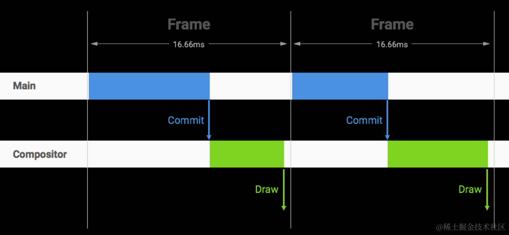
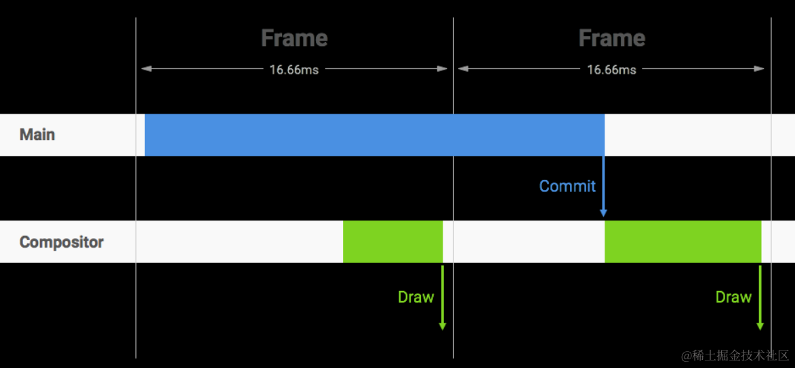
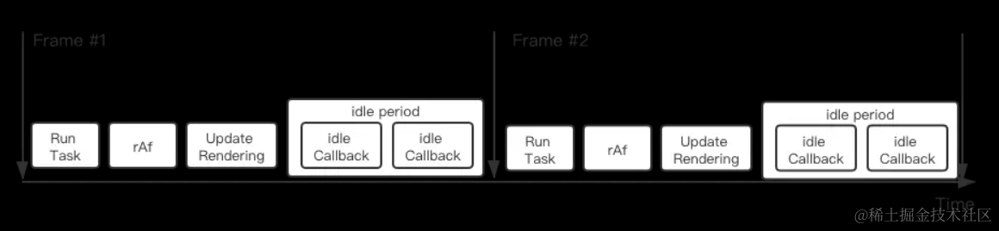
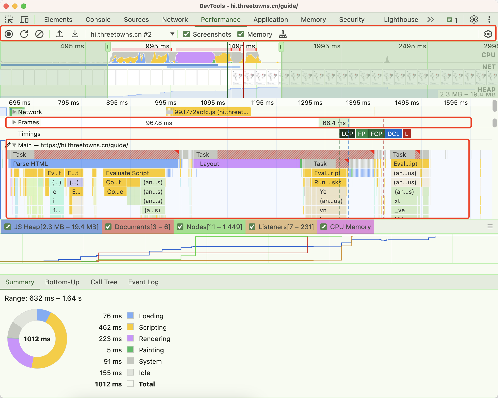

## Performance

性能优化是个老生常谈的话题，在实际开发中根本没有时间和精力去分析性能和优化性能。但，它在面试中却被当做一项重要的技术水平考核标准。

所以，不管你是为了丰富自己的羽翼也好，亦或是为了应付面试也罢，你不得不需要花一点点时间去了解它，最终让自己变得有一定的实战（分析和解决问题的能力）经验。

接下来，我们会从几个大家耳熟能详的概念开始，循序渐进的对性能Performance抽丝剥茧，并最终达到能对性能进行分析和优化的目的。

> 敬告：当到不认识的英语单词，就去查并记住它，也就是个顺手的事。要不然，你还是没逃脱低维度的努力。

### FPS

FPS，当我第一次看到它的时候，觉得好高端的名词，而我就是连查都不查一样是什么意思，一览而过。第二次再看到也是如此，不闻不问。第三次...第n次，我还是不知道它是什么意思。

总觉得自己很忙，忙得边花几秒钟的时间去了解一下都没空...也许，这就是牛马的生活状态，让你忙得没时间思考...

而这一次，我决定停下来，对任何自己想了解和遇到的点，进行学习，进而组建自己的知识体系。

> 废话这么多，是想告诉自己，你在低维度的自我感动的勤奋，最终没能上你过得更好。
>
> 你得提升认识和努力的维度，这样才会让你的未来有更多的可能。

**FPS**（**F**rames **P**er **S**econd，每秒帧数）。

我们日常接触的电子设备，如手机、电脑，它们默认的屏幕刷新率是 **60FPS**（即：1s内刷新60次，每一次我们称之为一帧）才不会感觉到卡顿。那么，1s = 1000ms，1000ms/60 = 16.7ms，即：16.7ms刷新一次。

回到我们的主题，那么可以得出一个结论：浏览器最佳渲染性能是，所有操作在一帧 **16.7ms** 内完成，这样就不人影响用户交互。

换言之就是：**FPS指浏览器每秒的帧数，FPS越大，则浏览器显示就越流畅**。

#### 标准渲染帧

在一个标准帧渲染时间 16.7ms之内，浏览器需要完成 Main 线程的操作，并 commit 给 Compositor 进程

#### 丢帧

主线程里操作太多，耗时长，commit 的时间被推迟，浏览器来不及将页面 draw 到屏幕，这就丢失了一帧。

#### 空间时间

在浏览器的一个渲染帧（16.7ms）里，会存在一段时间，叫做空闲时间（`idle period`），如果完成各种任务的执行以及页面渲染的工作等的时间少于 16.7 ms，那么这一帧就会存在空闲时间，可以把一些耗时操作拆分开来，然后在每一帧的空闲时间中去执行。

### 卡顿

所谓的页面卡顿、首屏加载慢，根本原因都是：**执行长任务，使得页面的渲染时机推后，在每一帧里得不到渲染**，从而造成用户的不好体验。

要想解决用户体验差的问题，那么就需要知道浏览器渲染过程中的每一帧都干了些啥任务，是啥原因导致渲染时机推后，这个时候我们就需要借助浏览器性能检测工具 **Performance** 来进行分析，然后再做针对性的优化，下面我们来了解下该工具的具体使用。

### performance demo

谷歌官方提供了一个demo，见 [evaluate-performance](https://googlechrome.github.io/devtools-samples/jank/) 。更多关于 google chrome tooldev，见[chrome-devtools](https://developers.google.com/web/tools/chrome-devtools/evaluate-performance/)

**google chrome**开发者工具中找到 `Performance` ，如下：

* Summary（总览区）：看到每个阶段具体耗时。
* Frames（帧）： 绿色代表该帧正常，黄色表示丢帧。
* Main（主线程）
  * Task（任务）：标红，代表任务为长任务（超过50ms）
  * Layout（布局）：当它为紫色时，表示reflow回流

具体分析见：[使用Performance工具分析性能瓶颈](https://juejin.cn/post/7321922279558266916)

