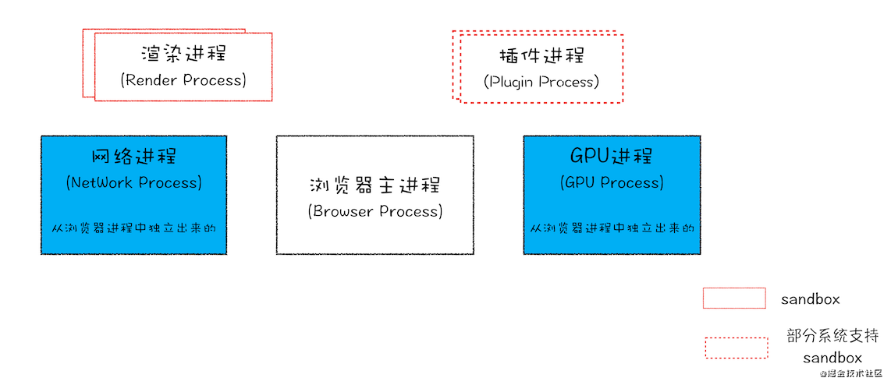

# 浏览器

> * 进程（Proscess）：正在运行的程序的实例，是一个具有一定独立功能的程序关于某个数据集合的一次运行活动。是系统进行**资源分配和调度的基本单位，是操作系统结构的基础**。
>
>   由程序、数据和进程控制块三部分组成。
>
> * 线程（Thread）：是操作系统能够进行运算**调度的最小单位**。它被包含在进程之中，是进程中的实际运作单位。
>
> * 队列

## 浏览器多进程

> 多线程就是指一个进程中同时有多个线程正在执行

通用浏览器架构，它可以是一个单进程多线程架构，也可以是具有几个通过IPC进行通信的多个线程的进程，即：多进程架构。（chrome采用多进程架构）

* 优点：
  * 稳定性：一个页面崩溃，不会影响到其他页面，因为使用了不同渲染进程。
  * 安全性和沙箱处理：浏览器可以从某些功能中沙漏某些进程。
* 缺点：
  * 更高的资源占用。
  * 更复杂的体系架构。

### 浏览器进程

* 浏览器主进程（Browser Process）

  主要负责界面显示、用户交互、子进程管理，同时提供存储等功能。

* 渲染进程（Render Process）

  ​		它的核心任务是，将HTML、CSS 和 JavaScript 转换为用户可以与之交互的网页。**排版引擎 Blink** 和 **JavaScript 引擎 V8** 都是运行在该进程中。

  ​		Google Chrome会为每个tab标签创建一个渲染进程，但如果从一个页面打开另一个新页面，而新页面和当前页面属于同一个站点的话，那么新页面会复用父页面的渲染进程。

* GPU进程

  ​		GPU的使用初衷是，为了实现 3D CSS的效果。后来 网页、Chrome的UI界面，都选择采用GPU来绘制，这使用得GPU成为浏览器普遍的需求。

* 网络进程

  主要负责网络资源加载

* 插件进程

  ​		主要是负责插件的运行。因插件易崩溃，所以需要通过插件进程来隔离以保证插件进程崩溃不会对浏览器和页面造成影响。

