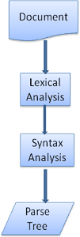
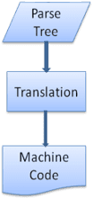
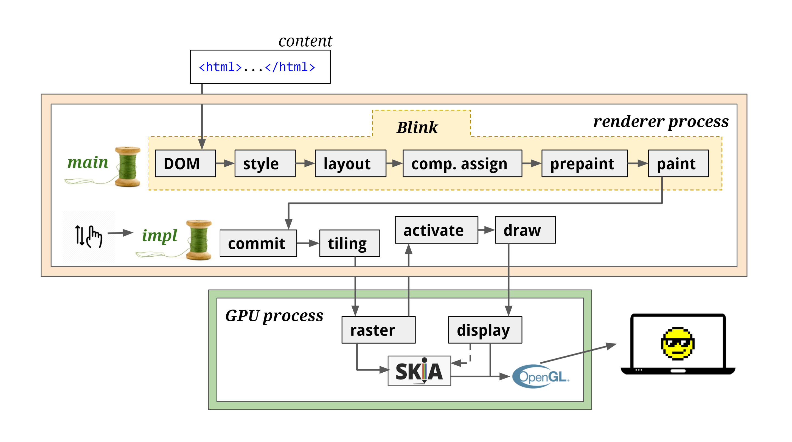

## Rendering Engine

渲染引擎，在浏览器屏幕上显示请求的内容。

默认情况下，渲染引擎可以显示HTML和XML文档以及图像。它可以通过插件或扩展显示其他类型的数据，例如显示PDF文档。

不同的浏览器使用不同的渲染引擎：Internet Explorer使用Trident，Firefox使用Gecko，Safari使用WebKit，Opera和Chrome使用**Blink**，这是WebKit的一个分支。


### Basic flow

渲染引擎的基本流程：


### Parsing

**Parsing（解析）**，将源代码解析成**Parse Tree（解析树）**，可以分为两个过程：`lexical analysis（词法分析）`和`syntax analysis（语法分析）`。




#### Lexical analysis

`Lexical analysis`（词法分析 ），也叫 **tokenization（标记化）**，将源码使用`tokenizer(分词器)`或者`lexer(词法分析器)`，拆分成更小的块（chunks）, 即：**tokens**。最终，会生成一个令牌流（`stream of tokens`）。

我们可以把这个过程想像成 **`汉译英`** 的过程，词分析相当于把句子拆分成单词，如：

> **源码**：我爱我的祖国 。
>
> **语法分析**（拆成最小chunks）：我、爱、我的、祖国


#### syntax analysis

 `syntax analysis`（语法分析），将词法分析得到的令牌流（tokens stream）结合语法规则，使用Paser（解析器）构建表示**元素之间层次关系**的 `parseTree`（解析树），也叫 **AST( Abstract Syntax Tree ,结构化语法树)**。

> **token stream**：我（主语，`I`）、爱（谓语,`love`）、我的（间接宾语,`my`）、祖国（直接宾语,`country`）
>
> **语法规则**：主语 + 谓语 + 宾语（间接宾语 + 直接宾语）
>
> AST：我（主语，`I`）+ 爱（谓语,`love`）+ 我的（间接宾语,`my`）+ 祖国（直接宾语,`country`）


### Types of parsers

`Types of parsers`（解析器的类型），有3种：

* Top-Down（自上而下）：从最高级别生成规则开始，通过递归地遍历语法，以匹配输入标记。
* Bottom-Up（自下而上）：从下向上，包含LR
* LR（Left-to-right，Rightmost derivation，从左向右；最右推导）

#### Top-Dow parse

下面来看一下自上而下的解析器，是如何扫描输入内容并直到匹配输入内容的结尾。

| Stack                | Input     |
| :------------------- | :-------- |
|                      | 2 + 3 - 1 |
| term                 | + 3 - 1   |
| term operation       | 3 - 1     |
| expression           | - 1       |
| expression operation | 1         |
| expression           | -         |

这种自上而下解析器，又称为 `shift-reduce parser`（移位归约解析器）。因为输入会向右移（假设指针首先指向输入的开头，然后向右移动），并逐渐归纳为语法规则。


#### Generating parsers automatically

有一些工具可以`Generating parsers automatically`（自动生成解析器）。只要向这些工具提供所用语言的语法（`vocabulary and syntax rules`，词汇和语法规则），它们就会生成可正常使用的解析器。 

WebKit 使用了两种广为人知的`parser generators`(解析器生成器)。

*  [Flex](http://en.wikipedia.org/wiki/Flex_lexical_analyser) ：创建`lexer`（词法分析器）
*  [Bison](http://www.gnu.org/software/bison/)：用于创建`parser`（解析器）


### Translation

`ParseTree`（解析树），不是渲染引擎最终产物。还需要将解析树转换为`machine code`（机器代码）。这个过程是在Parsing生成的AST（也叫解析树）的基础上按照规则输出新的AST。



```diff
  // Parse：AST / ParseTree
- I like paly the piano.
  // Translation
+ I like playing the piano.
```


### Code Generation




## HTML Parsing

* Tokenization Algorithm（标记化算法），是HTML解析的重要组成部分。用于将HTML分离成不同的部分，如：开始标签、结束标签、属性和文本内容。


### CSS Parsing

CSS解析负责解释（interpreting）CSS规则并将它应用于HTML文档。

CSS解析后最终会构建一个CSS object model (CSSOM)CSS对象模型。


### 处理script和style sheets顺序

scipt和style通常嵌入HTML文档中或作为外部文件引入。

渲染引擎通常以**顺序**的方式执行脚本和解析样式。此顺序确保在渲染引擎将样式应用于HTML之前执行脚本，从而允许脚本修改DOM结构或根据用户交互动态修改样式。


## Render Tree 

Render Tree 渲染树是基于DOM和CSSOM构建的。它是在五个渐进（gradual process）的过程中执行的。这种增量（incremental）构造有助于更有效地处理动态更改，而无需从头开始。


* [How browsers work](https://web.dev/articles/howbrowserswork)
* [How browsers work | The Rendering Engine](https://scientyficworld.org/how-browsers-work-the-rendering-engine/)
* [What does HTML parsing mean?](https://scientyficworld.org/author/snehasishkonger01/)

* [CSS parsing Explained](https://scientyficworld.org/author/snehasishkonger01/)

