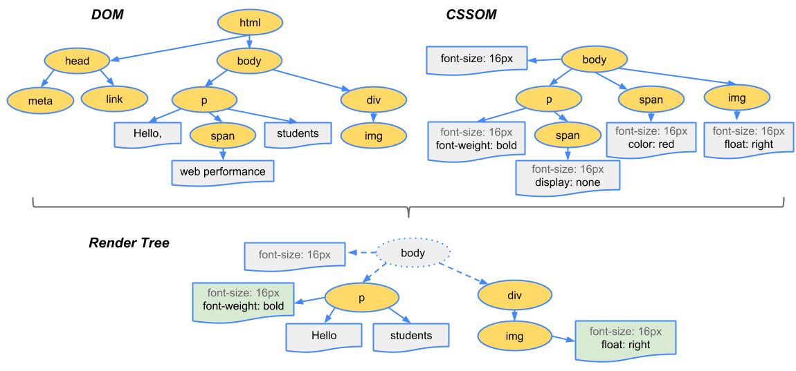
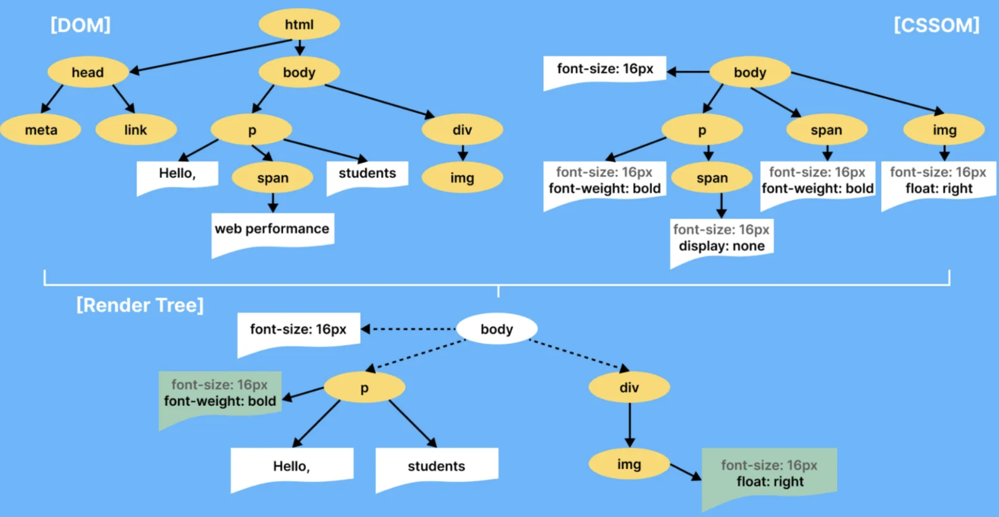

## Render Tree

**css3硬件加速（GPU加速）**

比起考虑如何减少回流重绘，我们更期望的是，根本不要回流重绘。这个时候，css3硬件加速就闪亮登场啦！！

划重点：使用css3硬件加速，可以让transform、opacity、filters这些动画不会引起回流重绘 。但是对于动画的其它属性，比如background-color这些，还是会引起回流重绘的，不过它还是可以提升这些动画的性能。

**如何使用css3硬件加速（GPU加速）**

常见的触发硬件加速的css3属性：

- transform
- opacity
- filters
- Will-change

**css3硬件加速的坑**

- 如果你为太多元素使用css3硬件加速，会导致内存占用较大，会有性能问题。
- 在GPU渲染字体会导致抗锯齿无效。这是因为GPU和CPU的算法不同。因此如果你不在动画结束的时候关闭硬件加速，会产生字体模糊。

## 

[Inside look at modern web browser (part 3)](https://developer.chrome.com/blog/inside-browser-part3)

[Render-tree Construction, Layout, and Paint](https://web.dev/articles/critical-rendering-path/render-tree-construction)

[浏览器渲染原理流程](https://347830076.github.io/myBlog/javascript/浏览器渲染原理流程.html)