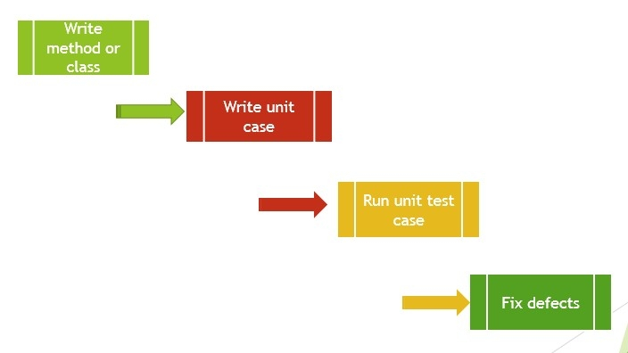
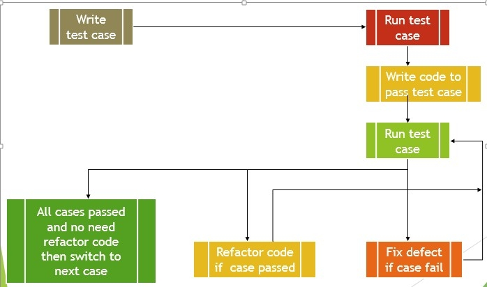

## 传统开发流程

**项目代码开发 -> 编写测试用例 –> 运行测试用例 -> 修复代码BUG**

## BDD

Behaviour Driven Development，行为驱动开发。

为了解决测试驱动开发中常遇到的问题，如：从哪里开始测试，应该测试什么，不应该测试什么等等

BDD框架通过webdriver调用浏览器的接口，模拟用户输入，读取浏览器页面上的内容用于验证。

BDD实践所面临的问题

进行BDD实践，首先要解决如下几个问题：

1. 如何实现一个能够描述系统行为（业务价值）、非技术人员可读的测试？
2. 如何让这个测试变得可执行？

## TDD

测试驱动开发，英文全称Test-Driven Development，简称TDD。

**编写测试用例 -> 运行测试用例 –> 编写项目代码 -> 运行测试用例 -> 重构代码**

TDD的原理是，在开发功能代码之前，先编写单元测试用例代码，测试代码确定需要编写什么产品代码。

TDD的基本思路就是，**通过测试来推动整个开发的进行**，但测试驱动开发并不只是单纯的测试工作，而是把**需求分析，设计，质量控制量化**的过程。

TDD首先考虑使用需求（对象、功能、过程、接口等），主要是编写测试用例框架对功能的过程和接口进行设计，而测试框架可以持续进行验证。

