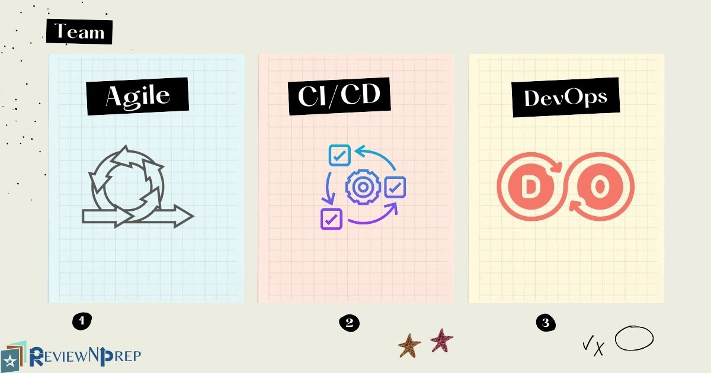
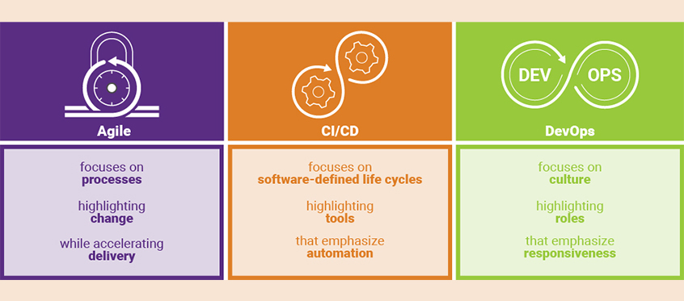
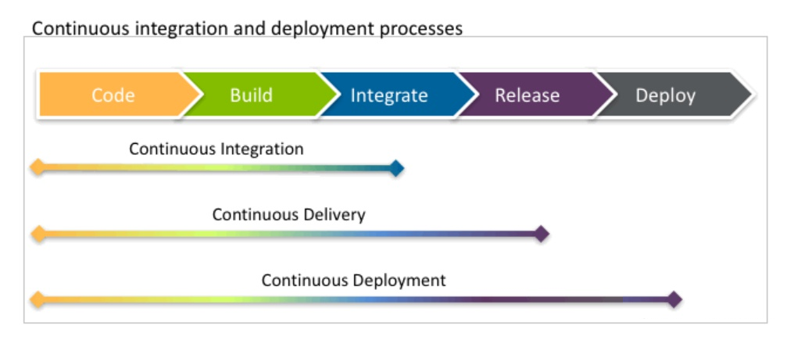
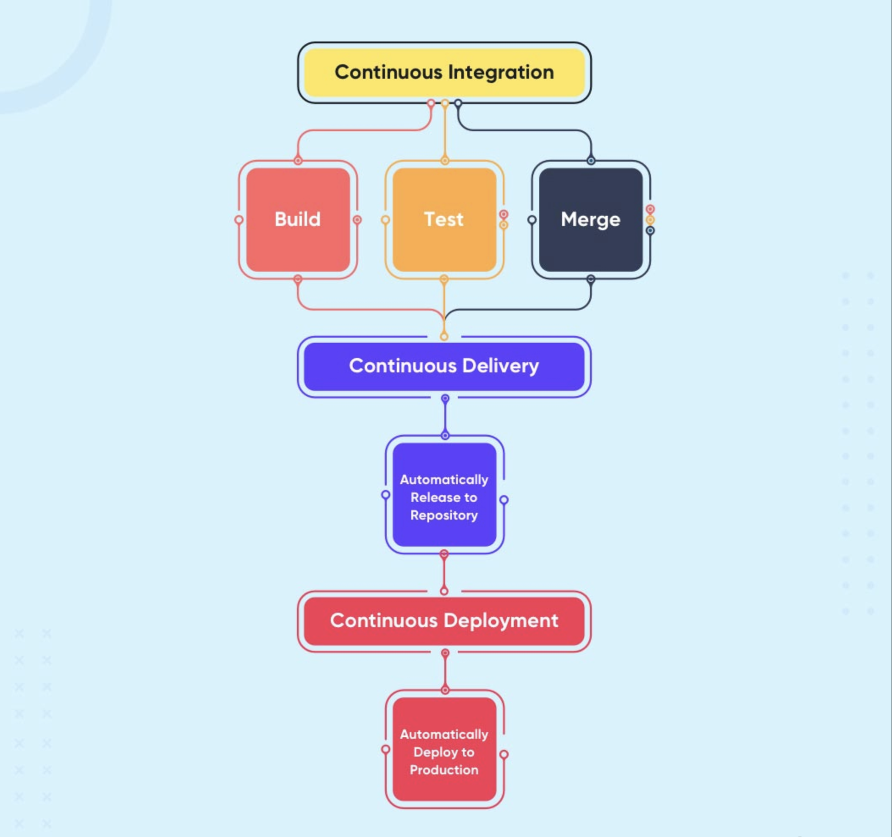
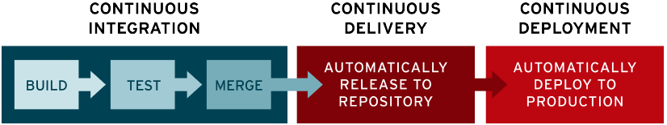
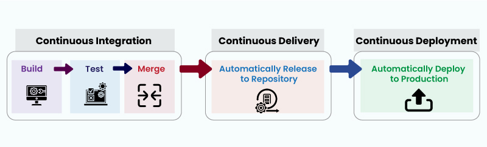
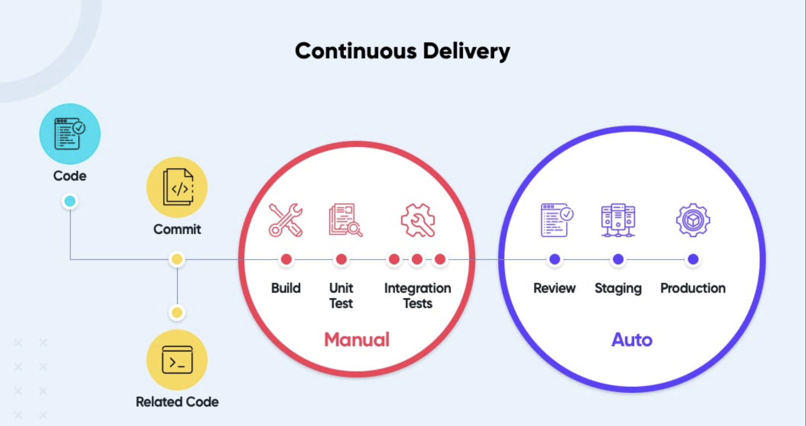
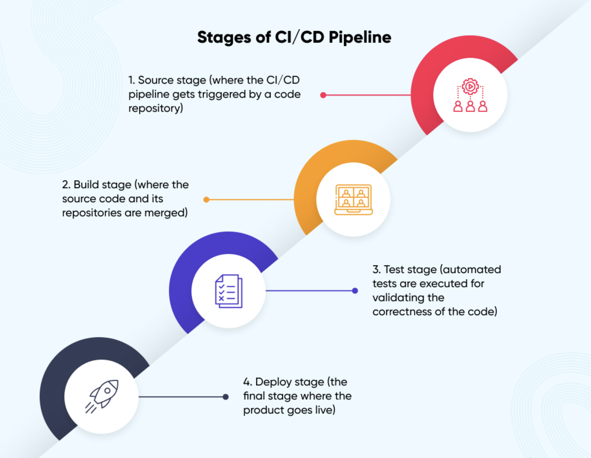
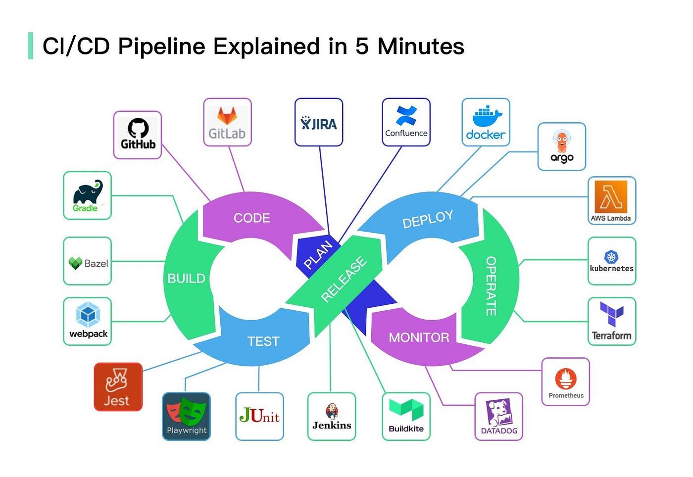

## Dev/Ops and CI/CD

### Aglie

敏捷开发：关注流程、突显变化、加快交付

### CI/CD

关注软件定义的生命周期、突显工具、加快自动化

### DevOps

关注文化、突显角色、强调响应能力

DevOps（Development and Operations），是一种重视“软件开发人员（Dev）”和“IT运维技术人员（Ops）”之间沟通合作的文化、运动或惯例。

CI/CD，指持续集成交付部署，是一套流程实现软件的构建测试部署的自动化。

* CI（Continuous Integration，持续集成）
* CD(Continuous Delivery and Continuous Deployment)，它包含两个**持续交付**和**持续部署**过程。

DevOps和CI/CD的有关系是理论与实践结合，DevOps要实现人员一体化，必须借助CI/CD工具来自动化整个流程。

DevOps的发展过程：

1. 传统瀑布模型（Waterfall Development）
2. 持续集成（Continuous Integration）
3. 持续发布（Continuous Delivery）
4. 持续部署（Continuous Deployment）

**小结**

* 敏捷专注于在加快交付的同时适应变化的**流程**。
* DevOps注重**文化**，强调重视响应能力的角色。
* CI/CD侧重于基于强调自动化的**工具**的软件定义的生命周期。

## CI/CD

**CI**（**C**ontinuous **I**ntegration，持续集成），它有一个持续的涵义。

**CD**，它有两个不同的过程：`Continuous Delivery（持续交付）` 和 `Continuous Deployment（持续部署）`。

整个产品开发中的 **CI/CD** 循环，类似于工厂自动化组装物品（集成），进行build、test、merge，并做好交付准备（交付），最后向仓库或商店提供物品（部署）。

### Continuous Integration

Continuous Integration持续集成，意味着新的用户需求被build构建、test测试、merge合并，最终集成在系统中。

这个过程，有点类似于：开发人员可以独立创建分支，来实现一些小的功能开发。然后经过build、test，最终集成到主分支上。

在CI/CD开发过程中，开发团队可以频繁地提交代码更改，而不是独立编写代码并每月提交一次（以前的开发模式是，固定期限提交一次）。

在这个过程中，持续测试会更快地修复bug和功能，并最终带来更好的协作和软件质量。

> CI是在**源代码变更后**自动<u>检测、拉取、构建和进行单元测试</u>的过程。（此过程，可能在github actions的workflow中实践）

### Continuous Delivery

持续交付，旨在确保对代码（经过自动构建、自动测试后）的每一次更改都可以将新功能发布到生产环境中。

### Continuous Deployment

持续部署，意味着在代码仓库中自动发布新功能，最终用户可以使用新功能。

持续交付和持续集成是密切相关的，通过自动化测试的软件发布到生产中。

## stages of CI/CD Pipeline

A typical CI/CD pipeline can be broken down into the following stages:

•**Development.** This stage is where the development happens, and the code is merged to a version control repository and validated.

•**Build.** The application is built using the validated code, and this artifact is used for testing.

•**Testing.** Usually, the built artifact is deployed to a test environment, and extensive tests are carried out to ensure the functionality of the application.

•**Deploy.** This is the final stage of the pipeline, where the tested application is deployed to the production environment.

## Tools to use for CI/CD

* Jenkins：它是一个开源、基于Java的自动化服务器，支持build、deploy和自动化软件开发过程。
* CircleCI:
* TravisCI：限时免费，过后按进程收费
* gitLab CI：与`Gitlab`高度绑定，提供了一套用于管理 软件开发生命周期的工具。可以执行构建、运行测试(run test)、部署代码。
* Github action：

A good CI/CD tool can help you create a strong CI/CD pipeline. Popular CI/CD tools include:

**Jenkins:** Jenkins is an open-source, Java-based automation server that supports building, deploying, and automating software development processes.

**CircleCI:** CircleCI supports software development and publishing. It allows you to automate the entire pipeline, and integrate with services like GitHub, GitHub Enterprise, and Bitbucket to perform builds when code is committed.

**GitLab:** GitLab provides a suite of tools for managing the software development lifecycle. You can perform builds, run tests, and deploy code. It also allows you to build jobs in a VM, Docker container, or a different server.

## 总结

* Dev/Ops：是一种重视开发与运维人员之间沟通的文化。
* CI/CD：包含Continuous Integration（持续集成，在github Actions中实践workflow如：自动build、lint、test）、Continuous Delivery（持续交付）和Continuous Deployment（持续部署）自动部署。
  * 还包括 rollback回滚、e2e端对端测试（一般是使用headless浏览器进行测试 生产环境）
* 如果Dev/Ops是一种理论，那么CI/CD就是一种实践。
  * DevOps，不仅关注技术和流程，还强调团队文化和组织变革，促进开发、测试、运维等**团队的沟通和协作**。
  * CI/CD，更侧重于**技术实现和流程自动化**，强调的是开发、测试和运维之间的顺畅流程。CI/CD可以视为DevOps的一个组成部分。

* [What is CI/CD?](https://www.netsolutions.com/insights/business-benefits-of-ci-cd/)
* [用Github Action给项目加上CICD](https://juejin.cn/post/7113562222852309023)