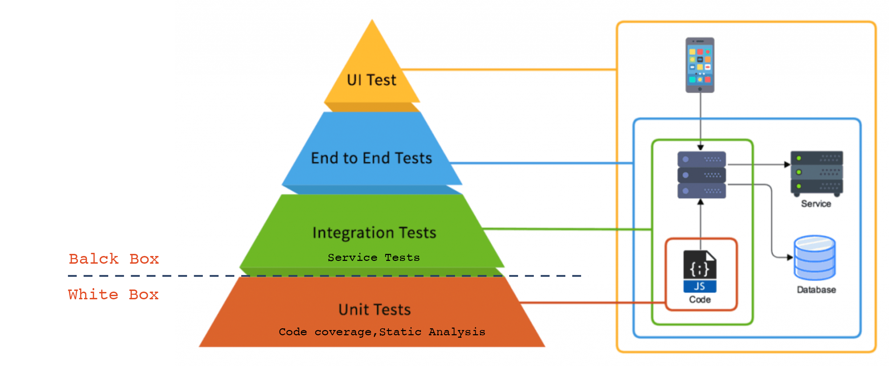
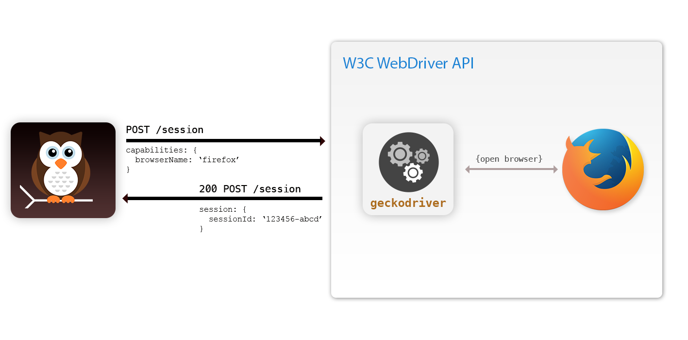
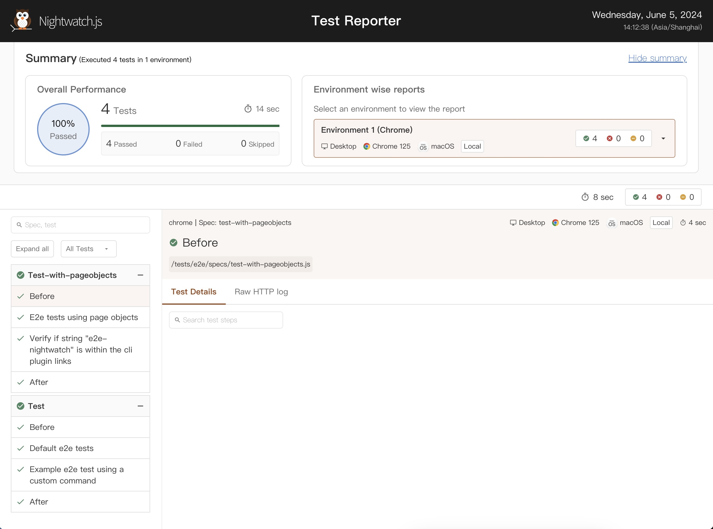

## Test

**单元测试（Unit Test）**、**集成测试（Integration Test）**、**端对端测试（End to End, e2e）**、**UI 测试（UI Test）**




### White Box Test

白盒测试，如：纯JS类测试

```js
// utils.test.js

import { add } from "../src/utils";

describe("utils::add test", function() {
  it("should 3 when add(1, 2) return", function() {
    expect(add(1, 2)).to.equal(3);
  });
});
```

* `describe`块，称为 **测试套件(test suite)**，表示一组相关的测试。

  它是一个函数，第一个参数是**测试套件**的名称，第二个参数是一个实际执行的函数。

* `it`块，称为 **测试用例（test case）**，表示一个单独的测试，是测试的最小单位。

  它也是一个函数，第一个参数是**测试用例**的名称，第二个参数是一个实际执行的函数。

上面代码中，使用了`expect` 风格的断言，其特点是更接近自然语言。如：

```js
expect(add(1, 2)).to.equal(3); // 意思是：期望 add(1, 2) 等于 3
```


### Blank Box Test

黑盒测试，如：DOM或BOM等UI测试。

```js
// main.test.js

import main from "../src/main";

describe("main::DOM test", function() {
  // 钩子函数
  beforeEach(function() {
    // 向页面的 body 元素中添加 DOM 元素，来辅助测试
    document.body.innerHTML = '<button id="btn">0</button>';

    main("#btn");
  });

  it("should 1 when button is clicked once", function() {
    // 获取前面添加的元素
    var btn = document.querySelector("#btn");
    // 模拟用户点击
    btn.click();

    expect(btn.innerText).to.equal("1");
  });
});
```

* `beforeEach` 是 Mocha 提供的钩子函数，作用是：在每个测试用例（`it` 块）执行之前，都会执行一次。

  类似的钩子函数有4个：`before`、`after`、`beforeEach`、`afterEach`

如果想要测试 DOM 相关的操作，我们需要在测试之前，向页面中添加需要用到的元素，例如上述示例代码中的 `document.body.innerHTML = '<button id="btn">0</button>';`。

接着，我们在测试用例（`it` 块）中，获取了提前添加好的 DOM 元素，然后通过 `btn.click();` 来主动触发该元素的点击事件，从而模拟了用户操作。

最后，进行断言来完成测试：`expect(btn.innerText).to.equal('1');`。


## Unit Test

单元测试

### 运行框架

* Karma：由Google团队开发测试框架。允许你在多种真实的浏览器环境中测试代码。
* Jest：是 Facebook 开源的测试框架。它使用了 **JSDOM 模拟浏览器环境**来支持测试，不能方便的在真实的浏览器中测试。


### 单元测试框架

* Mocha，它可以在NodeJs和浏览器环境下运行。

  * 4个钩子函数：`before`、`after`、`beforeEach`、`afterEach`

  * 关键字：`describe`、`describe.skip`、`it`、`done()`

  * 示例

    ```js
    describe.skip('async beforEach test', function() {
      beforeEach(function (done) {
        setTimeout(function () {
          foo = true;
          done();
        }, 50);
      });
    });
    
    describe('utils::add test', function() {
      it('should 3 when add(1, 2) return', function() {
        expect(add(1, 2)).to.equal(3);
      });
    });
    ```

### 断言库

> Chai is a **BDD / TDD assertion library** （断言库）for [node](http://nodejs.org/) and the browser that can be delightfully paired with any javascript testing framework.

提供了三种主要的API风格：`expect`，`should` 和 `assert`：

* `expect`

  ```js
  expect(myVar).to.be.a('string');  // 通过.to，.be等方法定义期望。
  ```

* `should`，一旦你将`.should`添加到任何对象上，就可以直接调用各种断言方法。

  ```js
  myVar.should.be.a('string');
  ```

* `assert`，与传统的基于函数的断言类似：

  ```js
  chai.assert.typeOf(myVar, 'string');
  ```

  


## e2e Test

e2e，(`end to end`)，端到端测试，又叫功能测试，站在用户视角，使用各种功能、各种交互，是用户的真实使用场景的仿真。

`e2e`测试正是**保证功能的最高层测试**，**不关注代码实现细节**，**专注于代码能否实现对应的功能**。

当我们使用`vue create <your-project-name>`创建项目时，会显示如下E2E方案：

```bash
? Pick an E2E testing solution: (Use arrow keys)
  Cypress (Test in Chrome, Firefox, MS Edge, and Electron)
❯ Nightwatch (WebDriver-based)
  WebdriverIO (WebDriver/DevTools based)
  
? Pick browsers to run end-to-end test on (Press <space> to select, <a> to toggle all, <i> to invert
selection, and <enter> to proceed)
❯◉ Chrome
 ◯ Firefox
```


### WebDriver and ChromeHeadless

* *WebDriver* 是 W3C 的一套规范，来源于 *Selenium* 这个自动化测试 Web 相关场景的项目。
* Chrome Headless，是Chrome 的“无头浏览器”模式，是指在没有 X 等图形桌面的环境下，执行完整的 Chrome 功能


### Nightwatch

* nightwatch：是一个e2e自动测试框架，它使用selenium或webdriver或phantomjs编写的
  * 可以使用`nightwatch.json`或`nightwatch.config.js`配置文件，使用runner会自动获取配置信息。
  * 也可以手动使用`--config` 来指定配置文件的相对路径
* Selenium：是一个强大的浏览器测试平台，其原理是打开浏览器时，把自己的JS文件嵌入网页中


**Nightwatch**的工作原理是通过一个网络驱动服务器（通常是Selenium服务器）来与一个rest式的HTTP api进行通信。restful API协议是由W3C WebDriver API定义的。







## Coverage

Coverage（代码覆盖率）

### Istanbul

- 行覆盖率（Lines）：是否每一行都执行了？
- 函数覆盖率（Functions）：是否每个函数都调用了？
- 分支覆盖率（Branchs）：是否每个 if 代码块都执行了？
- 语句覆盖率（Statements）：是否每个语句都执行了？


```bash
=============================== Coverage summary ===============================
Statements   : 79.58% ( 8324/10460 )
Branches     : 70.06% ( 5428/7748 )
Functions    : 82.17% ( 848/1032 )
Lines        : 81.11% ( 8020/9888 )
================================================================================
```


### Codecov

[Codecov](https://about.codecov.io/) 是一个测试结果的展示平台，你可以上传 lcov 生成的 `cover.info` 到 [Codecov](https://about.codecov.io/)，它就可以为你可视化这些结果，比 `genhtml` 生成的 html 页面更加友好。此外，你还可以获取 codecov 的小徽章放在你的仓库页面中。


* [前端测试的那些事](https://github.com/muwoo/blogs/issues/33#top)

* [what is Nightwatch](https://xianpengshen.gitbooks.io/nightwatch-js-cn/content/chapter1/gai-shu.html)
