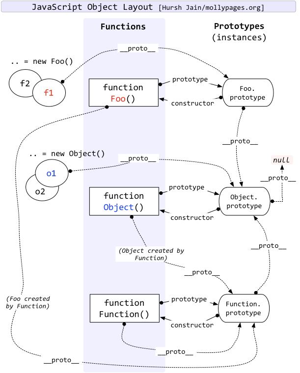

# core

> 梳理源码的框架：`intro.js`、`core.js`、`outro.js`。我们主要讨论的内容有两点：
>
> * 无`new` 实现实例化
> * `init` 功能函数实现基本选择器

```js
(function( window, undefined ) {
  
var
  // Define a local copy of jQuery
	jQuery = function( selector, context ) {
		// The jQuery object is actually just the init constructor 'enhanced'
		return new jQuery.fn.init( selector, context, rootjQuery );
	},
};

jQuery.fn = jQuery.prototype = {
	jquery: core_version,

	constructor: jQuery,
	init: function( selector, context, rootjQuery ) {
    
	},
};
  
// Give the init function the jQuery prototype for later instantiation
jQuery.fn.init.prototype = jQuery.fn;

jQuery.extend = jQuery.fn.extend = function() {};
jQuery.extend({
  noConflict: function( deep ) {}
});
jQuery.ready.promise = function( obj ) {};

// All jQuery objects should point back to these
rootjQuery = jQuery(document);
  
window.jQuery = window.$ = jQuery;

})( window );
```


## jQuery的无new构建原理

> * 没有采用new操作符；
> * return返回的是一个通过new出来的的对象 。


### new操作符构建对象

> new操作符主要是把原型链跟实例的this关联起来，这才是最关键的一点。

通过new操作符构建一个对象，一般经过四步：

 **A.创建一个新对象**

 **B.将构造函数的作用域赋给新对象（所以this就指向了这个新对象）**

 **C.执行构造函数中的代码**

 **D.返回这个新对象**


### 代码实践

* 达成目标

  ```js
  $('something')
  $('something').todo()
  ```

* 涉及知识点

  构造函数、面向对象、原型和原型链、new操作符、IIFE

#### 1. 通过构造函数实现类

```js
// 声明一个构造函数 mQuery
function Query() {
}

// 添加属性或方法
Query.prototype.init = function(){
   console.log('run init...')
}

// new生成一个对象
var oQuery = new Query();

// 调用init
oQuery.init();
```

#### 2. 创建对象的同时调用`init`方法

```diff
- var oQuery = new Query()
- oQuery.init()
+ new Query.prototype.init();
```

#### 3. 实现无`new`调用`init`方法

```diff
  function Query() {
+   return new Query.prototype.init();
  }
  Query.prototype.init = function(){
    console.log('run init...')
  }
```

* 创建一个实例对象

  ```js
  Query();   // 这是不是和我们调用 $()或jQuery() 很像了
  ```

#### 4. 给原型添加方法

```diff
  function Query() {
    return new Query.prototype.init();
  }
  Query.prototype.init = function(){
    console.log('run init...')
  }
+ Query.prototype.css = function(){
+   console.log('run css...')
+ }
```

* 我们把上在添加原型方法或属性，做一个合并

  ```diff
    function Query() {
      return new Query.prototype.init();
    }
  + Query.prototype = {
  +   init: function(){ console.log('run init...'); },
  +   css: function() { console.log('run css...'); }
  + }
  - Query.prototype.init = function(){
  -   console.log('run init...')
  - }
  - Query.prototype.css = function(){
  -   console.log('run css...')
  - }
  ```

* 上面代码，有一个比较严重的问题，因为它是完全覆盖`prototype`来实现的，会把`prototype`原型上的 `constructor` 方法覆盖：

  ```diff
    function Query() {
      return new Query.prototype.init();
    }
    Query.prototype = {
  +   constructor: Query,
      init: function(){ console.log('run init...'); },
      css: function() { console.log('run css...'); }
    }
  ```

  * 这样，我们就完美实现了 `ptototype` 的合并。

    接上来，我们来像`jQuery`中一样，调用`css()` 方法：

  ```js
  Query().css();
  ```

* 结果，报错了：

  ```js
  Uncaught TypeError: Query(...).css is not a function
  ```

#### 5. 🎉无法调用`css()` 

​		在 `Query()` 构造函数中，执行的是`init()` 方法，如果我们把 `Query.prototype` 的原型挂载到`init()` 上，那是不是就可以通过**原型链**来调用`css()`方法了？

```diff
  function Query() {
    return new Query.prototype.init();
  }
  Query.prototype = {
    constructor: Query,
    init: function(){ console.log('run init...'); },
    css: function() { console.log('run css...'); }
  }
+ Query.prototype.init.prototype = Query.prototype;
```

* 再来执行一下`css()`，看一下效果：

  ```js
  Query().css(); // everything is OK
  ```


#### 6. 代码优化

* 方法代码压缩，给 `Query.prototype` 定义一个变量：

```diff
  function Query() {
-   return new Query.prototype.init();
+   return new Query.fn.init();
  }
- Query.prototype = {
+ Query.fn = Query.prototype = {
    constructor: Query,
    init: function(){ console.log('run init...'); },
    css: function() { console.log('run css...'); }
  }
- Query.prototype.init.prototype = Query.prototype;
+ Query.fn.init.prototype = Query.fn;
```


#### 7. 模块化

通过`IIFE` 来实现模块化，并对外暴露全局变量：

```diff
+ (function(window, undefined){
    function Query() {
      return new Query.fn.init();
    }
    Query.fn = Query.prototype = {
      constructor: Query,
      init: function(){ console.log('run init...'); },
      css: function() { console.log('run css...'); }
    }
    Query.fn.init.prototype = Query.fn;
+   window.mQuery = window.$$ = Query;
+ })(window);
```

如此，便实现了`jQuery` 中的 **无new构建对象**

```js
$$()
mQuery()

$$().css()
mQuery().css()
```



