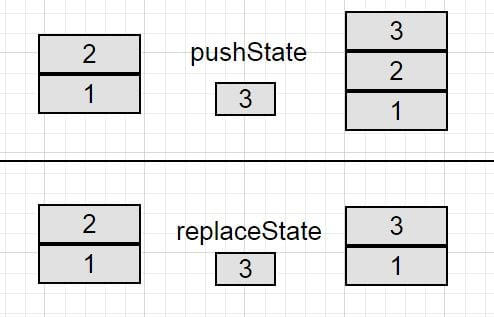
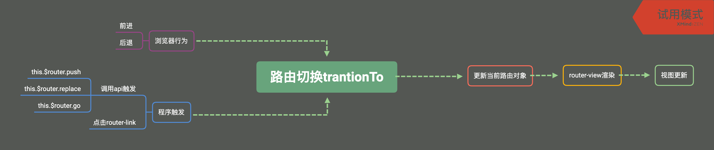

## vue-router


### 前端路由

**前端路由**，在WEB单页应用（Single Page Application）中，路由描述的是 **URL与UI之间的映射**关系。

这种映射是**单向**的，即：URL变化引起UI更新（无需刷新页面）。


通过上面对SPA中路由的最本质的分析，我们需要解决两个核心问题：

1. 如何改变URL，却不引起页面刷新
2. 如何检测URL变化了

在JS中，有 `hash` 和 `history` 两种实现方式，可以解决上面的问题。


#### hash原理

**hash** 是 URL中 `#` 及后面的部分，通常用作锚点在页面内进行导航，改变URL中的hash（`location.hash`）部分不会引起页面刷新。

通过 `hashchange` 事件来监听URL的变化，改变URL的方式中有这几种：

* 通过浏览器前进、后退，改变URL
* 通过`<a>` 标签，改变URL
* 通过`window.location`，改变URL

```js
window.addEventListener("hashchange", (event) => {});

window.onhashchange = (event) => {};
```

代码实现

```html
<ul>
  <ul>
    <li><a href="#/home">home</a></li>
    <li><a href="#/about">about</a></li>

    <div id="routeView"></div>
  </ul>
</ul>
<script>
  let routerView = routeView
  window.addEventListener('hashchange', ()=>{
    let hash = location.hash;
    routerView.innerHTML = hash
  })
  window.addEventListener('DOMContentLoaded', ()=>{
    if(!location.hash){
      location.hash="/"
    }else{
      let hash = location.hash;
      routerView.innerHTML = hash
    }
  })
</script>
```


#### history原理

history 提供了 `pushState` 和 `replaceState` 两个方法，这两个方法改变 URL 的 path `location.pathname`部分**不会**引起页面刷新

1. 通过浏览器前进、后退改变 URL 时**会触发** `window.onpopstate` 事件
2. 通过js 调用history的 `history.back()`，`history.go()`，`history.forward()`方法**会触发**该`window.onpopstate` 事件
3. 通过 `history.pushState` 、`hisotry.replaceState` 或 `<a>` 标签改变 URL **不会触**发 `window.onpopstate` 事件。因此，我们可以拦截 `history.pushState` 、`history.replaceState`的调用和`<a>`标签的点击事件来检测 URL 变化。

* popState

  ```js
  window.addEventListener("popstate", (event) => {});
  
  window.onpopstate = (event) => {};
  ```

* pushState

  ```js
  history.pushState(state, unused)
  history.pushState(state, unused, url)
  ```

* replaceState

  ```js
  history.replaceState(state, unused)
  history.replaceState(state, unused, url)
  ```

* History  method

  ```js
  history.forward();
  
  history.back();
  
  history.go()
  history.go(delta)
  ```




```html
<ul>
  <ul>
    <li><a href='/home'>home</a></li>
    <li><a href='/about'>about</a></li>

    <div id="routeView"></div>
  </ul>
</ul>
<script>
  let routerView = routeView
  window.addEventListener('DOMContentLoaded', onLoad)
  window.addEventListener('popstate', ()=>{
    routerView.innerHTML = location.pathname
  })
  function onLoad () {
    routerView.innerHTML = location.pathname
    var linkList = document.querySelectorAll('a[href]')
    linkList.forEach(el => el.addEventListener('click', function (e) {
      e.preventDefault()
      history.pushState(null, '', el.getAttribute('href'))
      routerView.innerHTML = location.pathname
    }))
  }
</script>
```


#### 小结

1. 如何改变URL，却不引起页面刷新？
   * `hash(#)`模式下，改变`location.hash`但不会引起页面刷新。
   * `history`模式下，`history.pushState` 和 `history.replaceState` 改变URL的path（`location.pathname`）不会触发页面刷新。


### vue-router使用

Vue Router的作用是，将组件 (components) 映射到路由 (routes)，然后告诉 Vue Router 在哪里渲染它们。



#### 使用流程

* 使用插件：`Vue.use(VueRouter)`
* 生成路由实例：
  * 路由记录 `routes`
  * 路由实例 `new VueRoute({ routes })`

* 挂载至Vue实例：`new Vue({ router })`


#### HTML

```vue
<div id="app">
  <h1>Hello App!</h1>
  <p>
    <!-- 使用 router-link 组件来导航. -->
    <!-- 通过传入 `to` 属性指定链接. -->
    <!-- <router-link> 默认会被渲染成一个 `<a>` 标签 -->
    <router-link to="/foo">Go to Foo</router-link>
    <router-link to="/bar">Go to Bar</router-link>
  </p>
  <!-- 路由出口 -->
  <!-- 路由匹配到的组件将渲染在这里 -->
  <router-view></router-view>
</div>
```


#### JS

```js
// 0. 如果使用模块化机制编程，导入Vue和VueRouter，要调用 Vue.use(VueRouter)
import Vue from 'vue'
import VueRouter from 'vue-router'

Vue.use(VueRouter)

// 1. 定义 (路由) 组件。
// 可以从其他文件 import 进来
const Foo = { template: '<div>foo</div>' }
const Bar = { template: '<div>bar</div>' }

// 2. 定义路由
// 每个路由应该映射一个组件。 其中"component" 可以是
// 通过 Vue.extend() 创建的组件构造器，
// 或者，只是一个组件配置对象。
// 我们晚点再讨论嵌套路由。
const routes = [
  { path: '/foo', component: Foo },
  { path: '/bar', component: Bar }
]

// 3. 创建 router 实例，然后传 `routes` 配置
// 你还可以传别的配置参数, 不过先这么简单着吧。
const router = new VueRouter({
  routes // (缩写) 相当于 routes: routes
})

// 4. 创建和挂载根实例。
// 记得要通过 router 配置参数注入路由，
// 从而让整个应用都有路由功能
const app = new Vue({
  router
}).$mount('#app')

// 现在，应用已经启动了！
```


#### 特性

* 动态路由匹配
* 嵌套路由
* 嵌套视图
* 导航守卫
* 过渡动效
* 路由懒加载


### vue-router实现

#### class VueRouter

* `VueRouter`是一个类（`class`），给它添加一个`VueRouter.install`方法。这样，就可以通过`Vue.use(VueRouter)`来使用它。

  ```js
  export default class VueRouter {
    // 声明install方法
  	static install: () => void;
    static version: string;
    
    // 构建器通过接收传参
    constructor (options: RouterOptions = {}) {
      this.options = options
      this.matcher = createMatcher(options.routes || [], this)
  
      let mode = options.mode || 'hash'
    }
  }
  
  VueRouter.install = install
  VueRouter.version = '__VERSION__'
  ```

* install

  ```js
  export let Vue
  
  // 1. 声明Router类
  class Router {
    // 2. 通过constructor接收参数options
    constructor (options = {}) {
      // 3. 处理一些常用参数，如：mode、routers、base、scrollBehavior等
      // 3.1  mode，默认是hash（#）模式，它有三种模式：hash、history、abstract
      let mode = options.mode || 'hash'
      // 3.2  路由的URL和组件映射关系，它是一个数组如：[{ path: '/foo', component: Foo }]
      this.router = options.routers;
      
      /**
       * 通过mode调用不同路由处理方式
       **/
      switch (mode) {
        case 'history':
          this.history = new HTML5History(this, options.base)
          break
        case 'hash':
          this.history = new HashHistory(this, options.base, this.fallback)
          break
        case 'abstract':
          this.history = new AbstractHistory(this, options.base)
          break
        default:
          if (process.env.NODE_ENV !== 'production') {
            assert(false, `invalid mode: ${mode}`)
          }
      }
    }
    
  }
  
  /**
   * 4. 这是 Vue.use(VueRouter) 的第一站
   *    当Vue.use(plugin)插件为对象时，它需要有一个install方法
   **/
  Router.install = install
  Router.version = '__VERSION__'
  
  export function Router;
  ```

#### install

```js
/**
 * externalVue在Vue.use(VueRouter)时，它给VueRouter.install传入的每一个参数就是Vue本身。
 * 所以，我们可以使用Vue的一些方法，如：
 *   Vue.mixin()
 *   Vue.component()
 **/

let Vue
// 1. install函数，externalVue是Vue.use(plugin)中的args（第一个参数是Vue构造函数）
export function install(externalVue) {
  Vue = externalVue;
  
  
}
```


#### Vue.mixin

```js
Vue.mixin({
  beforeCreate () {
    if (isDef(this.$options.router)) {
      this._routerRoot = this // 定义私有属性_routerRoot,指向Vue实例，用于$router属性和$route属性从中读取值
      this._router = this.$options.router //定义私有属性_router,指向VueRouter实例
      this._router.init(this) //初始化vue-router
      Vue.util.defineReactive(this, '_route', this._router.history.current) // 定义私有属性_route,设置为响应式
    } else {
      this._routerRoot = (this.$parent && this.$parent._routerRoot) || this
    }
    registerInstance(this, this) // 注册实例
  },
  destroyed () {
    registerInstance(this)  // 销毁实例
  }
})
```


#### RouterOptions

```typescript
declare var document: Document;

declare class RouteRegExp extends RegExp {
  keys: Array<{ name: string, optional: boolean }>;
}

declare type PathToRegexpOptions = {
  sensitive?: boolean,
  strict?: boolean,
  end?: boolean
}

declare module 'path-to-regexp' {
  declare module.exports: {
    (path: string, keys?: Array<?{ name: string }>, options?: PathToRegexpOptions): RouteRegExp;
    compile: (path: string) => (params: Object) => string;
  }
}

declare type Dictionary<T> = { [key: string]: T }

declare type NavigationGuard = (
  to: Route,
  from: Route,
  next: (to?: RawLocation | false | Function | void) => void
) => any

declare type AfterNavigationHook = (to: Route, from: Route) => any

type Position = { x: number, y: number };
type PositionResult = Position | { selector: string, offset?: Position } | void;

declare type RouterOptions = {
  routes?: Array<RouteConfig>;
  mode?: string;
  fallback?: boolean;
  base?: string;
  linkActiveClass?: string;
  linkExactActiveClass?: string;
  parseQuery?: (query: string) => Object;
  stringifyQuery?: (query: Object) => string;
  scrollBehavior?: (
    to: Route,
    from: Route,
    savedPosition: ?Position
  ) => PositionResult | Promise<PositionResult>;
}

declare type RedirectOption = RawLocation | ((to: Route) => RawLocation)

declare type RouteConfig = {
  path: string;
  name?: string;
  component?: any;
  components?: Dictionary<any>;
  redirect?: RedirectOption;
  alias?: string | Array<string>;
  children?: Array<RouteConfig>;
  beforeEnter?: NavigationGuard;
  meta?: any;
  props?: boolean | Object | Function;
  caseSensitive?: boolean;
  pathToRegexpOptions?: PathToRegexpOptions;
}

declare type RouteRecord = {
  path: string;
  regex: RouteRegExp;
  components: Dictionary<any>;
  instances: Dictionary<any>;
  name: ?string;
  parent: ?RouteRecord;
  redirect: ?RedirectOption;
  matchAs: ?string;
  beforeEnter: ?NavigationGuard;
  meta: any;
  props: boolean | Object | Function | Dictionary<boolean | Object | Function>;
}

declare type Location = {
  _normalized?: boolean;
  name?: string;
  path?: string;
  hash?: string;
  query?: Dictionary<string>;
  params?: Dictionary<string>;
  append?: boolean;
  replace?: boolean;
}

declare type RawLocation = string | Location

declare type Route = {
  path: string;
  name: ?string;
  hash: string;
  query: Dictionary<string>;
  params: Dictionary<string>;
  fullPath: string;
  matched: Array<RouteRecord>;
  redirectedFrom?: string;
  meta?: any;
}

```


[手写vue-router核心原理](https://cloud.tencent.com/developer/article/1880448)

[手写vue-router源码系列](https://juejin.cn/post/6995956430310211598)

[vue-router源码阅读](https://segmentfault.com/a/1190000021592204)

[前端路由](https://github.com/muwoo/blogs/issues/22)

[自己动手实现一款简易版vue-router](https://juejin.cn/post/7316171289096781858)
