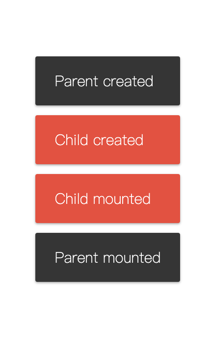
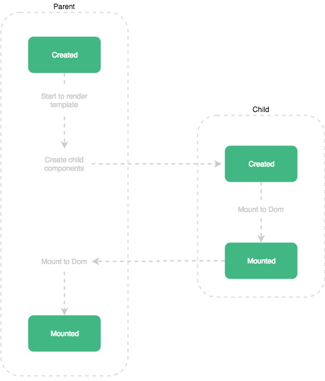

## lifecycle

这里我们主要讨论的是 父子组件的生命周期（执行顺序）

### Parent/Child lifecycle hooks

* Parent component

  ```vue
  <!-- src/App.vue -->
  <template>
    <div id="app">
      <router-view />
    </div>
  </template>
  
  <script>
  export default {
    name: "app",
    created() {
      this.$toasted.show("Parent created");
    },
    mounted() {
      this.$toasted.show("Parent mounted");
    },
  };
  </script>
  ```

* Child component

  ```vue
  <!-- src/components/Child.vue -->
  <script>
  export default {
    name: "Child",
    data() {
      return {
        msg: "Welcome to Your Vue.js App",
      };
    },
    created() {
      this.$toasted.error('Child created')
    },
    mounted() {
      this.$toasted.error('Child mounted')
    },
  };
  </script>
  ```

执行结果：



We just need to remember that the **parent component** will **wait for its children to mount** before it mounts its own template to the DOM.

父组件将等待其子组件挂载(`mount`)，然后再将自己的模板挂载到DOM。





1）加载渲染过程
父先创建，才能有子；子创建完成，父才完整。
顺序：父 beforeCreate -> 父 created -> 父 beforeMount -> 子 beforeCreate -> 子 created -> 子 beforeMount -> 子 mounted -> 父 mounted

2）子组件更新过程
a)子组件更新 影响到 父组件的情况。
顺序：父 beforeUpdate -> 子 beforeUpdate -> 子 updated -> 父 updated

b)子组件更新 不影响到 父组件的情况。
顺序：子 beforeUpdate -> 子 updated

3）父组件更新过程
a)父组件更新 影响到 子组件的情况。
顺序：父 beforeUpdate -> 子 beforeUpdate -> 子 updated -> 父 updated

b)父组件更新 不影响到 子组件的情况。
顺序：父 beforeUpdate -> 父 updated

4）销毁过程
顺序：父 beforeDestroy -> 子 beforeDestroy -> 子 destroyed -> 父 destroyed


[vue lifecycle](https://medium.com/@brockreece/vue-parent-and-child-lifecycle-hooks-5d6236bd561f)