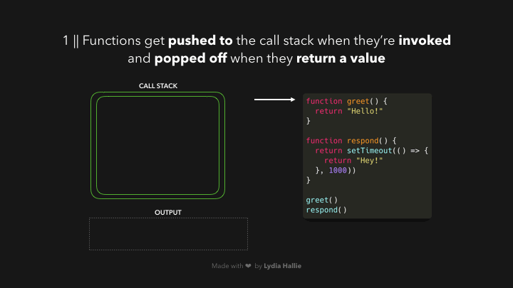
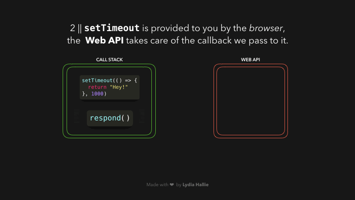
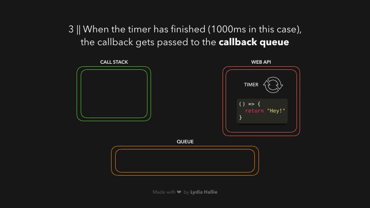
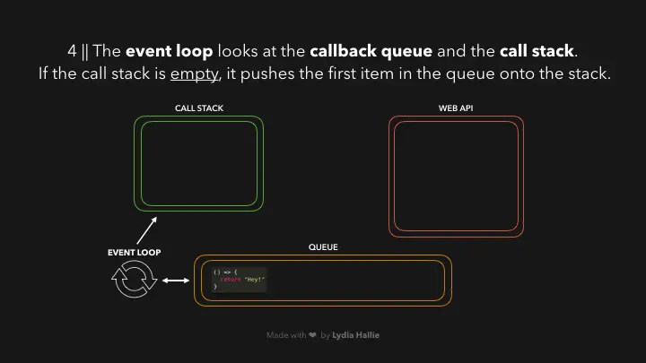
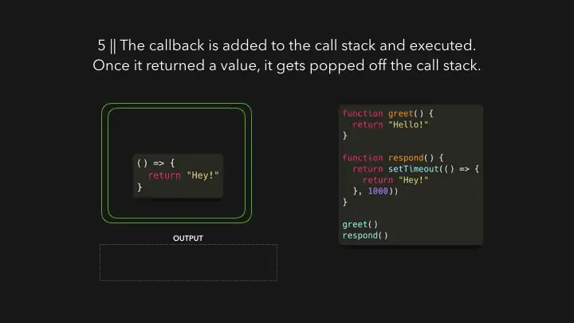
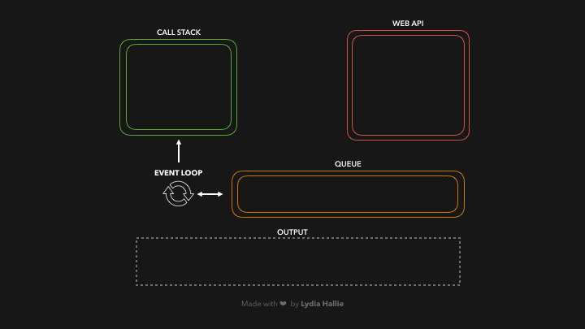

# ✨♻️ JavaScript Visualized: Event Loop

​		Event Loop（事件循环），这是每个JavaScript开发人员都必须以这样或那样的方式处理的事情之一，但一开始理解起来可能会有点困惑。接下来，我想我会尝试通过gif动画图片以视觉方式来帮助你。


> 先思考一下，什么是事件循环，我们为什么要关心它？


JavaScript是单线程（**single-threaded**）：一次只能运行一个任务（only one task can run at a time）。

通常情况下这是没问题的。但试想一下，你要运行一个需要花费30秒的任务...在这项任务中，我们等待30秒，然后才能发生其他事情（默认情况下，JavaScript在浏览器的主线程上运行，因此整个UI都被卡住了）...多少有些过分了。


幸运的是，浏览器为我们提供了JavaScript引擎本身无法提供的一些功能：Web API。它包括：DOM API、`setTimeout`、HTTP请求等。可以帮助我们创建一些异步（async）、非阻塞行为（non-blocking behavior）。


当我们调用一个函数时（invoke a function），它被添加到调用堆栈（**call stack**）中。调用堆栈是JS引擎的一部分，这不是特定于浏览器的。一个堆栈，意味着它是**先进后出（first in, last out）**。当函数返回值时，它会从堆栈中弹出。



`respond` 函数返回一个 `setTimeout` 函数（`setTimeout` 函数是Web API提供给我们的：它允许我们在不阻塞主线程的情况下延迟任务。）

setTimeout函数的回调函数是一个箭头函数`（）=>｛return 'Hey'｝` 被添加到Web API中。同时，setTimeout函数和response函数从堆栈中弹出，它们都返回了值！




在Web API中，计时器的运行时间与我们传递给它的第二个参数一样长，即1000ms。回调不会立即添加到调用堆栈中，而是传递给称为**队列（queue）**的对象。




这可能是一个令人困惑的部分：这并不意味着回调函数在1000ms后被添加到调用堆栈（从而返回一个值）！它只需在1000毫秒后添加到队列中。但这是一个队列，函数必须等待轮到它！


现在这是我们一直在等待的部分……事件循环完成其唯一任务的时间：将队列与调用堆栈连接起来(**connecting the queue with the call stack**)！如果调用堆栈为空，那么如果之前调用的所有函数都返回了它们的值并从堆栈中弹出，则队列中的第一个项将添加到调用堆栈中。在这种情况下，没有调用其他函数，这意味着在回调函数成为队列中的第一项时，调用堆栈为空。



回调被添加到调用堆栈，被调用并返回一个值，然后从堆栈中弹出。




```js
const foo = () => console.log("First");
const bar = () => setTimeout(() => console.log("Second"), 500);
const baz = () => console.log("Third");

bar();
foo();
baz();
```





1. We invoke `bar`. `bar` returns a `setTimeout` function.
2. The callback we passed to `setTimeout` gets added to the Web API, the `setTimeout` function and `bar` get popped off the callstack.
3. The timer runs, in the meantime `foo` gets invoked and logs `First`. `foo` returns (undefined),`baz` gets invoked, and the callback gets added to the queue.
4. `baz` logs `Third`. The event loop sees the callstack is empty after `baz` returned, after which the callback gets added to the call stack.
5. The callback logs `Second`.