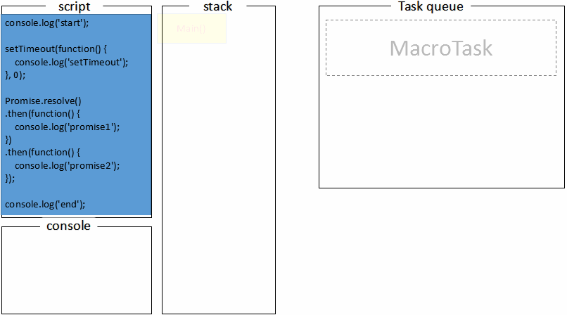

# Event Loop

事件循环机制(Event Loop)

:boom: [Event Loop机制](https://www.yuque.com/guoba7/mz70ea/nw3k1g)

[浏览器和Node.js中的Event Loop](https://fynn90.github.io/2019/07/13/%E6%B5%8F%E8%A7%88%E5%99%A8%E7%9A%84Even%20Loop%E5%92%8CNode.JS%E7%9A%84Even%20Loop/)




:::tip 结论

* **微任务**执行时机比**宏任务**早
* 宏任务：`setTimeout`、`setInterval`、`DOM事件`、`Ajax请求`
* 微任务：`Promise`、`asycn/await`

:::


下面代码执行结果：

```js
console.log(1)

// 宏任务
setTimeout(() => {
	console.log(2)
}, 0)

// 微任务
Promise.resolve().then(() => {
  console.log(3)
})

console.log(4)

// 1 4 3 2

/**
 * 结论：微任务 执行时机比宏任务早！
 * 原因：微任务 > DOM渲染 > 宏任务
 **/
```


https://zhuanlan.zhihu.com/p/448426887

```js
document.body.innerHTML = ` 
    <button id="btn" type="button">btn</button> 
`; 

const button = document.getElementById('btn')
 
button.addEventListener('click',()=>{
  Promise.resolve().then(()=>console.log('promise resolved 1'))
  console.log('listener 1')
})
 
button.addEventListener('click',()=>{
  Promise.resolve().then(()=>console.log('promise resolved 2'))
  console.log('listener 2')
})
 
// 1. 手动点击按钮 
// button.click() // 2. 解开这句注释，用JS触发点击行为
```

- 手动点击按钮时： listener1 -> promise resolved 1 -> listener2 -> promise resolved 2
- 当我们使用2： listener1 -> listener2 -> promise resolved 1 -> promise resolved 2

UI 触发的 click 事件是异步的，每个 listener 是一个 macrotask；代码触发的 click 底层是 dispatchEvent，这是一个同步的方法，会同步执行所有 listener
