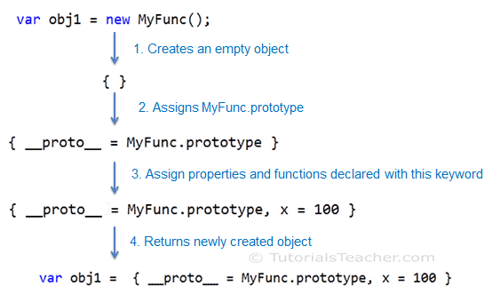

## new keyword

在 `Object`中，可以通过`new`关键字创建一个对象。

```js
function MyFunc() {
    this.x = 100;
}

var obj1 = new MyFunc();
obj1.x;
```

上面代码中，我们通过 `new` 关键字创建一个MyFunc构造函数的对象。

`new` 关键字执行了下面4个任务：

1. It creates new empty object e.g. obj = { };
2. It sets new empty object's invisible 'prototype' property to be the constructor function's visible and accessible 'prototype' property. (Every function has visible 'prototype' property whereas every object includes invisible 'prototype' property)
3. It binds property or function which is declared with this keyword to the new object.
4. It returns newly created object unless the constructor function returns a non-primitive value (custom JavaScript object). If constructor function does not include return statement then compiler will insert 'return this;' implicitly at the end of the function. If the constructor function returns a primitive value then it will be ignored.


```js
function MyFunc() {
    var myVar = 1;
    this.x = 100;
}

MyFunc.prototype.y = 200;

var obj1 = new MyFunc();
obj1.x; // 100
obj1.y; // 200
```


Let's understand what happens when you create an object (instance) of MyFunc() using new keyword.

First of all, new keyword creates an empty object - { }.

Second, it set's invisible 'prototype' property (or attribute) of this empty object to myFunc's prototype property. As you can see in the above example, we have assigned new property 'y' using MyFunc.prototype.y. So, new empty object will also have same prototype property as MyFunc which includes y property.

In third step, it binds all the properties and function declared with this keyword to new empty object. Here, MyFunc includes only one property x which is declared with this keyword. So new empty object will now include x property. MyFunc also includes myVar variable which does not declared with this keyword. So myVar will not be included in new object.

In the fourth and last step, it will return this newly created object. MyFunc does not include return statement but compiler will implicitly insert 'return this' at the end.

So thus, object of MyFunc will be returned using new keyword.

The following figure illustrates the above process.




* [ new keyword](https://www.tutorialsteacher.com/javascript/new-keyword-in-javascript)

