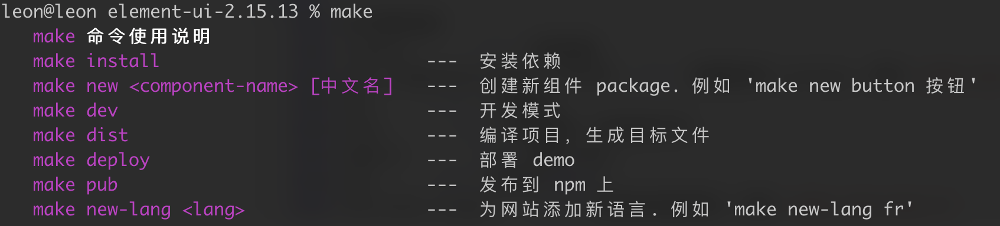

# 构造流程

* `Makefile`，构建指令

  

* `package.json`中的`scripts`字段，构建入口文件


## 新建组件

> `make new <component-name> [中文名]`

```bash
$ make new leon '里昂'
node build/bin/new.js leon 里昂

DONE!

make: *** No rule to make target `leon'.  Stop.

$ git status
头指针分离于 v2.15.13
尚未暂存以备提交的变更：
  （使用 "git add <文件>..." 更新要提交的内容）
  （使用 "git restore <文件>..." 丢弃工作区的改动）
	修改：     components.json
	修改：     examples/nav.config.json
	修改：     package.json
	修改：     packages/theme-chalk/src/index.scss
	修改：     types/element-ui.d.ts

未跟踪的文件:
  （使用 "git add <文件>..." 以包含要提交的内容）
	examples/docs/en-US/leon.md
	examples/docs/es/leon.md
	examples/docs/fr-FR/leon.md
	examples/docs/zh-CN/leon.md
	package-lock.json
	packages/leon/
	packages/theme-chalk/src/leon.scss
	test/unit/specs/leon.spec.js
	types/leon.d.ts

修改尚未加入提交（使用 "git add" 和/或 "git commit -a"）
```

