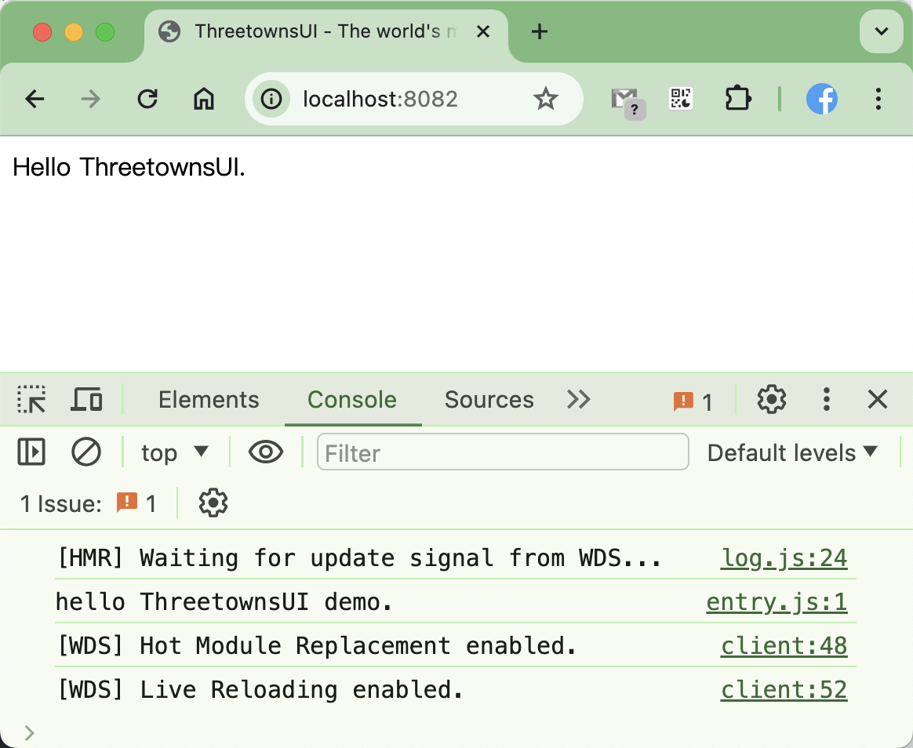
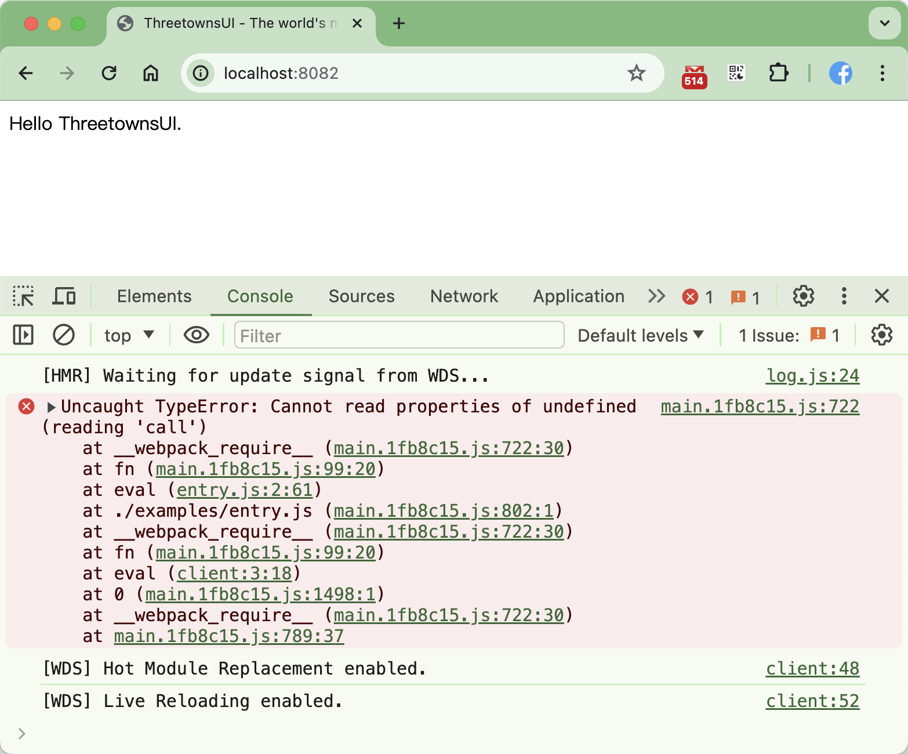
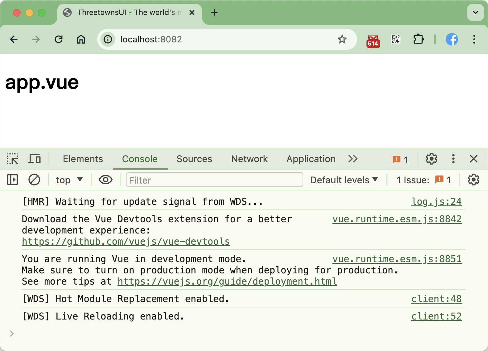

# ElementUI Examples

Examples是什么？在ElementUI中examples是**文档项目**。

从今天开始，咱就开始**从零搭建**文档项目（当然，你也可以通过`vue-cli`创建），以此解决我们组件调试的问题。整个文档项目，大概分两个比较核心的过程：

* 从零开始，搭建文档项目（vue、vue-router、scss、页面组件等）
* 文档内容处理（将markdown通过md-loader，处理成vue，然后再通过vue-loader将其处理成html）


## dev:demo

搭建文档的第一步，我们期望将我们的模板最终渲染成页面，且让能运行在浏览器中。这里需要两个比较重要的webpack依赖：

* `webapck-dev-server`：用于**启动一个本地服务器**，我们可以配置它的 `host`、`prot`、`hot`、`publicPath`等信息。
* `html-webpack-plugin`：用于将模板`template`，编译在指定文件`filename`中。

```bash
yarn add -D webpack-dev-server@3.11.3 html-webpack-plugin
```

### webpack.demo.js

接入，我们创建一个`build/webpack.demo.js`文件，用于配置一些`webpack`信息，最终通过配置启动我们的文档项目。

```js
const path = require('path');
const HtmlWebpackPlugin = require('html-webpack-plugin');

module.exports = {
    mode: process.env.NODE_ENV,
    entry: './examples/entry.js',
    output: {
        path: path.resolve(process.cwd(), './examples/threetowns-ui/'),
        publicPath: '',
        filename: '[name].[hash:7].js',
        chunkFilename: '[name].js'
   },
   devServer: {
    host: 'localhost',
    port: 8082,
    publicPath: '/',
    hot: true
  },
  plugins: [
    new HtmlWebpackPlugin({
        template: './examples/index.tpl',
        filename: './index.html'
      }),
  ]
}

```

#### entry.js

入口文件`examples/entry.js`，我们先简单编写一点代码：

```js
console.log('Hello ThreetownsUI');
```

#### html-template

HTML模板，我们指定的是 `./examples/index.tpl`，需要写点内容：

```html
<!DOCTYPE html>
<html lang="en">
  <head>
    <meta charset="utf-8">
    <meta name="viewport" content="width=device-width, user-scalable=no, initial-scale=1.0, maximum-scale=1.0, minimum-scale=1.0">
     <title>ThreetownsUI - The world's most popular Vue UI framework.</title>
    <meta name="description" content="ThreetownsUI，一套为开发者、设计师和产品经理准备的基于 Vue 2.0 的桌面端组件库" />
  </head>
  <body>
    <div id="app">Hello ThreetownsUI.</div>
  </body>
</html>
```


### dev:demo

webpack启动本地html服务器的准备工作已经完毕。接着，咱们给`package.json`配置`scripts`：

```bash
npm set-script dev:demo "cross-env NODE_ENV=development webpack-dev-server --config build/webpack.demo.js"
```

* `cross-env`：可以在命令行中设置环境变量`NODE_ENV`，而不用担心跨操作系统的兼容问题。


### run

```bash
yarn dev:demo
```

浏览器中看到的效果，正是和我们预期一致：




至此，demo文档项目跑起来了，接下来，我们需要引入vue，整个项目的准备工作才算真正意义上完成了。

## app.vue

现在咱们来创建一个项目的主文件`examples/app.vue` 并在 `build/entry.js`中创建`Vue`实例：

> 这里的`app.vue`和`entry.js` 分为对应，我们用`vue-cli` 创建项目的`App.vue`和`main.js`

* `examples/app.vue`

  ```vue
  <template>
  	<h1>app.vue</h1>
  </template>
  ```

* `examples/entry.js`

  ```js
  import Vue from 'vue';
  import entry from './app'; // 此处省略了文件后缀`.vue`,在webpack的resolve.extensions项应该正确配置
  
  new Vue({ // eslint-disable-line
    ...entry
  }).$mount('#app');
  
  ```

### import vue

因为引入了`*.vue`，所以我们需要将`.vue`后缀的文件通过`vue-loader`进行处理。（注意：`webpack`默认只能处理`js`和`json`，对于其它文件类型需要借助相应的`loader`）

* 安装依赖

  `vue`、`vue-template-compiler`（注意版本应该和vue版本一致）、`vue-loader`

  ```bash
  yarn add -D vue@2.6.14 vue-template-compiler@2.6.14
  yarn add -D vue-loader@15.7.2
  ```

* 修改`build/webpack.demo.js`文件

```diff
+ const VueLoaderPlugin = require('vue-loader/lib/plugin');

  module.exports = {
    mode: process.env.NODE_ENV,

+   resolve: {
+     extensions: ['.js', '.vue', '.json']
+   },
+   module: {
+     rules: [
+       {
+         test: /\.vue$/,
+         loader: 'vue-loader',
+         options: {
+           compilerOptions: {
+             preserveWhitespace: false
+           }
+         }
+       }
+     ]
+   },
    plugins: [
      new HtmlWebpackPlugin({
        template: './examples/index.tpl',
        filename: './index.html'
      }),
+     new VueLoaderPlugin()
   ]
```

此时，我们再重新项目：`yarn dev:demo`，看下项目运行效果：



讲道理，不应该有问题的。但实际情况，却不讲道理，报了个错。

### fix entry bug

经过一番排查，最终将**entry**属性字符串改成数组，解决了：

```diff
 module.exports = {
   mode: process.env.NODE_ENV,
-  entry: './examples/entry.js',
+  entry: {  
+    app: ['./examples/entry.js']
+  },
   output: {
  
```

具体产生报错原因不明，先记录解决方案，后面有机会再补充产生原因。




至此，准备工作已经完成，现在就可以集中精力为文档的界面添砖加瓦了。


* [vue-loader&vue-template-compiler详解](https://zhuanlan.zhihu.com/p/114239056)