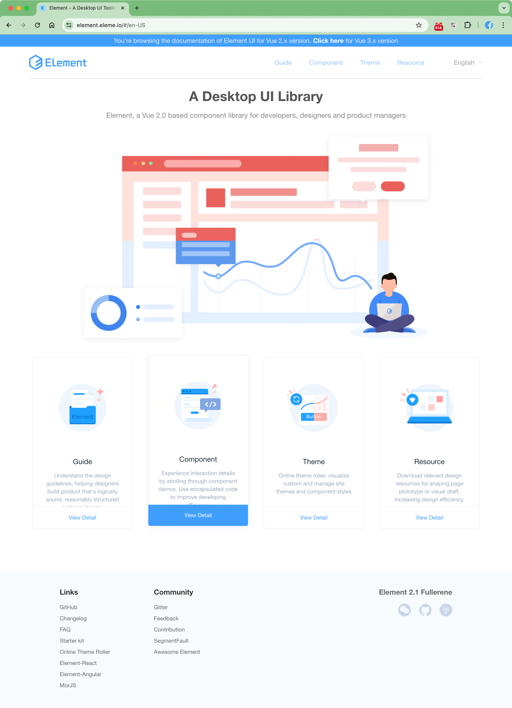
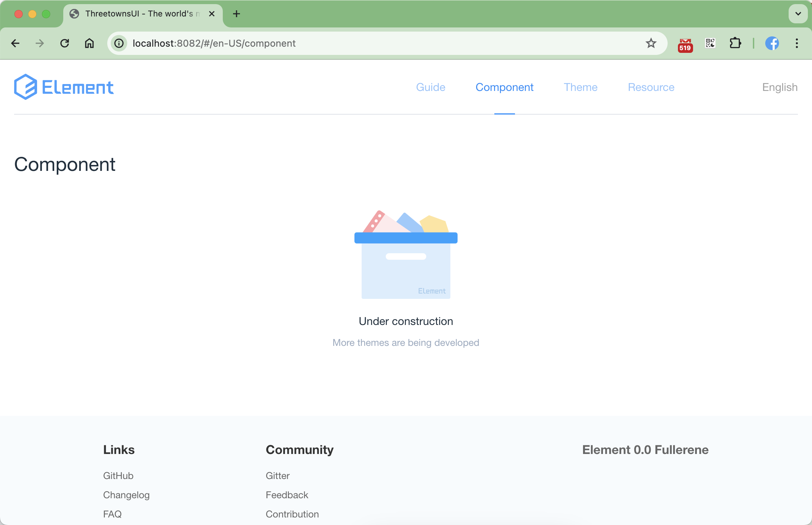
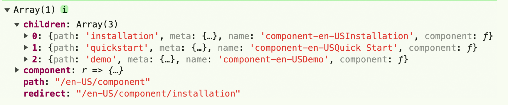
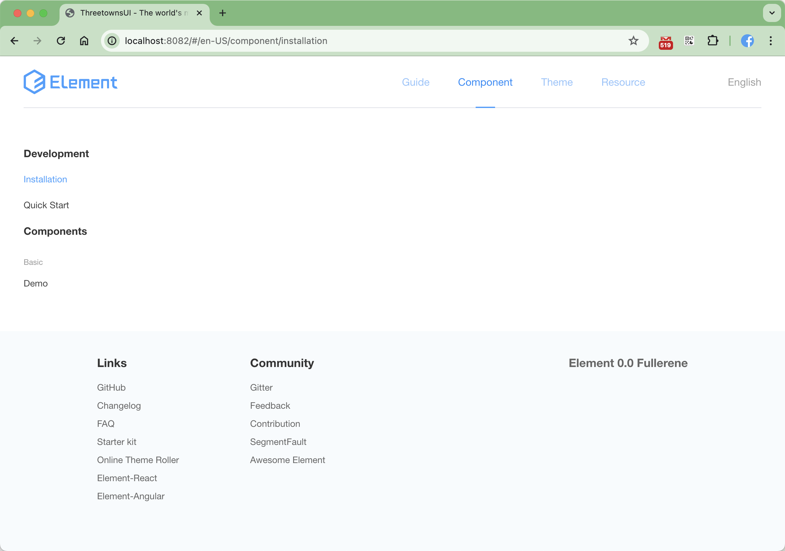
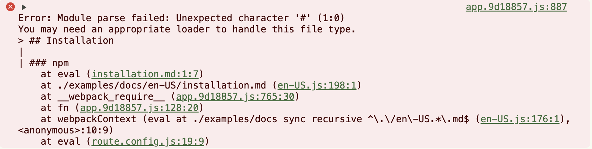

# ElementUI Layout

我们先来一睹 [ElementUI](https://element.eleme.io/#/en-US) 官网的风采，这样对我们后面要做成什么样有个大概的预期。



通过网站页面，我们可以直观看到以下几点：

* **多语言**：支持`English`、`中文` 等语言，通过在hash路由中标识如，`en-US`、`zh-CN` 来实现多语言切换。
* **导航**：`Guide（指南）`、`Component（组件）`、`Theme（主题）`、`Resource（资源）`等。


## 页面布局

* `examples/app.vue`，页面布局。

  ```vue
  <template>
    <div id="app">
      <main-header></main-header>
      <div class="main-cnt">
        <router-view></router-view>
      </div>
      <main-footer></main-footer>
    </div>
  </template>
  
  <script>
    export default {
      name: 'app',
    }
  </script>
  ```

* `examples/entry.js`，加载组件、路由信息、样式等。

  ```js
  import Vue from 'vue';
  import entry from './app';
  
  import routes from './route.config';
  import MainFooter from './components/footer';
  import MainHeader from './components/header';
  
  import './assets/styles/common.css';
  
  Vue.component('main-footer', MainFooter);
  Vue.component('main-header', MainHeader);
  
  new Vue({ // eslint-disable-line
    ...entry
  }).$mount('#app');
  ```
  
* `build/webpack.demo.js`，添加处理`scss`和`svg`的loader。

  ```diff
    module: {
      rules: [
        {
          test: /\.vue$/,
          loader: 'vue-loader',
          options: {
            compilerOptions: {
              preserveWhitespace: false
            }
          }
        },
  +     {
  +       test: /\.(scss|css)$/,
  +       use: [
  +         'style-loader',
  +         'css-loader',
  +         'sass-loader'
  +       ]
  +     },
  +     {
  +       test: /\.(svg|otf|ttf|woff2?|eot|gif|png|jpe?g)(\?\S*)?$/,
  +       loader: 'url-loader',
  +       // todo: 这种写法有待调整
  +       query: {
  +         limit: 10000,
  +         name: path.posix.join('static', '[name].[hash:7].[ext]')
  +       }
  +     },
      ]
    },
  ```

* 安装依赖

  ```bash
  yarn add -D sass-loader@^7.1.0 style-loader@^0.23.1 css-loader@^2.1.0
  
  yarn add -D url-loader@^1.0.1
  ```


### 组件

* `examples/components/header.vue`

  ```vue
  <ul class="nav">
    <li class="nav-item">
      <router-link active-class="active" to="`/${ lang }/guide`">
        {{ langConfig.guide }}
      </router-link>
    </li>
    <li class="nav-item">
      <router-link active-class="active" :to="`/${ lang }/component`">
        {{ langConfig.components }}
      </router-link>
    </li>
    <li class="nav-item nav-item-theme">
      <router-link active-class="active" :to="`/${ lang }/theme`">
        {{ langConfig.theme }}
      </router-link>
    </li>
    <li class="nav-item">
      <router-link active-class="active" :to="`/${ lang }/resource`" exact>
        {{ langConfig.resource }}
      </router-link>
    </li>
    <li class="nav-item nav-versions" v-show="isComponentPage">
      <span class="nav-dropdown is-active">{{ version }}</span>
    </li>
    <!-- 语言选择器 -->
    <li class="nav-item lang-item">
      <span class="nav-dropdown nav-lang" :class="{ 'is-active': langDropdownVisible }">
        {{ displayedLang }}
      </span>
    </li>
  </ul>
  ```

* `examples/components/footer.vue`

* `examples/i18n/component.json`：多语言替换文本


## 路由

* 安装依赖

  ```bash
  yarn add vue-router@3.6.5
  ```

* 引入路由信息

  ```js
  import VueRouter from 'vue-router';
  import routes from './route.config';
  
  Vue.use(VueRouter);
  
  const router = new VueRouter({
    mode: 'hash',
    base: __dirname,
    routes
  });
  
  new Vue({ // eslint-disable-line
    ...entry,
    router
  }).$mount('#app');
  ```


### route.config

#### 一级目录

> `home（首页）`、`guide（指南）`、`Component（组件）`、`Theme（主题）`、`Resource（资源）`。

* 一组目录

```js
import langs from './i18n/route';

const LOAD_MAP = {
  'en-US': name => {
    return r => require.ensure([], () =>
      r(require(`./pages/en-US/${name}.vue`)),
    'en-US');
  }
};

const load = function(lang, path) {
  return LOAD_MAP[lang](path);
};

// 单独处理`componemt组件`目录
const registerRoute = (navConfig) => {
  let route = [];
 
  route.push({
      path: `/${ lang }/component`, component: load(lang, 'component'),
      children: []
  });
  return route;
}

// 构建一组目录
const generateMiscRoutes = function(lang) {
  let guideRoute = {
    path: `/${ lang }/guide`, // 指南
    meta: { lang },
    name: 'guide' + lang,
    component: load(lang, 'guide'),
  };

  let componentRoute = {
    path: `/${ lang }/component`, // 组件
    meta: { lang },
    name: 'component' + lang,
    component: load(lang, 'component'),
  };

  let themeRoute = {
    path: `/${ lang }/theme`, // 主题
    meta: { lang },
    name: 'home' + lang,
    component: load(lang, 'theme'),
  };

  let resourceRoute = {
    path: `/${ lang }/resource`, // 资源
    meta: { lang },
    name: 'resource' + lang,
    component: load(lang, 'resource')
  };

  let indexRoute = {
    path: `/${ lang }`, // 首页
    meta: { lang },
    name: 'home' + lang,
    component: load(lang, 'index')
  };

  return [guideRoute, componentRoute, resourceRoute, themeRoute, indexRoute];
};
```




这里的`Index`、`Guide`、`Theme`、`Resource` 内容基本都是固定不变的，所以没什么要讲的。接下来，我们主要看一下`Component`


### component

```vue
<template>
  <div class="page-component__scroll" ref="componentScrollBar">
  <div class="page-container page-component">
    <div class="page-component__nav">
      <side-nav :data="navsData[lang]" :base="`/${ lang }/component`"></side-nav>
    </div>
    <div class="page-component__content">
      <router-view class="content"></router-view>
      <footer-nav></footer-nav>
    </div>
  </div>
  </div>
</template>
```


#### nav.config.json

`nav.config.json`，是`component（组件）`左侧的导航（**components/side-nav.vue**）配置信息，它包包含：

```json
[
  { "name": "Development", "children": [
      { "path": "/installation", "name": "Installation" },
      { "path": "/quickstart", "name": "Quick Start" }
    ]
  },
  { "name": "Components", "groups": [
  	{
      "groupName": "Basic", "list": [
        { "path": "/demo", "title": "Demo" },
     	]
    }]
  }
]
```

#### route.config.js

* 根据 `examples/nav.config.json` 来处理`component`路由 

```js
import navConfig from './nav.config';

const LOAD_DOCS_MAP = {
  'en-US': path => {
    return r => require.ensure([], () =>
      r(require(`./docs/en-US${path}.md`)),
      'en-US');
  },
}

const loadDocs = function(lang, path) {
  return LOAD_DOCS_MAP[lang](path);
};

const registerRoute = (navConfig) => {
  let route = [];
  Object.keys(navConfig).forEach((lang, index) => {
    let navs = navConfig[lang];
    route.push({
      path: `/${ lang }/component`,
      redirect: `/${ lang }/component/installation`,
      component: load(lang, 'component'),
      children: []
    });
    navs.forEach(nav => {
      if (nav.href) return;
      if (nav.groups) {
        nav.groups.forEach(group => {
          group.list.forEach(nav => {
            addRoute(nav, lang, index);
          });
        });
      } else if (nav.children) {
        nav.children.forEach(nav => {
          addRoute(nav, lang, index);
        });
      } else {
        addRoute(nav, lang, index);
      }
    });
  });
  function addRoute(page, lang, index) {
    const component = loadDocs(lang, page.path);
    let child = {
      path: page.path.slice(1),
      meta: {
        title: page.title || page.name,
        description: page.description,
        lang
      },
      name: 'component-' + lang + (page.title || page.name),
      component: component.default || component
    };

    route[index].children.push(child);
  }
  return route;
};

let route = registerRoute(navConfig);
```

* 打印出 `registerRoute(navConfig);`的路由信息，如下：



* 此时，页面展示如下：




## Module parse failed

在控制台中，我们会看到如下信息：



产生错误原因是，我们加载了`*.md` 文件，即：**vue无法解析markdown文件**。

```js
const LOAD_DOCS_MAP = {
  'en-US': path => {
    return r => require.ensure([], () =>
      r(require(`./docs/en-US${path}.md`)),
      'en-US');
  },
}
```


所以，接下来我们需要开发一个`md-loader`，用来将`markdown`文件转换成`vue`，最终通过`vue-loader`转换成html。

