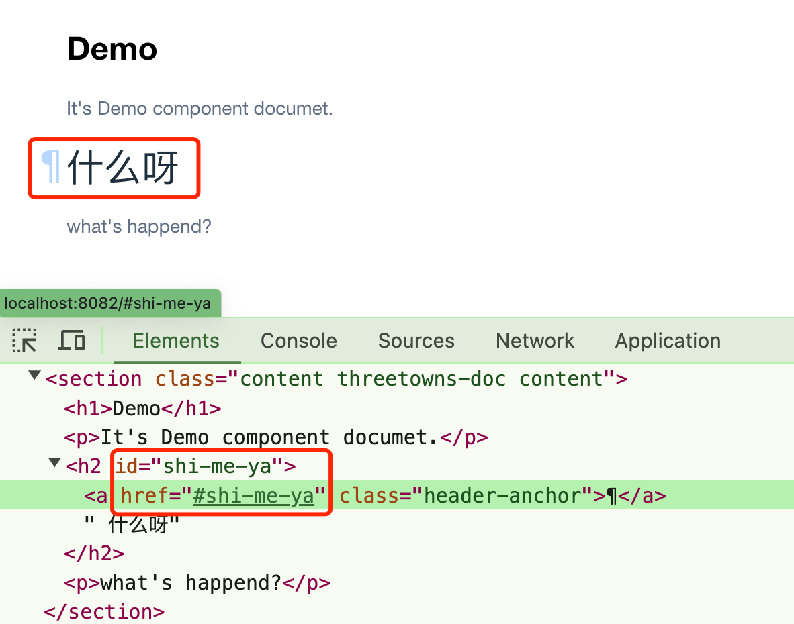
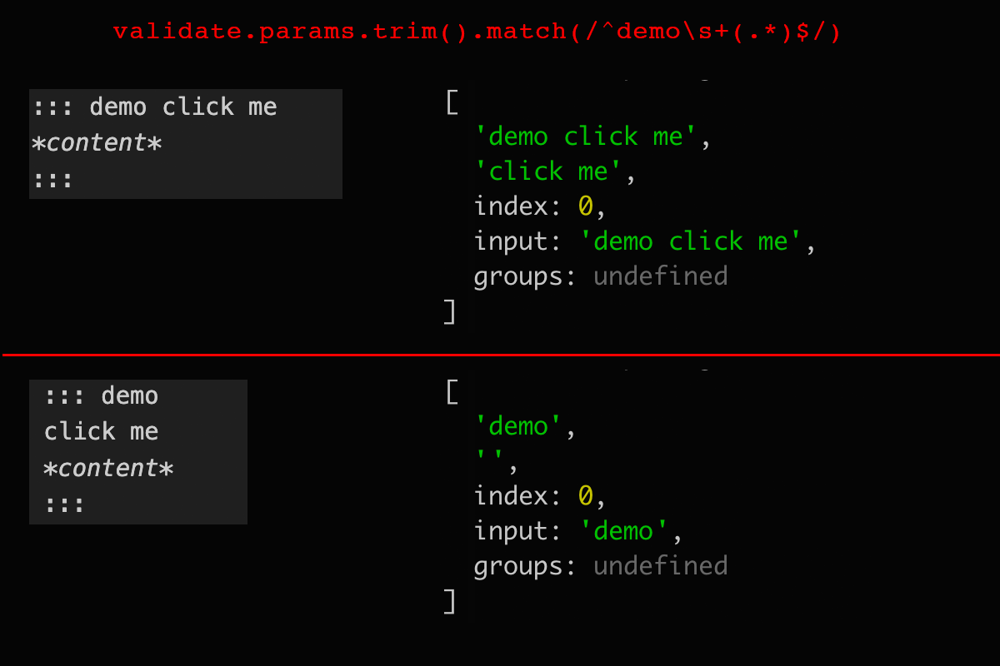
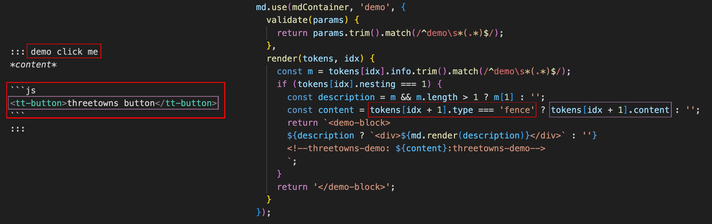
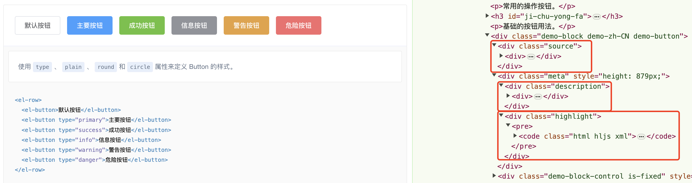
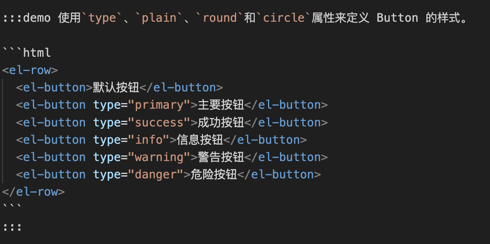
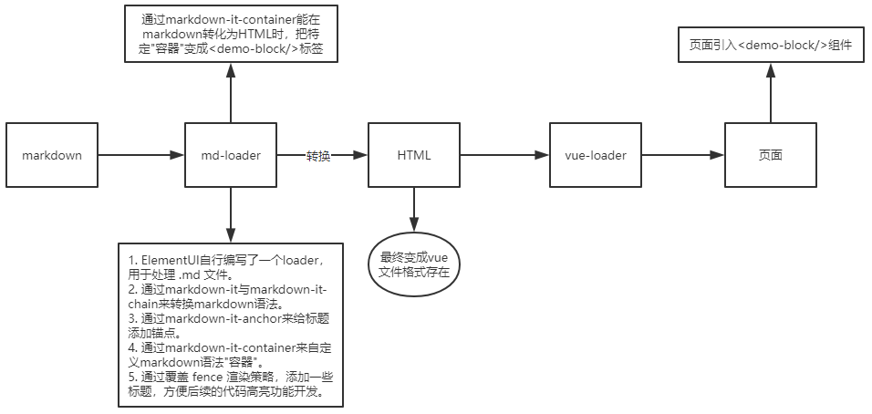

# md-loader

**webpack**只能对`js`和`json`文件类型进行处理，对于其它文件类型的处理，需要借助 `loader`。我们在`build/webpack.demo.js`中配置markdown的`model`规则：

```js
{
  test: /\.md$/,
    use: [
      {
        loader: 'vue-loader',
        options: {
          compilerOptions: {
            preserveWhitespace: false
          }
        }
      },
      {
        loader: path.resolve(__dirname, './md-loader/index.js')
      }
    ]
},
```

我们可以在 `webpack/md-loader/index.js` 中，通过`source`获取 **md**文件的源码内容

```js
module.exports = function (source) {
  return `
    <template>
      <section class="content element-doc">
        Hello md-loader.
      </section>
    </template>
  `;
}
```


## markdown转html

对于`markdown`文件，我们封装一个`md-loader`，将它处理成**html**。需要用到以下依赖：

* [markdown-it](https://markdown-it.github.io/markdown-it/)：将`makedown`字符串转换成`html`字符串，即：`# h1 Heading` 到 `<h1>h1 Heading</h1>` 的转换。
* [markdown-it-chain](https://www.npmjs.com/package/markdown-it-chain)：以链式调用的形式来`makedown`库（A chaining API like `webpack-chain` but for `markdown-it`）。
* [makedown-it-anchor]()：为各级标题添加锚点。
* [markdown-it-container](https://www.npmjs.com/package/markdown-it-container)：创建自定义块级容器。
* [transliteration](https://www.npmjs.com/package/transliteration)：中文转拼音。

这3个依赖，都有比较详细的官方文档可以查询。

```bash
yarn add -D markdown-it@^8.4.1 markdown-it-chain@^1.3.0 markdown-it-container@^2.0.0

yarn add -D transliteration@^1.1.11 markdown-it-anchor@^5.0.2
```


### markdown-it

* `build/md-loader/index.js`

  ```js
  const markdownit = require('markdown-it');
  const md = markdownit();
      
  module.exports = function (source) {
    return `
      <section class="content threetowns-doc">
        ${md.render(source)}
      </section>
    `;
  }
  ```

* `examples/docs/demo.md`

  ```markdown
  # Demo
  
  It's Demo component documet.
  ```

* 转换后，如下：

  ```html
  <section class="content threetowns-doc content">
    <h1>Demo</h1>
    <p>It's Demo component documet.</p>
  </section>
  ```


### markdown-it-anchor

> A markdown-it plugin that adds an `id` attribute to headings and optionally permalinks.

 `## Foo` becomes `<h2 id="foo">Foo</h2>`.


### transliteration

```js
import { transliterate as tr, slugify } from 'transliteration';

tr('你好, world!');
// Ni Hao , world!
slugify('你好, world!');
// ni-hao-world
```


### markdown-it-anchor & transliterate

```js
const Config = require('markdown-it-chain');
const anchorPlugin = require('markdown-it-anchor');
const slugify = require('transliteration').slugify;

const config = new Config();
config
  .options.html(true).end()
  .plugin('anchor').use(anchorPlugin, [
    {
      level: 2, // 传入数字，则代表最少包含的渲染层级
      slugify: slugify, // 生成有效url的自定义函数
      permalink: true,  // 是否在标题旁加入永久链接
      permalinkBefore: true // 将永久链接放在标题的前面
    }
  ]).end()

const md = config.toMd();

module.exports = function (source) {
  const content = md.render(source);
  return `
    <template>
      <section class="content threetowns-doc">
      ${content}
      </section>
    </template>
  `;
}
```




### markdown-it-container

前面的依赖，可以自行将`md`转换成`html`，并给标题添加锚点。`markdown-it-container` 可以创建自定义块级容器。

```js
var md = require('markdown-it')()
            .use(require('markdown-it-container'), name [, options]);
```

**Params:**

* **name** - mandatory, container name.（内容名称，必选）
* **options**:
  * **validate** - optional, function to validate tail after opening marker, should return true on success.（校验开始标记的结束，如果成功则返回true）
  * **render** - optional, renderer function for opening/closing tokens.开始/结束标记的渲染函数
  * **marker** - optional (`:`), character to use in delimiter.分隔符

#### validate



#### tokens

```js
[
  Token {
    type: 'container_demo_open', tag: 'div',
    attrs: null, map: [ 1, 6 ], nesting: 1, level: 0, children: null,
    content: '', markup: ':::', info: ' demo click me',
    meta: null, block: true, hidden: false
  },
  Token {
    type: 'paragraph_open', tag: 'p',
    attrs: null, map: [ 2, 3 ], nesting: 1, level: 1, children: null,
    content: '', markup: '', info: '',
    meta: null, block: true, hidden: false
  },
  Token {
    type: 'inline', tag: '',
    attrs: null, map: [ 2, 3 ], nesting: 0, level: 2, children: [ [Token], [Token], [Token] ],
    content: '*content*', markup: '', info: '',
    meta: null, block: true, hidden: false
  },
  Token {
    type: 'paragraph_close', tag: 'p',
    attrs: null, map: null, nesting: -1, level: 1, children: null,
    content: '', markup: '', info: '',
    meta: null, block: true, hidden: false
  },
  Token {
    type: 'fence', tag: 'code',
    attrs: null, map: [ 3, 6 ], nesting: 0, level: 1, children: null,
    content: '<tt-button>threetowns button</tt-button>', markup: '```',
    info: 'js',
    meta: null, block: true, hidden: false
  },
  Token {
    type: 'container_demo_close', tag: 'div',
    attrs: null, map: null, nesting: -1, level: 0, children: null,
    content: '', markup: ':::', info: '',
    meta: null, block: true, hidden: false
  }
]
```

#### description

`const m = tokens[idx].info.trim().match(/^demo\s+(.*)$/);`

```js
[
  'demo click me',
  'click me',   // const description = m && m.length > 1 ? m[1] : '';
  index: 0,
  input: 'demo click me',
  groups: undefined
]
```

#### content

`const content = tokens[idx + 1].type === 'fence' ? tokens[idx + 1].content : '';`

处理`type === 'fence'` （fenced-code-blocks，栅栏代码块）的内容。

```js
render(tokens, idx) {
  const m = tokens[idx].info.trim().match(/^demo\s*(.*)$/);
  if (tokens[idx].nesting === 1) {
    const description = m && m.length > 1 ? m[1] : '';
    const content = tokens[idx + 1].type === 'fence' ? tokens[idx + 1].content : '';
    return `<demo-block>
        ${description ? `<div>${md.render(description)}</div>` : ''}
        <!--threetowns-demo: ${content}:threetowns-demo-->
        `;
  }
  return '</demo-block>';
}
```


* `build/md-loader/index.js`

~~~js
const mdContainer = require('markdown-it-container');

module.exports = md => {
  md.use(mdContainer, 'demo', {
    validate: function(params) {
      return params.trim().match(/^demo\s+(.*)$/);
    },

    render: function (tokens, idx) {
      var m = tokens[idx].info.trim().match(/^demo\s+(.*)$/);

      if (tokens[idx].nesting === 1) { // 嵌套
        // 获取description
        const description = m && m.length > 1 ? m[1] : '';
        // 获取fence内容：fenced code blocks
        const content = tokens[idx + 1].type === 'fence' ? tokens[idx + 1].content : '';
        return `<demo-block>
          ${description ? `<div>${md.render(description)}</div>` : ''}
          <!--threetowns-demo: ${content}:threetowns-demo-->
          `;
      }
      return '</demo-block>';
    }
	});
};

console.log(md.render('::: demo click me\n
*content*
```js
<tt-button>threetowns button</tt-button>
```
:::'));
~~~



* input

  ````markdown
  ::: demo click me
  *content*
  
  ```js
  <tt-button>threetowns button</tt-button>
  ```
  :::
  
  ````

* output

  ```html
  <demo-block>
    <div><p>click me</p></div>
    <!--threetowns-demo: :threetowns-demo-->
    <p><em>content</em></p>
    <pre>
    	<code class="language-js">
    		&lt;tt-button&gt;threetowns button&lt;/tt-button&gt;
  		</code>
  	</pre>
  </demo-block>
  ```


#### fence

* `build/md-loader/fence.js`

```js
// 覆盖默认的 fence 渲染策略
module.exports = md => {
    const defaultRender = md.renderer.rules.fence;
    md.renderer.rules.fence = (tokens, idx, options, env, self) => {
      const token = tokens[idx];
      // 判断该 fence 是否在 :::demo 内
      const prevToken = tokens[idx - 1];
      const isInDemoContainer = prevToken && prevToken.nesting === 1 && prevToken.info.trim().match(/^demo\s*(.*)$/);
      if (token.info === 'html' && isInDemoContainer) {
        return `<template slot="highlight"><pre v-pre><code class="html">${md.utils.escapeHtml(token.content)}</code></pre></template>`;
      }
      return defaultRender(tokens, idx, options, env, self);
    };
  };
  
```


### md-loader/index.js

```html
<demo-block>
  <div><p>click me</p></div>
  <!--threetowns-demo: :threetowns-demo-->
  <p><em>content</em></p>
  <pre>
  	<code class="language-js">
  		&lt;tt-button&gt;threetowns button&lt;/tt-button&gt;\n
  	</code>
  </pre>
</demo-block>

<script>
  export default {
    name: 'component-doc',
    components: {
      "threetowns-demo0": (function() {

        var render = function () {
          var _vm = this
          var _h = _vm.$createElement
          var _c = _vm._self._c || _h
          return _c("div")
        }
        var staticRenderFns = []
        render._withStripped = true

        const democomponentExport = {}
        return {
          render,
          staticRenderFns,
          ...democomponentExport
        }
      })(),
    }
  }
</script>
```


### demo-block.vue

```vue
<template>
    <div
      class="demo-block"
      :class="[blockClass, { 'hover': hovering }]"
      @mouseenter="hovering = true"
      @mouseleave="hovering = false">
      <div class="source">
        <slot name="source"></slot>
      </div>
      <div class="meta" ref="meta">
        <div class="description" v-if="$slots.default">
          <slot></slot>
        </div>
        <div class="highlight">
          <slot name="highlight"></slot>
        </div>
      </div>
      <div
        class="demo-block-control"
        ref="control"
        :class="{ 'is-fixed': fixedControl }"
        @click="isExpanded = !isExpanded">
        <transition name="arrow-slide">
          <i :class="[iconClass, { 'hovering': hovering }]"></i>
        </transition>
        <transition name="text-slide">
          <span v-show="hovering">{{ controlText }}</span>
        </transition>
        <tt-tooltip effect="dark" :content="langConfig['tooltip-text']" placement="right">
          <transition name="text-slide">
            <tt-button
              v-show="hovering || isExpanded"
              size="small"
              type="text"
              class="control-button"
              @click.stop="goCodepen">
              {{ langConfig['button-text'] }}
            </tt-button>
          </transition>
        </tt-tooltip>
      </div>
    </div>
  </template>
```


## 示例



* markdown语法

  


## 总结

`md-loader`的转换流程，整个转换流程的核心是通过`markdown-it-container`自定义 block-lever 块级内容（未定义的块级内容（将自定义内容处理成`<demo-block>`组件），会被`markdown`转换成**html**），最终变成**vue**文件。然后通过`vue-loader`将vue处理成最终的html页面。

`markdown-it-container` 的**基本功能**使用方法，如：

```js
const mdContainer = require('markdown-it-container');

module.exports = md => {
  md.use(mdContainer, 'tip');
  md.use(mdContainer, 'warning');
};
```

遇到，如下情况时：

```markdown
:::tip
This is a tip container.
:::

:::warning
This is a waring container
:::
```

被转换成：

```html
<div class="tip">
  <p>This is a tip container.</p>
</div>

<div class="warning">
  <p>This is a warning container.</p>
</div>
```

**高级功能**

通过`validate`、`render` 进行自定义

```js
const mdContainer = require('markdown-it-container');

module.exports = md => {
	md.use(mdContainer, 'demo', {
    validate(params) {
      return params.trim().match(/^demo\s*(.*)$/);
    },
    render(tokens, idx) {
      const m = tokens[idx].info.trim().match(/^demo\s*(.*)$/);
      if (tokens[idx].nesting === 1) {
        const description = m && m.length > 1 ? m[1] : '';
        const content = tokens[idx + 1].type === 'fence' ? tokens[idx + 1].content : '';
        return `<demo-block>
        ${description ? `<div>${md.render(description)}</div>` : ''}
        <!--threetowns-demo: ${content}:threetowns-demo-->
        `;
      }
      return '</demo-block>';
    }
  });
```


同时，对 `fence` 渲染策略进行覆盖（对于**html-fence**，将内容写入到**highlight**中）。我们就是得到一个包含`vue`组件的内容：``

```vue
<div class="demo-block">
  <div class="source">
    <slot name="source"></slot>
  </div>
  <div class="meta" ref="meta">
    <div class="description" v-if="$slots.default">
      <slot></slot>
    </div>
    <div class="highlight">
      <slot name="highlight"></slot>
    </div>
  </div>
</div>
```


**其它细节**

通过`markdown-it-anchor`和`transliteration`给标题添加锚点。





* [fenced code blocks](http://spec.commonmark.org/0.18/#fenced-code-blocks)