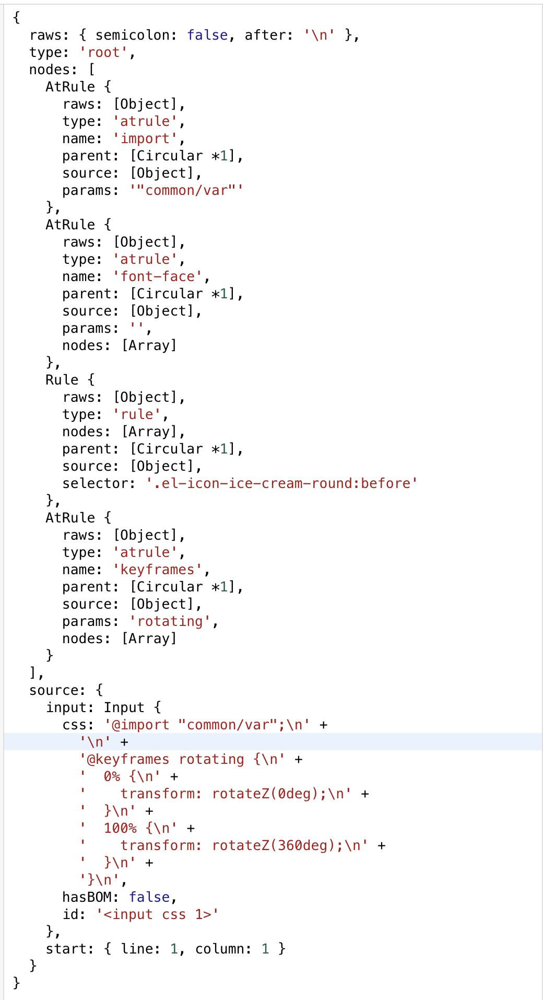
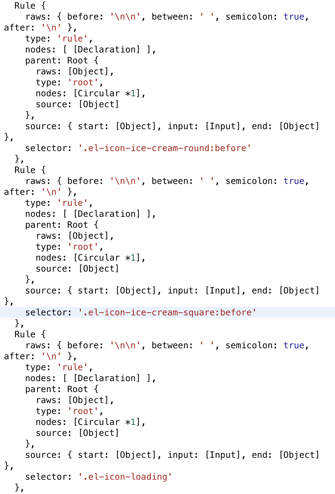

# Icon

在`package.json`中`scripts`字段，有一个 **build:file** 命令用于自动生成一些文件。

```bash
node build/bin/iconInit.js & 
node build/bin/build-entry.js & 
node build/bin/i18n.js & 
node build/bin/version.js
```

其中的 `build/bin/iconInit.js` 就是自动生成 **icon** 的命令。

```js
'use strict';

var postcss = require('postcss');
var fs = require('fs');
var path = require('path');
var fontFile = fs.readFileSync(path.resolve(__dirname, '../../packages/theme-chalk/src/icon.scss'), 'utf8');
var nodes = postcss.parse(fontFile).nodes;
var classList = [];

nodes.forEach((node) => {
  var selector = node.selector || '';
  var reg = new RegExp(/\.el-icon-([^:]+):before/);
  var arr = selector.match(reg);

  if (arr && arr[1]) {
    classList.push(arr[1]);
  }
});

classList.reverse(); // 希望按 css 文件顺序倒序排列

fs.writeFile(path.resolve(__dirname, '../../examples/icon.json'), JSON.stringify(classList), () => {});

```


## 解析过程

### readFileSync

```scss
@import "common/var";

@font-face {
  font-family: 'element-icons';
  src: url('#{$--font-path}/element-icons.woff') format('woff'), /* chrome, firefox */
       url('#{$--font-path}/element-icons.ttf') format('truetype'); /* chrome, firefox, opera, Safari, Android, iOS 4.2+*/
  font-weight: normal;
  font-display: $--font-display;
  font-style: normal;
}

[class^="el-icon-"], [class*=" el-icon-"] {
  /* use !important to prevent issues with browser extensions that change fonts */
  font-family: 'element-icons' !important;
  speak: none;
  font-style: normal;
  font-weight: normal;
  font-variant: normal;
  text-transform: none;
  line-height: 1;
  vertical-align: baseline;
  display: inline-block;

  /* Better Font Rendering =========== */
  -webkit-font-smoothing: antialiased;
  -moz-osx-font-smoothing: grayscale;
}

.el-icon-ice-cream-round:before {
  content: "\e6a0";
}

.el-icon-ice-cream-square:before {
  content: "\e6a3";
}


.el-icon-loading {
  animation: rotating 2s linear infinite;
}

.el-icon--right {
  margin-left: 5px;
}
.el-icon--left {
  margin-right: 5px;
}

@keyframes rotating {
  0% {
    transform: rotateZ(0deg);
  }
  100% {
    transform: rotateZ(360deg);
  }
}

```

### parse

经过 parse 解析：`postcss.parse(fontFile)` ，会得到一个对象：

```bash
<ref *1> Root {
  raws: { semicolon: false, after: '\n' },
  type: 'root',
  nodes: [
   // ...
  ],
  source: {
    input: Input {
      css: '
      //
      ',
      hasBOM: false,
      id: '<input css 1>'
    },
    start: { line: 1, column: 1 }
  }
}
```



### nodes

获取其中的 nodes（它是一个数组），`postcss.parse(fontFile).nodes`

```bash
[
  Rule {
    raws: { before: '\n\n', between: ' ', semicolon: true, after: '\n' },
    type: 'rule',
    nodes: [
      [Comment],     [Declaration],
      [Declaration], [Declaration],
      [Declaration], [Declaration],
      [Declaration], [Declaration],
      [Declaration], [Declaration],
      [Comment],     [Declaration],
      [Declaration]
    ],
    parent: Root {
      raws: [Object],
      type: 'root',
      nodes: [Circular *1],
      source: [Object]
    },
    source: { start: [Object], input: [Input], end: [Object] },
    selector: '[class^="el-icon-"], [class*=" el-icon-"]'
  },
  Rule {
    raws: { before: '\n\n', between: ' ', semicolon: true, after: '\n' },
    type: 'rule',
    nodes: [ [Declaration] ],
    parent: Root {
      raws: [Object],
      type: 'root',
      nodes: [Circular *1],
      source: [Object]
    },
    source: { start: [Object], input: [Input], end: [Object] },
    selector: '.el-icon-ice-cream-round:before'
  },
]
```




### selecotr

1. 通过正则匹配出nodes中的 selector：

```js
nodes.forEach((node) => {
  var selector = node.selector || '';
})
```

得到 `selector` （注意没有selector的，也会返回空行）

```bash
// 不返回 @import "common/var";
// 不返回 @font-face
[class^="el-icon-"], [class*=" el-icon-"]
.el-icon-ice-cream-round:before
.el-icon-ice-cream-square:before
.el-icon-loading
.el-icon--right
.el-icon--left
// @keyframes rotating
```

2. 正则配置

   ```diff
    var reg = new RegExp(/\.el-icon-([^:]+):before/);
      var arr = selector.match(reg);
   +  var reg = new RegExp(/\.el-icon-([^:]+):before/);
   +  var arr = selector.match(reg);
    })
   ```

   得到 `arr`

   ```js
   null  // 对应：@import "common/var";
   null  // 对应：@font-face
   null  // 对应：[class^="el-icon-"], [class*=" el-icon-"]
   [
     '.el-icon-ice-cream-round:before',
     'ice-cream-round',
     index: 0,
     input: '.el-icon-ice-cream-round:before',
     groups: undefined
   ]
   [
     '.el-icon-ice-cream-square:before',
     'ice-cream-square',
     index: 0,
     input: '.el-icon-ice-cream-square:before',
     groups: undefined
   ]
   null  // 对应：.el-icon-loading
   null  // 对应：.el-icon--right
   null  // 对应：.el-icon--left
   null  // 对应： @keyframes rotating
   ```

* 获取 `arr[1]`

  ```diff
   var reg = new RegExp(/\.el-icon-([^:]+):before/);
     var arr = selector.match(reg);
     var reg = new RegExp(/\.el-icon-([^:]+):before/);
     var arr = selector.match(reg);
  +  if (arr && arr[1]) {
  +    classList.push(arr[1]);
  +  }
   })
  ```

### writeFile

* 将所有`icon`的 class名写入到 `examples/icon.json`中

  ```js
  fs.writeFile(path.resolve(__dirname, '../../examples/icon.json'), JSON.stringify(classList), () => {});
  ```


## 输出

最终就是得到icon图标列表

