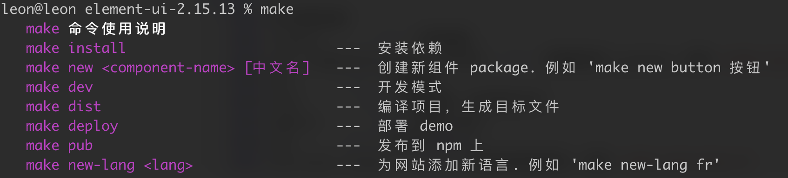
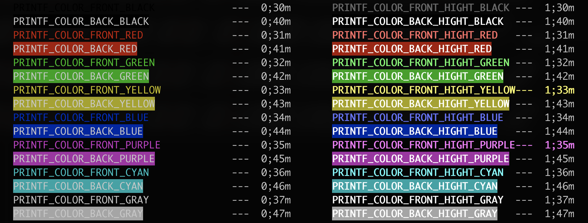

# Makefile

## syntax

```makefile
targets : prerequisites
    command
    
# or

targets : prerequisites; command
    command
```

* `targets`：规则的目标（必须要有的），可以是：
  *  `Object File`（一般称它为中间文件）
  * 可执行文件
  * 一个标签
* `prerequisites`： `targets` 需要的依赖（可以是文件或者是目标；也可以是没有）
* `command`：`make`执行的命令（任意的 `shell` 命令【可以有多条命令，每一条命令占一行】）
  * 需要先使用 **tab 键**空开（规定），然后在写入命令。


## example

```makefile
.PHONY: dist test
default: help

# build all theme
build-theme:
	npm run build:theme

install:
	npm install

install-cn:
	npm install --registry=http://registry.npm.taobao.org

dev:
	npm run dev

play:
	npm run dev:play

new:
	node build/bin/new.js $(filter-out $@,$(MAKECMDGOALS))

new-lang:
	node build/bin/new-lang.js $(filter-out $@,$(MAKECMDGOALS))

dist: install
	npm run dist

deploy:
	@npm run deploy

pub:
	npm run pub

test:
	npm run test:watch

help:
	@echo "   \033[35mmake\033[0m \033[1m命令使用说明\033[0m"
	@echo "   \033[35mmake install\033[0m\t\033[0m\t\033[0m\t\033[0m\t---  安装依赖"
	@echo "   \033[35mmake new <component-name> [中文名]\033[0m\t---  创建新组件 package. 例如 'make new button 按钮'"
	@echo "   \033[35mmake dev\033[0m\t\033[0m\t\033[0m\t\033[0m\t---  开发模式"
	@echo "   \033[35mmake dist\033[0m\t\033[0m\t\033[0m\t\033[0m\t---  编译项目，生成目标文件"
	@echo "   \033[35mmake deploy\033[0m\t\033[0m\t\033[0m\t\033[0m\t---  部署 demo"
	@echo "   \033[35mmake pub\033[0m\t\033[0m\t\033[0m\t\033[0m\t---  发布到 npm 上"
	@echo "   \033[35mmake new-lang <lang>\033[0m\t\033[0m\t\033[0m\t---  为网站添加新语言. 例如 'make new-lang fr'"
```

## make

### .PHONY

用来修饰`tagets（目标文件）`是一个**伪造**的目标文件。即：执行规则命令并**不会生成这个目标文件**

```makefile
.PHONY: targets
```


### filter-out

```makefile
new:
	node build/bin/new.js $(filter-out $@,$(MAKECMDGOALS))

new-lang:
	node build/bin/new-lang.js $(filter-out $@,$(MAKECMDGOALS))
```


### 彩色进度条



#### 控制码

| 功能说明     | ANSI      | 功能说明   | ANSI                   |
| ------------ | --------- | ---------- | ---------------------- |
| 关闭所有属性 | `\033[0m` | 下划线     | `\033[4m`              |
| 高亮         | `\033[1m` | 反显       | `\033[7m`              |
| 淡化         | `\033[3m` | 设置前景色 | `\033[30m -- \033[37m` |
| 倾斜         | `\033[3m` | 设置背景色 | `\033[40m -- \033[47m` |

#### 字体色和背景色

| 颜色 | 字体色                         | 背景色                        |
| ---- | ------------------------------ | ----------------------------- |
| 黑   | 30 `PRINTF_COLOR_FRONT_BLACK`  | 40 `PRINTF_COLOR_BACK_BLACK`  |
| 红   | 31 `PRINTF_COLOR_FRONT_RED`    | 41 `PRINTF_COLOR_BACK_RED`    |
| 绿   | 32 `PRINTF_COLOR_FRONT_GREEN`  | 42 `PRINTF_COLOR_BACK_GREEN`  |
| 黄   | 33 `PRINTF_COLOR_FRONT_YELLOW` | 43 `PRINTF_COLOR_BACK_YELLOW` |
| 蓝   | 34 `PRINTF_COLOR_FRONT_BLUE`   | 44 `PRINTF_COLOR_BACK_BLUE`   |
| 紫   | 35 `PRINTF_COLOR_FRONT_PURPLE` | 45 `PRINTF_COLOR_BACK_PURPLE` |
| 深绿 | 36 `PRINTF_COLOR_FRONT_CYAN`   | 46 `PRINTF_COLOR_BACK_CYAN`   |
| 灰色 | 37 `PRINTF_COLOR_FRONT_GRAY`   | 47 `PRINTF_COLOR_BACK_GRAY`   |

