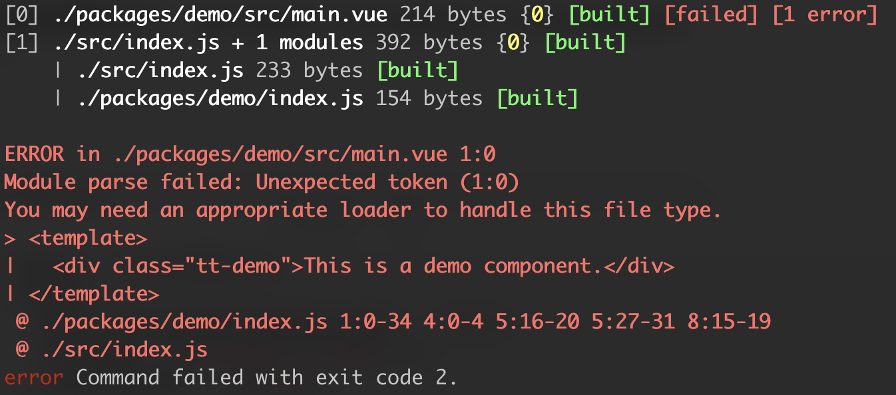

# 组件库流程

一个完整的组件库，应该包含以下功能：

* 具体组件的实现：它支持全局引入和按需引入
* **dev**时，可以起一个本地服务器
* **dist**时，即：最终可以输出`commonjs`和`UMD`格式的代码
* **test**时，自动化测试功能，也是一个完整组件库必不可少的功能
* **theme**时，组件库的色彩应该是可以自定义的
* **demo**时，即：应该有完整的示例及使用文档
* **build**时，即：应该有完整的CI/CD流程


基本的功能，我们大致梳理了。接下来，我们就来实践...注意，在实践的过程中，你会遇到很多稀奇古怪的问题（可能你会习惯性的回避或试图放弃），通过第一性原理去解决它，最终你会得到内啡肽的补偿，从而成就更好的自己。

接下来，我们开始造轮子，先来实践一个简易版的组件库（熟悉流程、应付面试，后面工作后再重新开发完整组件库），我们以**element-ui**组件库源码为基石和参考，来实践一个组件库（注意：我们的主要目标是实践一个组件库，而不是分析element-ui组件库的实践，所以在这个过程中应该保持清晰的思路）。

一个组件库最基本的功能是：组件库开发和最终的输出发布。我们先着重看下**dev**和**dist**指令来着手，从而确定目录结构和打包配置信息。


## dev

> 需要解决的问题：
>
> * 目录结构
> * 本地服务器

在 `package.json`文件中`scripts`的 `dev` 指令：

```bash
npm run bootstrap &&
npm run build:file &&
cross-env NODE_ENV=development
webpack-dev-server --config build/webpack.demo.js &
node build/bin/template.js
```

将上面的指令一一拆解：

* bootstrap

  ```bash
  yarn || npm i
  ```

* build:file

  ```bash
  node build/bin/iconInit.js & 
  node build/bin/build-entry.js & 
  node build/bin/i18n.js & 
  node build/bin/version.js
  ```

  分别是处理：icon图标、入口文件、国际化、版本号。我们先只关注`build-entry`。

* webpack-dev-server

  ```bash
  cross-env NODE_ENV=development
  webpack-dev-server --config build/webpack.demo.js
  ```

* template

  ```bash
  node build/bin/template.js
  ```

  用于构建demo模板

通过对`dev`的分析，我们发现element-ui的demo是通过一系列工程化生成的（这是我们最终的目标）。所以，很明显步子迈得太大了，我们得抓住核心部分，一步一步去推演，近而最终实现它。

## dist

打包执行脚本

```bash
npm run clean && 
npm run build:file && 
npm run lint && 
webpack --config build/webpack.conf.js && 
webpack --config build/webpack.common.js && 
webpack --config build/webpack.component.js && 
npm run build:utils && 
npm run build:umd && 
npm run build:theme
```

* lint

  ```bash
  eslint src/**/* test/**/* packages/**/* build/**/* --quiet
  ```

  通过`eslint`进行语法检测

* webpack

  ```bash
  webpack --config build/webpack.conf.js && 
  webpack --config build/webpack.common.js && 
  webpack --config build/webpack.component.js &&
  ```

* build:utils

  ```bash
  cross-env BABEL_ENV=utils babel src --out-dir lib --ignore src/index.js
  ```

* build:theme

  ```bash
  node build/bin/gen-cssfile && 
  gulp build --gulpfile packages/theme-chalk/gulpfile.js && 
  cp-cli packages/theme-chalk/lib lib/theme-chalk
  ```


## pub

发布流程

```bash
npm run bootstrap && 
sh build/git-release.sh && 
sh build/release.sh && 
node build/bin/gen-indices.js
```

检测代码冲突，并构造**algolia**需要的内容搜索json配置信息


## 小结

通过对`dev`、`dist`、`pub`的分析，我们发现了有很多花里胡哨的操作，对于我们实现最基本的组件库而言，并不是刚需。所以，我们得删繁就简，抓住主线，使注意力集中，先从0到1，再从1到100。


## 从零开始

### 目录结构

```bash
.
├── package.json
├── packages
│   └── demo
│       ├── index.js
│       └── src
│           └── main.vue
└── src
    └── index.js
```

* 通过 `npm init -y`创建并初始化`package.json`
* 创建`src`目录，并初始化入口文件`src/index.js`
* 创建组件目录，并初始化 **demo**组件

### demo组件

* `packages/demo/src/main.vue`

  ```vue
  <template>
    <div class="tt-demo">This is a demo component.</div>
  </template>
  
  <script>
  export default {
    name: 'Tt-demo'
  };
  </script>
  
  ```

* `packages/demo/index.js`

  ```js
  import Demo from './src/main.vue';
  
  // 按需引用：Vue.use(Demo)
  Demo.install = function(Vue) {
    Vue.component(Demo.name, Demo);
  };
  
  export default Demo;
  
  ```

### 入口文件

* `src/index.js`

```js
import Demo from '../packages/demo/index.js';

const components = [
  Demo
];

const install = (Vue) => {
  components.forEach(component => {
    Vue.component(component.name, component);
  })
}

export default {
  install, // 全局引用：vue.use(ThreetownsUI)
  Demo // 组件引用：Vue.component(Demo.name, Demo);
}
```


### 打包

#### 引入webpack

```bash
yarn add -D webpack@4.14.0 webpack-cli@3.0.8
```

* 修改 `package.json`

  * `main` 配置项，改成打包后生成的文件

  ```json
  "main": "lib/element-ui.common.js",
  "scripts": {
    "build": "webpack --config build/webpack.common.js"
  }
  ```

#### 配置webpack

* `build/webpack.common.js`

```js
const path = require('path');

module.exports = {
  mode: 'production',
  entry: './src/index.js',
  output: {
    path: path.resolve(process.cwd(), './lib'),
    filename: 'threetowns-ui.common.js',
    libraryTarget: 'commonjs2',
  }
};

```

众所周知，**webpack**只能处理 `js` 和 `.json` 文件，其它类型的文件需要通过相应的 **loader** 处理。


#### 处理 .vue文件

而我们的组件文件后缀是：`.vue`。当我们执行 **yarn build** 时，会报错：

> ```bash
> $ yarn build
> ERROR in ./packages/demo/src/main.vue 1:0
> Module parse failed: Unexpected token (1:0)
> You may need an appropriate loader to handle this file type.
> ```



通过上面的webpack提示，我们得知：需要一个合适的**loader**去处理`.vue`文件类型。

* 安装 `vue-loader` 依赖

```js
yarn add -D vue-loader@15.7.2
```

* 修改配置文件

  ```diff
   const path = require('path');
  +const VueLoaderPlugin = require('vue-loader/lib/plugin');
   
   module.exports = {
     mode: 'production',
     // ...
  -  }
  +  },
  +  module: {
  +    rules: [
  +      {
  +        test: /\.vue$/,
  +        loader: 'vue-loader',
  +        options: {
  +          compilerOptions: {
  +            preserveWhitespace: false // 打包后清除多余的空格
  +          }
  +        }
  +      },
  +    ]
  +  },
  +  plugins: [
  +    new VueLoaderPlugin()
  +  ]
   };
  ```


### 测试组件库

#### 打包成本地npm

* 生成支持**commonJS**类型文件，`lib/threetowns-ui.common.js`

  ```bash
  yarn build
  ```

* 本地打包成 `.tgz` 压缩文件，`threetowns-ui-0.0.1.tag`

  ```bash
  yarn pack
  ```

#### 在实际项目中使用

通过 `vue create threetowns-ui-demo`创建 **vue@2.x**的项目，并引入本地npm包（相对路径）：

```bash
yarn add ../threetowns-ui/threetowns-ui-0.0.1.tag
```

* `package.json` 变化：

  ```diff
   "dependencies": {
      "core-js": "^3.8.3",
      "element-ui": "^2.15.14",
  +   "threetowns-ui": "../threetowns-ui/threetowns-ui-v0.0.1.tgz",
      "vue": "^2.6.14"
    },
  ```

* 全局引入 

  在项目`main.js`中引入

  ```bash
  import ThreetownsUI from 'threetowns-ui';
  Vue.use(ThreetownsUI);
  ```

> 这样可以模拟真实的应用场景，但不足的是：组件每次有改动，都需要重新build并引入到项目中使用，对于组件开发人员并不友好。


#### 快速测试组件

现在的方案用很多，如：`storybook`。但这里，我们手动创建`examples`文件夹。这里先不讨论，后面会详细说明。


## 总结

一个组件库的雏形，应该包括以下信息：

```bash
$ tree -I "node_modules|lib"
.
├── build
│   └── webpack.common.js   # webpack配置文件
├── package.json
├── packages                # 组件目标
│   └── demo
│       ├── index.js
│       └── src
│           └── main.vue
├── src
│   └── index.js            # 入口文件
└── yarn.lock

5 directories, 6 files
```

* **build**时，`main`配置项为打包后的文件：`lib/threetowns-ui.common.js`
* 需要引入`vue-loader`对**.vue**文件进行处理
* 组件开发的细节中，需要将组件对外暴露 `install()`方法


### 后续

* 样式
* icon图标
* svg、图标资源
* 文档
* 测试