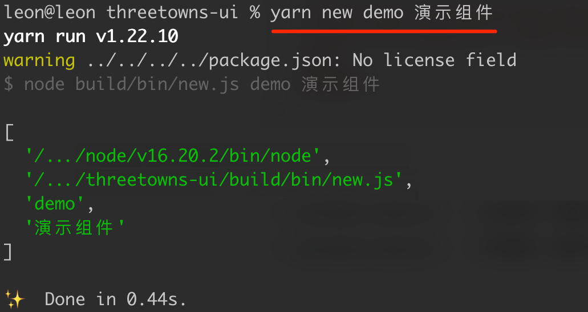

# 自动创建组件

前面，我们已经通过 `gen-cssfile.js` 遍历`components.json`自动创建组件的 `scss` 文件，并 `@import` 到 `index.scss` 中。在自动创建过程中，对`icon.scss` 和 `fonts` 直接copy。

同样，我们也可以将手动创建组件的过程，自动化。

我们先来回顾一下，创建一个完整的组件（以`demo`为例），大概需要哪些步骤：

* 创建组件目录结构，如：

  ```diff
   └── packages
  +    └── demo
  +        ├── index.js
  +        └── src
  +            └── main.vue
  ```

* 创建组件样式文件（可以通过`gen-cssfile.js`自动创建【依赖于`components.json`】）

  ```diff
   packages/theme-chalk
   └── src
       ├── base.scss
       ├── common
       │   ├── transition.scss
       │   └── var.scss
  +    ├── demo.scss
       ├── fonts
       │   ├── threetowns-icons.ttf
       │   └── threetowns-icons.woff
       ├── icon.scss
  +    ├── index.scss
       └── mixins
           ├── config.scss
           ├── function.scss
           └── mixins.scss
  ```

  * `packages/theme-chalk/index.scss`中会`@import './demo.scss';`

* 在入口文件（`src/index.js`）中添加组件信息

  ```diff
  + import Demo from '../packages/demo/index.js';
  
   const components = [
  +  Demo
   ];
  
  const install = (Vue) => {
     components.forEach(component => {
       Vue.component(component.name, component);
     })
   }
  
   export default {
     install,
  +  Demo
   }
  ```

  

现在我们已经清楚了创建一个完整组件3步走步骤了，接下来就依次通过代码实践并整合它们吧。


## 自动创建组件目录结构

### set-script创建script

* 在`package.json`中给`scripts`创建一个命令

  ```bash
  npm set-script new "node build/bin/new.js"
  ```

  **package.json**变化如下：

  ```diff
   "scripts": {
      // ...
  +   "new": "node build/bin/new.js"
    },
  ```

* 创建`build/bin/new.js`文件：

  ```bash
  code build/bin/new.js
  ```

接下来，我们需要对`yarn new`命令进行设计，重点需要考虑的是期望执行它时，**传递哪些参数**。


### yarn new

我们的诉求是：自动创建组件（可能的应用场景：**组件**、**样式**、**文档**【可能需要中文名】、**测试用例**、**typescript**等）。所以，我们大概需要接收两个参数：

* 组件名：（必选）用于生成文件名及组件名，即：它可以是包含<u>破折号/点/下划线/空格分隔</u>的字符串。
* 中文名：（可选）可以是中文名或其它，用于备注。

```bash
yarn new <component-name> [<chinese-name>]
```


那么，如何在**Node**命令行接收参数呢？

在node中有一个[process](http://nodejs.cn/api/process.html) 模块，通过`process.argv`可以获取命令行输入的参数。


### process

`process`模块，是 **Node**环境的全局模块。

接下来，我们在`build/bin/new.js` 里对指令功能进行实践并接收参数：

```js
'use strict';

console.log();
process.on('exit', () => {
  console.log();
});

if (!process.argv[2]) {
  console.error('[组件名]必填 - Please enter new component name');
  process.exit(1);
}
console.log(process.argv)

```

* 执行 `yarn new demo 演示组件 `，并打印`process.argv`

  

  `process.argv` 返回一个**数组**：

  * 第一个参数，是 **process.execPath**，即：启动 Node.js 进程的可执行文件的绝对路径名。
  * 第二个参数，返回正在执行的JS文件的路径。
  * 其余参数，是任何命令行参数。


至此，准备工作已经完毕。在开始**创建组件**目录结构之前，我们先来确定一下组件的内容。

### 组件模板

* `packages/demo/src/main.vue`

  ```vue
  <template>
    <div class="tt-leon"></div>
  </template>
  
  <script>
  export default {
    name: 'TtLeon'
  };
  </script>
  ```

* `packages/demo/index.js`

  ```js
  import Demo from './src/main';
  
  /* istanbul ignore next */
  Demo.install = function(Vue) {
    Vue.component(Demo.name, Demo);
  };
  
  export default Demo;
  
  ```

将组件模板抽取出来，并将组件名（通过`uppercamelcase`模块，对组件名进行驼峰处理） **ComponentName** 做为变量，得到如下模块：

```js
const uppercamelcase = require('uppercamelcase');
const componentname = process.argv[2];
const chineseName = process.argv[3] || componentname;
const ComponentName = uppercamelcase(componentname);

const Files = [
  {
    filename: 'index.js',
    content: `import ${ComponentName} from './src/main';

/* istanbul ignore next */
${ComponentName}.install = function(Vue) {
  Vue.component(${ComponentName}.name, ${ComponentName});
};

export default ${ComponentName};`
  },
  {
    filename: 'src/main.vue',
    content: `<template>
  <div class="tt-${componentname}"></div>
</template>

<script>
export default {
  name: 'Tt${ComponentName}'
};
</script>`
  },
];
```

### uppercamelcase

[uppercamelcase](https://www.npmjs.com/package/uppercamelcase) 模块：将破折号/点/下划线/空格分隔的字符串转换为**驼峰**形式。

```bash
yarn add -D uppercamelcase@1.1.0
```


接下来，我们就可以开始在**package**目录下创建组件了。

因为创建组件时，需要在新建目录下创建文件（如：`demo/src/index.js`），这里我们使用`file-save`模块。


### file-save

[file-save](https://www.npmjs.com/package/file-save) 模块：用于创建文件与写入文件内容，和 `fs.writeFileSync()`很相似。

* 它是对写入（`fs.writeFileSync`）进行了一层封装，实现了分段的**链式调用**。
* 如果**目录不存在**，模块将**自行创建目录**，使用起来更加方便快捷。

安装依赖

```bash
yarn add -D file-save@0.2.0
```

`build/bin/new.js` 添加创建逻辑：

```js
const path = require('path');
const fileSave = require('file-save');
const PackagePath = path.resolve(__dirname, '../../packages', componentname);

// 创建 package
Files.forEach(file => {
  fileSave(path.join(PackagePath, file.filename))
    .write(file.content, 'utf8')
    .end('\n');
});
```

代码中的涉及到对**目录的处理**。 


### path & __dirname

目录的处理，我们需要考虑不同平台分隔符，有以下两个知识点：

**__dirname**

获取当前模块的绝对目录名。如：`/.../threetowns-ui/build/bin`

**path模块**

path模块，是nodejs 中用于**处理文件/目录路径**的一个**内置模块**。

  * `path.resolve()`：把一个路径或路径片段的序列解析为一个**绝对路径**。
    * 如，代码中的的`PackagePath` 为：`/.../threetowns-ui/packages/demo`。
  * `path.join()`：使用**平台特定的分隔符**把全部给定的 `path` 片段连接到一起，并规范化生成的**路径**。
    * 如，代码中的`path.join(PackagePath, file.filename)`为：`/.../threetowns-ui/packages/demo/index.js`


至此，我们可以通过命令行，创建组件目录结构了 :tada:  与此同时，我们也可以顺手在创建样式。


## 自动创建样式

* 添加 `<componentname>.scss` 样式配置，包含：**filename** 和 **content**。
* 将 ` <componentname>.scss` 引入 `packages/theme-chalk/src/index.scss`中。

```diff
 const Files = [

+  {
+    filename: path.join('../../packages/theme-chalk/src', `${componentname}.scss`),
+    content: `@import "mixins/mixins";
+ @import "common/var";
+
+ @include b(${componentname}) {
+ }`
+ },
];


+ // 添加到 index.scss
+ const sassPath = path.join(__dirname, '../../packages/theme-chalk/src/index.scss');
+ const sassImportText = `${fs.readFileSync(sassPath)}@import "./${componentname}.scss";`;
+ fileSave(sassPath)
+  .write(sassImportText, 'utf8')
+  .end('\n');
```


### 与gen-cssfile.js区别

上一篇我们分析过`gen-cssfile.js`的功能，它根据`components.json`用于**自动创建遗漏的scss样式；**而这里自动创建样式是和创建组件时，同步进行的。

* `new`自动创建时，和创建组件同步进行；
* `build:theme`，做为补充创建组件**scss**（并为后续将scss编译成css配合使用）

这里，我们注意到了 `components.json` 文件的应用场景。因此，应该在自动创建组件和样式时，也更新一下，避免后期执行`build:theme`时创建遗漏**scss**。


## components.json

`components.json` 文件作为补充创建`scss`的前提，那么我们是不是可以在创建组件（组件及样式）时，也同步添加定义呢？下面是`components.json`的格式：

```json
{
  "demo": "./packages/demo/index.js",
  "loading": "./packages/loading/index.js"
}
```

* 在`build/bin/new.js`中添加在`components.json`中加入组件定义的逻辑：

```js

// 添加到 components.json
const componentsFile = require('../../components.json');
if (componentsFile[componentname]) {
  console.error(`${componentname} 已存在.`);
  process.exit(1);
}

componentsFile[componentname] = `./packages/${componentname}/index.js`;
fileSave(path.join(__dirname, '../../components.json'))
  .write(JSON.stringify(componentsFile, null, '  '), 'utf8')
  .end('\n');
```

上面的代码，我们做了2件事情：

* 将`componentsFile`内容读取出来，并根据`componentsFile[componentname]`判断，防止重复创建
* 通过`JSON.stringify(componentsFile, null, '  ')` 转换成**json**写入`components.json`


### JSON.stringify()

* 语法： `JSON.stringify(value[, replacer [, space]])`

* `JSON.stringify(componentsFile, null, '  ')`的作用，将下面代码

  ```json
  {
    loading: './packages/loading/index.js',
    demo: './packages/demo/index.js'
  }
  ```

  转换成：

  ```json
  {
    "loading": "./packages/loading/index.js",
    "demo": "./packages/demo/index.js"
  }
  ```


## 总结

 :tada: 至此，我们在自动创建**组件**的同时，也创建了**组件样式**及更新**components.json**了。

但，对于组件库的封装，还不够完善，我们还需要将创建的组件添加到入口文件`src/index.js`中。

