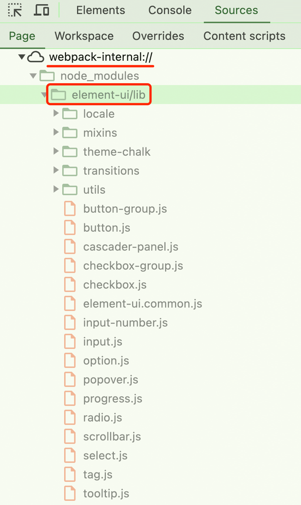
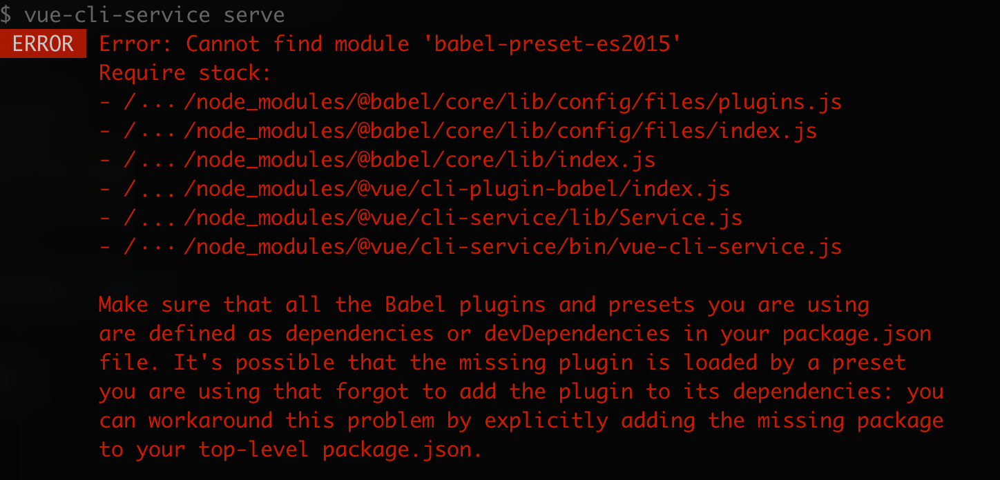
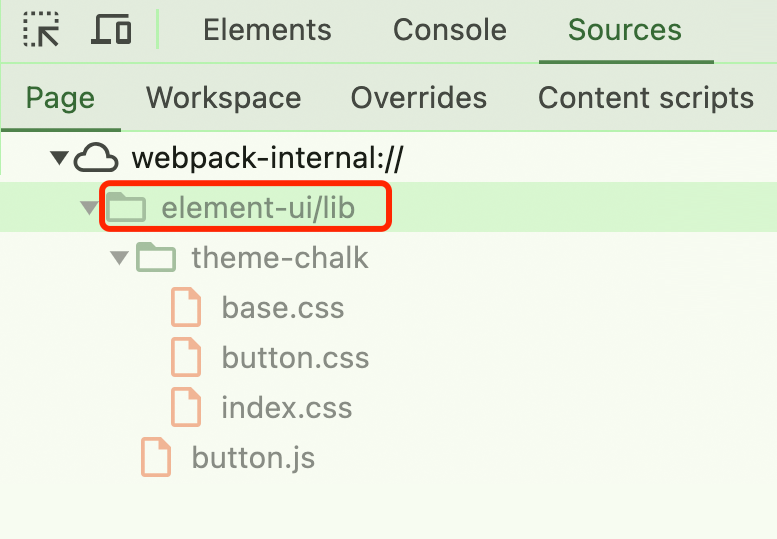
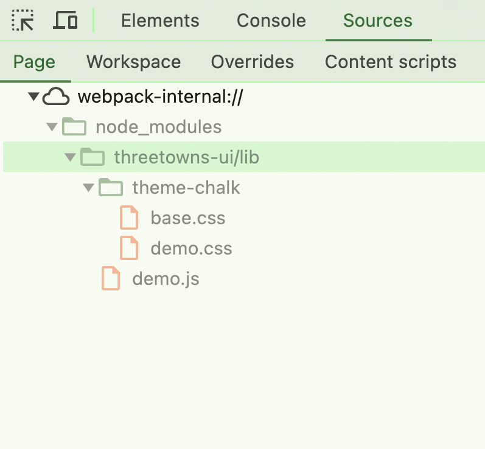

# 按需引入

前面五篇文章，我们依次实践了：

* 从零开始，搭建组件库
* 通过`packages/theme-chalk/gulpfile.js`，将**scss**编译成**css**
* 通过`build/bin/gen-cssfile.js`，根据`components.json` **自动补充生成**组件样式scss样式并 `@import` 到 `index.scss` 中。
* 通过`build/bin/new.js`，自动创建组件、组件样式、更新`components.json`。
* 通过`build/bin/build-entry.js`，自动更新入口文件`src/index.js`。

如此，我们就可以通过执行命令来生成需要的文件，替代手动大部分重复和易遗漏的工作，可以将精力放在组件开发本身。


接下来，我们将精力放在解决组件库根本问题上（而不是提效，具体的组件开发后面会单独逐一实践）。我们需要解决 **组件按需要引入**的问题。


接下来，我们先以**ElementUI**为例，在项目中分别实践**全局引入**和**按需引入**。进而，来优化我们自己封装的组件库，让组件库也具备**按需引入**的能力。


## Fully import

在项目中使用组件库时，默认是 **Fully import**（全局引入），如下：

```js
// demo/src/main.js

import { Button } from 'element-ui';
Vue.use(Button)
```

### webpack-internal

浏览器中查看组件引入情况：`Google Chrome` —> `DevTools` —> `Sources` —>`webpack-internal://node_modules`




## On demand

在[ElementUI](https://element.eleme.io/#/en-US/component/quickstart#on-demand)官方文档中，告诉我们 `on demand（按需引入）` 时需要使用 [bable-plugin-component](https://github.com/QingWei-Li/babel-plugin-component) 并在`.babelrc`中添加配置项：

```json
{
  "presets": [["es2015", { "modules": false }]],
  "plugins": [
    [
      "component",
      {
        "libraryName": "element-ui",
        "styleLibraryName": "theme-chalk"
      }
    ]
  ]
}
```

我们按照官方文档实践一下。

### babel-plugin-component

> * `babel-plugin-component`，是**element-ui** 自家用的babel打包工具。
>
> * `babel-plugin-import`，是 **umijs**开发的babel按需加载的babel打包工具，用于`iviewui`和`antdv`。

* 安装`babel-plugin-component`开发依赖

  ```bash
  yarn add babel-plugin-component -D
  ```

* 在`babel.config.js` （或 `.babelrc` ）中添加`plugins`字段并配置`component`项。

  ```diff
   module.exports = {
     presets: [
       '@vue/cli-plugin-babel/preset',
  +    ["es2015", { "modules": false }]
     ],
  +  plugins: [
  +    [
  +      "component",
  +      {
  +        libraryName: "element-ui",
  +        styleLibraryName: "theme-chalk"
  +      }
  +    ]
  +  ]
   }
  ```


  * 如何记住新增的配置呢？

    我们可以将依赖：`babel-plugin-component`，拆成三个字段：

    * `babel`：对应为babel配置文件，即：`babel.config.js` （或 `.babelrc` ）
    * `plugin`：对应为配置文件中的 **plugins** 字段
    * `component`：对应为puligins字段下的 **component**字段，它有：`libraryName` 和 `styleLibraryName`


#### ERROR

当我们再次启动项目时，会提示 **ERROR**：需要确认`Bable` 的 `plugins（插件）`和 `presets（预设）`依赖在使用，这里提示找不到`babel-preset-es2015` 预设模块。



* `Babel 6`：预设为 `babel-preset-env`

  2017年9月，Babel官网宣布**ES20xx**被废弃，取而代之的是`babel-preset-env`。所以，上面错误提示找不到`babel-preset-es2015`，如果你用的是**babel 6.x**，可以直接使用`babel-preset-env`替代。）

* `Babel 7`：预设为`@babel/preset-env`

通过对错误提示的分析，最终我们结合项目实际情况，安装对应的babel预设。


### @babel/preset-env

因为我们项目中，使用的是`bable 7.x`，所以需要安装对应的bable预设：

```bash
yarn add -D @babel/preset-env
```

`@babel/preset-env` 是一个Babel插件，用于<u>将ES6+代码转换为向后兼容的JavaScript</u>代码，以便在当前和旧版本的浏览器或其他环境中运行。

同时，需要在项目根目录中的`babel.config.js`中，添加预设配置并对`modeules`选项进行设置：

```diff
 module.exports = {
   presets: [
     '@vue/cli-plugin-babel/preset',
-    ["es2015", { "modules": false }]
+    ['@babel/preset-env', { modules: false }]
   ],
   plugins: [
     [
       "component",
       {
         libraryName: "element-ui",
         styleLibraryName: "theme-chalk"
       }
     ]
   ]
 }
```

#### modules

`@babel/preset-env`的`modules`为`false`时，用于指定Babel在转换过程中**不应该引入模块polyfills**。即：可能会**影响**代码在**不支持ES6模块的环境**中的运行。

`modules`选项设置为：`amd`、`umd`、`systemjs`、`commonjs`、`false`。


再次启动项目时，在控制台`Sources`的`webpack-internal://`下可以看到组件引入情况：



如此，我们已经完成了在项目中按需要引入的配置。


## 组件库的按需加载

前面提到过，市面上的组件库有：`ElementUI`、`antd vue`、`iviewui`，它们在按需加载时，分别需要不同的bable打包工具配合使用。

* `ElementUI` ：需要配合`babel-plugin-component`使用
* `Antdv`：需要配合`babel-plugin-import` 使用
* `iviewui`：需要配合`babel-plugin-import`使用

因为，我们封装的组件库是仿**ElementUI**，所以在需要中使用时，应遵守`babel-plugin-component`（当然，如果有精力后面也可以实践`antdv`和`iview`组件库）


### webpack.components.js

言归正传，前面铺垫了那么多，终于要开始对组件库下手了😜

在`build`文件夹下新建`webpack.components.js`，并添加`webpack.common.js`一样的配置信息：

```bash
cp build/webpack.common.js build/webpack.component.js
```

接着，我们修改`entry` 和`output`配置项：

```diff
+ const Components = require('../components.json');

 module.exports = {
   mode: 'production',
-  entry: './src/index.js',
+  entry: Components,
   output: {
     path: path.resolve(process.cwd(), './lib'),
-    filename: 'threetowns-ui.common.js',
+    filename: '[name].js',
     libraryTarget: 'commonjs2'
   },
```


### build

执行：`yarn build`，将构建入口文件、全局打包、按需打包、构建样式

```bash
npm run clean && 
npm run build:entry && 
webpack --config build/webpack.common.js && 
webpack --config build/webpack.component.js && 
npm run build:theme"
```


## 项目中使用

* `babel.config.js`

  ```js
  module.exports = {
    presets: [
      '@vue/cli-plugin-babel/preset',
      ['@babel/preset-env', { modules: false }]
    ],
    plugins: [
      [
        "component",
        {
          libraryName: "threetowns-ui",
          styleLibraryName: "theme-chalk"
        }
      ]
    ]
  }
  ```

  




https://juejin.cn/post/7062880887406329863/

