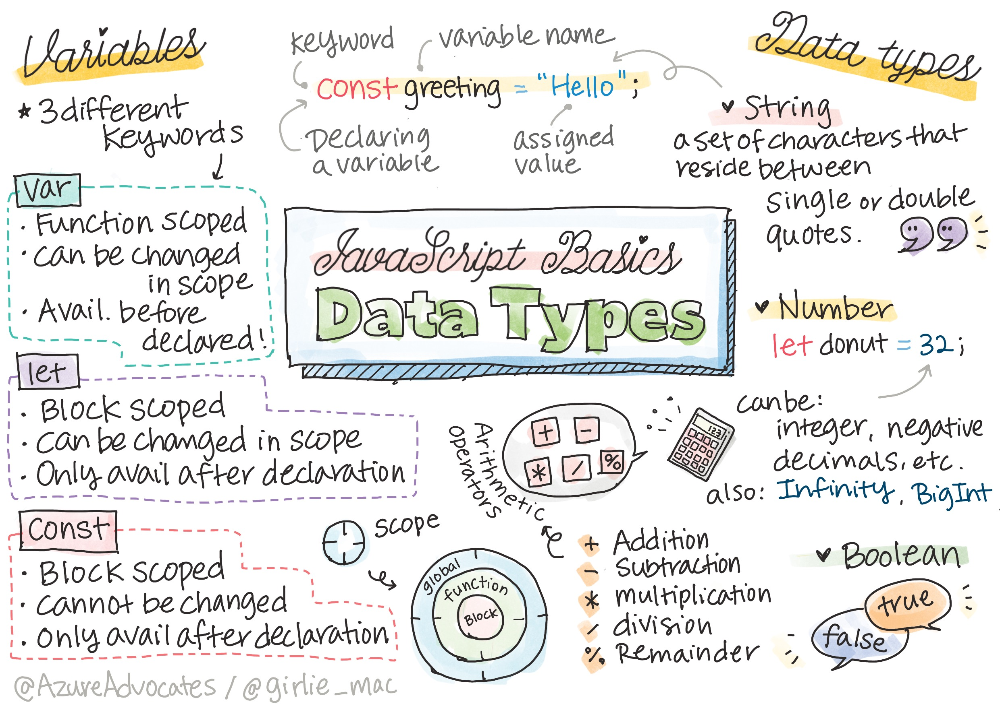

## 变量

变量可以用于保存任何类型的数据，有 3 个关键字可以声明变量：var、const 和 let。


### var

#### 1. 声明

使用var操作符，后面跟变量名，可以用它保存任何类型的值。

`var message;`

#### 2. 作用域

`var`定义的变量会成为包含它的函数的**局部变量**。如下：

```js
function test(){
  var message = 'hi';  // 在函数内，message是一个局部变量
}

test();
console.log(message); // Uncaught ReferenceError: message is not defined at <anonymous>
```

**在一个函数内部定义一个变量，意味着该变量将在函数退出时被销毁。**


在函数内定义变量时省略 var 操作符，可以创建一个全局变量：

```js
function test(){
  message = 'hi';  // 省略var操作符，message是一个全局变量
}

test();
console.log(message); // 只要调用一次函数 test()，就会定义这个变量，并且可以在函数外部访问到。
```


#### 3. 声明提升

使用 `var` 时，下面代码不会报错。

```js
function foo() {
  console.log(age);  // 使用这个关键字声明的变量，会自动提升到函数作用域顶部
  var age = 18;
}

foo()
```

在 **ECMAScript** 运行时，把上面代码等价于如下代码：

```diff
  function foo() {
+   var age;        // 这就是所谓的“提升”(hoist),即：把所有变量声明都拉到函数作用域的顶部。
		console.log(age);
		age = 18;
  }
```


### let

`let` 跟 `var` 的作用差不多，但最明显的区别是：`let` 声明的范围是 **块作用域**，而 `var` 声明的范围是 **函数作用域**。

```JS
if (true) {
 var name = 'Matt';
 console.log(name); // Matt
}
console.log(name);  // Matt

if (true) {
 let age = 18;
 console.log(age); // 18
}
console.log(age);   // Uncaught ReferenceError: age is not defined
```

这里 `age ` 变量之所以不能在 `if` 块外部被引用，是因为它的作用域仅限于该块内部。


* `let` 也不允许同一个块作用域中出现冗余声明。这样会导致报错：

```js
let age;
let age;  // Uncaught SyntaxError: Identifier 'age' has already been declared
```

* `let` 声明的变量不会在作用域中被提升。

```js
// name 会被提升
console.log(name); // undefined
var name = 'Matt';


// age 不会被提升
console.log(age); // Uncaught ReferenceError: age is not defined
let age = 26; 

```

* 使用 `let` 在全局作用域中声明的变量不会成为 `window` 对象的属性（`var` 声 明的变量则会）。

```js
var name = 'Matt';
console.log(window.name); // 'Matt'

let age = 26;
console.log(window.age); // undefined
```

* `for` 循环中的 `let` 声明

```js
for (var i = 0; i < 5; ++i) {
 setTimeout(() => console.log(i), 0)
} 
// 5, 5, 5, 5, 5


for (let i = 0; i < 5; ++i) {
 setTimeout(() => console.log(i), 0)
} 
// 0, 1, 2, 3, 4
```


### const

const 的行为与 let 基本相同，唯一一个重要的区别是用它**声明变量时必须同时初始化变量**，且 **尝试修改 const 声明的变量会导致运行时错误**。

```js
// const不允许重复声明
const name = 'Matt';
const name = 'Nicholas'; // Uncaught TypeError: Assignment to constant variable.

// const声明的作用域也是块
const name = 'Matt';
if (true) {
 const name = 'Nicholas';
}
console.log(name); // Matt

// 必须声明时赋值
const PI; // Uncaught SyntaxError: Missing initializer in const declaration
```

* const 声明的限制只适用于它指向的变量的引用。

  > 如果 `const` 变量**引用的是一个对象， 那么修改这个对象内部的属性并不违反 const 的限制**。

```js
const person = {};
person.name = 'Matt';  // 运行正常
```


## 作用域


函数作用域

块级作用域：块作用域是函数作用域的子集。

词法作用域


## The Lifetime of JavaScript Variables

The lifetime of a JavaScript variable starts when it is declared.

Function (local) variables are deleted when the function is completed.

In a web browser, global variables are deleted when you close the browser window (or tab).


## hoisting

提升


|                | var                      | let                                                          | const                                                        |
| -------------- | ------------------------ | ------------------------------------------------------------ | ------------------------------------------------------------ |
| 作用域         | 函数作用域               | 块级作用域                                                   | 块级作用域                                                   |
| 是否变量提升   | 自动提升到函数作用域顶部 | ❌                                                            | ❌                                                            |
| 是否可冗余声明 | ✅                        | ❌                                                            | ❌                                                            |
| 是否可被修改   | ✅                        | ✅                                                            | ❌ 尝试修改 const 声明的变量会导致运行时错误 <br>✅ const声明的限制只适用于它指向的变量的引用（可以修改这个对象内部的属性） |
| demo           | 打印 0 ~ 5（闭包实现）   | `for (let i = 0; i < 5; ++i) { setTimeout(() => console.log(i), 0) }` | `for (const value of [1,2,3,4,5]) { console.log(value); } `  |





## 练习题

```js
var x = 10;
     
    function test()
    {
        var x = 20;
        console.log(x);
    }
     
    test();
```


```js
var x = 10;
    function test()
    {
        if (x > 20) {
            var x = 50;
        }
     
        console.log(x);
    }
    test();
```

