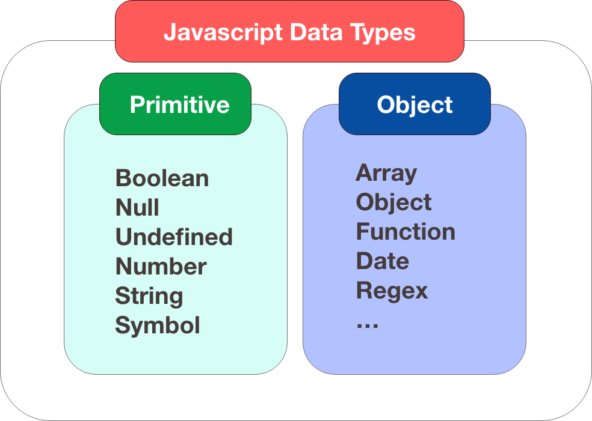

## 一、JavaScript数据类型

### 1. 知识点

<table>
  <tr>
    <th>数据分类</th>
    <th>类型</th>
    <th>typof返回值</th>
    <th>对象包装器</th>
  </tr>
  <tr>
    <td rowspan="7">原始数据类型 (PrimitiveValue) 放在栈内存中基本类型数据是不可变的</td>
    <td>String（字符串）</td><td>`string`</td><td>`String`</td>
  </tr>
  <tr>
    <td>Number(数字)</td><td>`number`</td><td>`Number`</td>
  </tr>
  <tr>
    <td>Boolean(布尔)</td><td>`boolean`</td><td>`Boolean`</td>
  </tr>
  <tr>
    <td>Null（空）</td><td>`object`</td><td>N/A</td>
  </tr>
  <tr>
    <td>Undefined（未定义）</td><td>`undefined`</td><td>`N/A`</td>
  </tr>
  <tr>
    <td>Symbol</td><td>`symbol`</td><td>`Symbol`</td>
  </tr>
  <tr>
    <td>BigInt</td><td>`bigint`</td><td>`BigInt`</td>
  </tr>
  <tr>
    <td rowspan="3">引用数据类型 地址: 数据的映射关系来进行存储，其中地址放在栈内存，数据放在堆内存，若两个或 N 个变量指向同一个地址，则共用一份数据。 引用类型数据是可变的</td>
    <td>Object（对象）</td><td>`object`</td><td>`String`</td>
  </tr>
  <tr>
    <td>Array(数组)</td><td>`object`</td><td>`Number`</td>
  </tr>
  <tr>
    <td>Function(函数)</td><td>`function`</td><td>`Number`</td>
  </tr>
</table>

https://wangdoc.com/javascript/stdlib/wrapper

对象包装器

### 2. 应用场景

### 3. 拓展

构造函数：函数名前加`new`