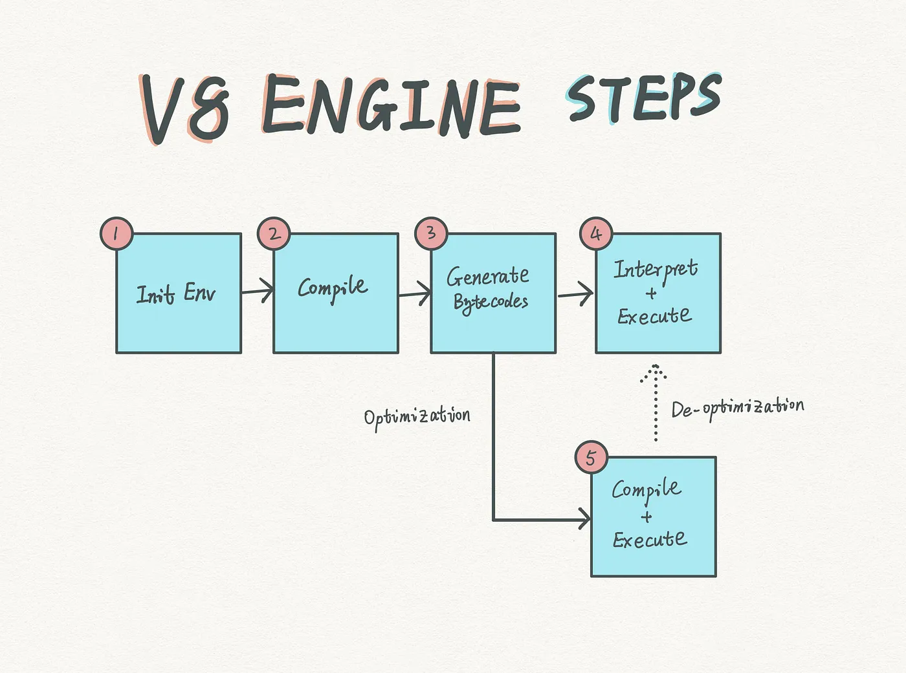

# browser

JS engine:

1. Taking your ~~fuel~~ source code
2. The parser is generating an abstract syntax tree from the source
3. V8's interpreter is generating a bytecode from the syntax tree that a compiler can understand
4.  V8's compiler is generating a [graph](https://freshcodeit.com/freshcode-post/graphcool-framework-analysis-and-its-use-case) from bytecode (replacing bytecode sections with optimized machine code)
5.  And, ta-dah – executing!

https://v8.dev/blog/ignition-interpreter

https://mathiasbynens.be/notes/shapes-ics

:tada: 详细查看

https://cabulous.medium.com/how-v8-javascript-engine-works-5393832d80a7

