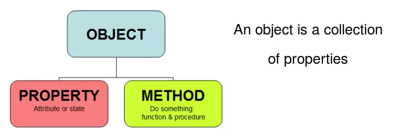
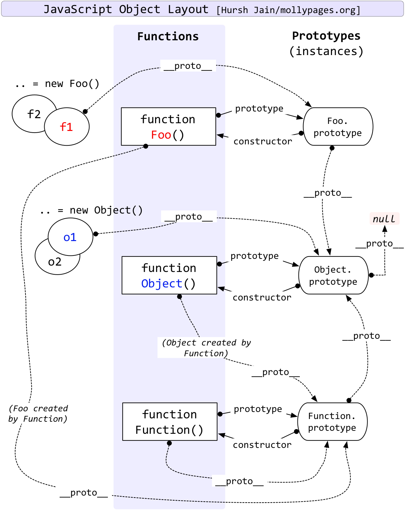

## Object

> An Object is a collection of properties




Object properties can either be primitive data types, other objects, or functions (we called methods)


We initial an object as below:

```js
var person = {
  firstName: 'leon',
  lastName: 'lei',
  fullName: function() {
    console.log(`${this.firstName} ${this.lastName}`)
  }
}
```


### Initialize any Object

In javascript we need to intial an object with 3 ways:

> 1. An object as literal, eg: {}
> 1. Object constructor, eg: new Object()
> 1. Using the function constructor, eg: Fn()
> 1. Using the Object.create method, eg: Object.create(null)
> 1. Constructor function and object prototype, eg: prototype


A constructor function is function used to create an object

JavaScript comes with many build-in objects, such as the **Array**, **Image**, and **Date** objects.





在 JavaScript 中，函数（function）是允许拥有属性的。所有的函数会有一个特别的属性 —— `prototype` 。

```js
function Foo(){}
Foo.prototype;

// 输出
{
    constructor: ƒ doSomething(),
    __proto__: {
        constructor: ƒ Object(),
        hasOwnProperty: ƒ hasOwnProperty(),
        isPrototypeOf: ƒ isPrototypeOf(),
        propertyIsEnumerable: ƒ propertyIsEnumerable(),
        toLocaleString: ƒ toLocaleString(),
        toString: ƒ toString(),
        valueOf: ƒ valueOf()
    }
}
```

给Foo函数的原型对象添加新属性，如下：

```diff
  function Foo(){}
+ Foo.prototype.name = "bar";
  Foo.prototype;
```

控制台输出：

```json
{
    foo: "bar",
    constructor: ƒ doSomething(),
    __proto__: {
        constructor: ƒ Object(),
        hasOwnProperty: ƒ hasOwnProperty(),
        isPrototypeOf: ƒ isPrototypeOf(),
        propertyIsEnumerable: ƒ propertyIsEnumerable(),
        toLocaleString: ƒ toLocaleString(),
        toString: ƒ toString(),
        valueOf: ƒ valueOf()
    }
}
```


每个实例对象（object）都有一个私有属性（称之为 __proto__）指向它的构造函数的原型对象（**prototype**）。该原型对象也有一个自己的原型对象（__proto__），层层向上直到一个对象的原型对象为 `null`。根据定义，`null` 没有原型，并作为这个**原型链**中的最后一个环节。


 **prototypes**

*prototype chain** 

 **prototypal inheritance**